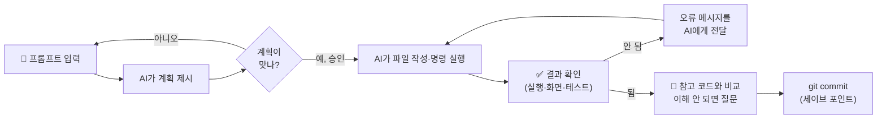
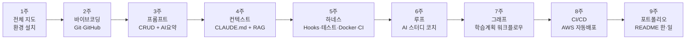
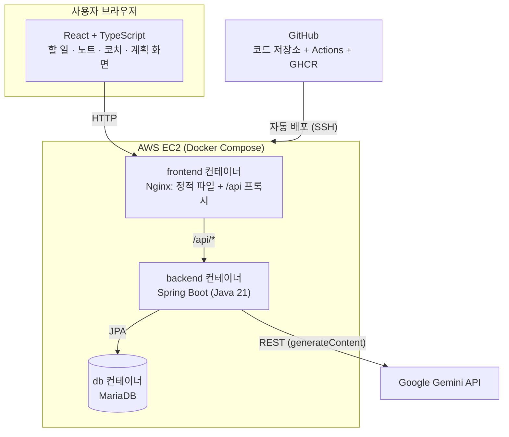
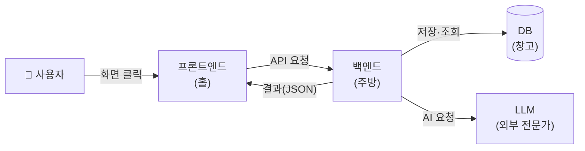
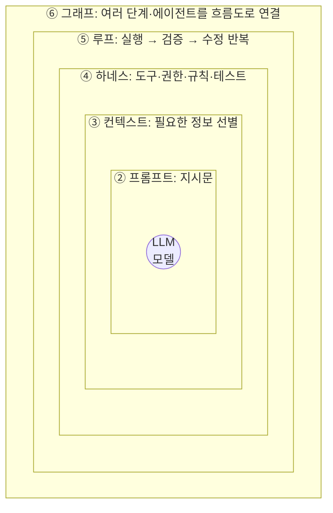
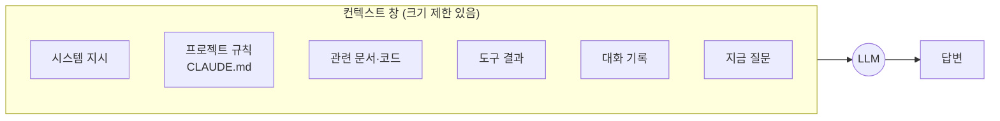
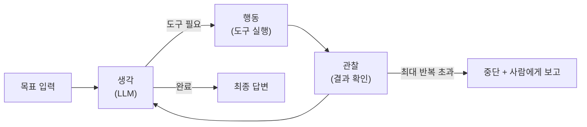
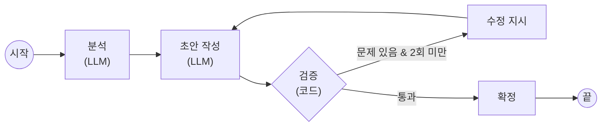
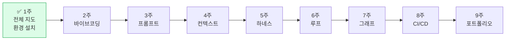

# 1주차 · AI 엔지니어링 6단계 전체 지도

> **바이브코딩 → 프롬프트 → 컨텍스트 → 하네스 → 루프 → 그래프**
>
> 오늘은 9주 동안 걸어갈 길의 "지도"를 먼저 펼쳐 봅니다. 코드를 많이 짜기보다, **왜 이런 단계가 생겼는지** 이해하고 개발 환경을 준비하는 날입니다.

---

## 📘 이 교안을 읽는 법 (9주 공통)

이 교안은 **"AI에게 시키는 부분"** 과 **"그 결과를 확인·비교하는 부분"** 을 아이콘으로 분명하게 나눠 두었습니다. 실습할 때 지금 내가 **무엇을 해야 하는 단계인지** 아이콘을 먼저 보세요.

| 표시 | 이름 | 무엇이 들어 있나 | 여러분이 할 일 |
|---|---|---|---|
| 🤖 | **Claude Code 프롬프트** | Claude Code 입력창에 붙여 넣을 **지시문**과 AI가 진행하는 모습 | 복사해서 입력 → AI가 보여 주는 계획을 읽고 승인 |
| ⌨️ | **직접 실행** | 터미널(명령 프롬프트)에 **직접 입력**하는 명령 | 한 줄씩 입력하고 결과 보기 |
| ✅ | **결과 확인** | 잘 되었는지 확인하는 방법, **기대 결과(출력·화면)** | 내 결과와 비교 |
| 📄 | **참고 코드** | AI가 만든 코드와 **비교할 기준 코드** | 다른 점을 찾고, 이해 안 되면 AI에게 질문 |
| 📖 | **용어 풀이** | 처음 나오는 용어의 **뜻·비유·쓰는 이유** | 읽고 이해한 뒤 넘어가기 |
| 💡 / ⚠️ | 팁 / 주의 | 알아 두면 좋은 것 / 꼭 지켜야 하는 것 | |

### 한 번의 실습은 이렇게 흘러갑니다



> 📌 **참고 코드는 "정답"이 아니라 "비교 기준"입니다.** AI는 같은 프롬프트에도 조금씩 다른 코드를 만듭니다. ✅ 결과 확인을 통과했다면 여러분의 AI가 만든 코드도 훌륭한 답입니다. 다만 막혔을 때, 시간이 부족할 때는 📄 참고 코드를 그대로 붙여 넣고 다음 단계로 넘어가세요. 다음 주 실습은 참고 코드를 기준으로 이어집니다.

> 💡 **화면 예시 이미지**: 결과 확인에 나오는 앱 화면 이미지는 이해를 돕기 위한 **예시 화면(모의 데이터)** 입니다. 할 일 이름·날짜·AI 답변 문장은 여러분의 화면과 다를 수 있습니다.

---

## 0. 오늘의 수업 진행표 (3시간)

| 시간 | 내용 | 형태 |
|---|---|---|
| 0:00 ~ 0:15 | 오리엔테이션 · 9주 로드맵 · 최종 결과물 소개 | 설명 |
| 0:15 ~ 1:10 | AI 엔지니어링 6단계 개념 (비유·그림·수식) | 설명 + 토론 |
| 1:10 ~ 1:20 | 휴식 | |
| 1:20 ~ 2:30 | 개발 환경 설치 (Git, JDK, Node, Docker, Claude Code, API 키) | 실습 |
| 2:30 ~ 2:50 | 첫 번째 Claude Code 대화 · 설치 확인 체크리스트 | 실습 |
| 2:50 ~ 3:00 | 정리 · 퀴즈 · 과제 안내 | 정리 |

## 1. 학습 목표

이번 주가 끝나면 여러분은 다음을 할 수 있습니다.

1. AI 엔지니어링 6단계(바이브·프롬프트·컨텍스트·하네스·루프·그래프)를 **한 문장씩** 설명할 수 있다.
2. 각 단계가 **이전 단계의 어떤 한계**를 해결하기 위해 등장했는지 말할 수 있다.
3. 9주 동안 만들 **"AI 스터디 플래너"** 의 구조(프론트엔드·백엔드·DB·AI·배포)를 그림으로 그릴 수 있다.
4. 실습에 필요한 개발 도구를 모두 설치하고 동작을 확인할 수 있다.

---

## 2. 9주 로드맵 한눈에 보기



| 주차 | 엔지니어링 단계 | 프로젝트에 추가되는 것 | Git 태그 |
|---|---|---|---|
| 1 | 전체 개요 | 개발 환경 | - |
| 2 | 바이브코딩 | 프로젝트 뼈대, D-Day 카운터 | `week-02` |
| 3 | 프롬프트 엔지니어링 | 할 일·노트 CRUD, AI 노트 요약 | `week-03` |
| 4 | 컨텍스트 엔지니어링 | `CLAUDE.md`, 설계 문서, 노트 기반 질의응답(RAG) | `week-04` |
| 5 | 하네스 엔지니어링 | 권한·Hooks·Skill·Subagent, 테스트, Docker, CI | `week-05` |
| 6 | 루프 엔지니어링 | 도구를 쓰는 "AI 스터디 코치" 에이전트 | `week-06` |
| 7 | 그래프 엔지니어링 | 학습계획 생성 워크플로우(StateGraph) | `week-07` |
| 8 | CI/CD | GitHub Actions → GHCR → AWS EC2 자동 배포 | `week-08` |
| 9 | 포트폴리오 | `README.md`(한국어) + `README.ja.md`(일본어) | `v1.0.0` |

---

## 3. 우리가 만들 것: AI 스터디 플래너

시험·과제를 관리하고, 공부 노트를 정리하며, AI가 공부 계획을 짜 주는 웹 서비스입니다.

### 3.1 완성된 시스템 구조



### 3.2 기능 목록과 관련 단계

| 화면 | 기능 | 주로 배우는 엔지니어링 |
|---|---|---|
| 할 일 | 과목별 할 일 등록·상태 변경·삭제, D-Day 표시 | 바이브코딩, 프롬프트 |
| 노트 | 공부 노트 작성, **AI 3줄 요약** | 프롬프트 |
| 노트 Q&A | "내 노트에서" 답을 찾아 주는 질문 응답 | 컨텍스트 (RAG) |
| AI 코치 | "이번 주 할 일 정리해 줘" → AI가 **도구를 반복 호출**하며 처리 | 루프 |
| AI 계획 | 목표·시험일 입력 → 분석→초안→검증→수정 **워크플로우**로 계획 생성 | 그래프 |
| (보이지 않는 곳) | 테스트 자동 실행, 위험 명령 차단, 자동 배포 | 하네스, CI/CD |

---

### 3.3 이 과정에서 계속 쓰이는 기본 용어

처음 듣는 용어가 많아도 괜찮습니다. 아래 표는 9주 내내 반복해서 나오니 지금은 **"대충 이런 뜻이구나"** 정도로만 읽어 두세요.

| 용어 | 쉬운 뜻 | 비유 | 우리 프로젝트에서 왜 쓰나 |
|---|---|---|---|
| **프론트엔드** (Frontend) | 사용자가 보고 누르는 **화면** 부분 | 식당의 홀(메뉴판·테이블) | 할 일·노트·AI 결과를 보여 주는 React 화면 |
| **백엔드** (Backend) | 화면 뒤에서 데이터를 처리하는 **서버** 프로그램 | 식당의 주방 | 저장·조회·AI 호출을 처리하는 Spring Boot |
| **데이터베이스** (DB) | 데이터를 표 형태로 **오래 보관**하는 곳 | 식당의 창고 | 할 일과 노트를 MariaDB에 저장 |
| **API** | 프로그램끼리 **주고받는 약속된 창구** | 주방의 주문 창구 | 화면이 `/api/tasks`로 서버에 요청 |
| **REST API** | 주소(URL)와 동작(GET·POST 등)으로 자원을 다루는 API 방식 | "3번 테이블(주소)에 주문 추가(POST)" | 할 일 등록 = `POST /api/tasks` |
| **LLM** | 글을 이해하고 만들어 내는 **대규모 언어 모델** | 엄청나게 많이 읽은 작가 | Gemini가 요약·계획을 만든다 |
| **에이전트** (Agent) | 목표를 위해 **스스로 도구를 골라 쓰며** 일하는 AI 프로그램 | 심부름센터 직원 | Claude Code, 6주차 AI 코치 |
| **클라우드** (AWS) | 인터넷으로 빌려 쓰는 **남의 컴퓨터** | 렌터카 | 8주차에 서버를 빌려 서비스 공개 |
| **컨테이너** (Docker) | 프로그램과 실행 환경을 **통째로 포장**한 상자 | 이삿짐 컨테이너 | 내 PC·서버 어디서나 똑같이 실행 |
| **CI/CD** | 코드를 올리면 **자동으로 검사(CI)하고 배포(CD)** 하는 흐름 | 공장의 자동 검수·출고 라인 | push하면 테스트 후 AWS에 자동 반영 |



## 4. AI 엔지니어링 6단계 — 큰 그림

### 4.1 하나의 비유로 전체를 이해하기: "천재 신입 인턴"

> AI는 **엄청나게 똑똑하지만, 우리 회사에 오늘 처음 출근한 신입 인턴**이라고 생각해 봅시다.
>
> 세상 지식은 많지만 **우리 프로젝트의 사정은 아무것도 모릅니다.** 그리고 가끔 **자신 있게 틀립니다.**

| 단계 | 인턴에게 일을 시키는 방식 | 핵심 질문 |
|---|---|---|
| ① 바이브코딩 | "대충 이런 느낌으로 만들어 줘~" | **무엇을** 원하는지 말로 전달하면 되나? |
| ② 프롬프트 엔지니어링 | 잘 쓴 **업무 지시서** 한 장 | **어떻게 말해야** 원하는 결과가 나오나? |
| ③ 컨텍스트 엔지니어링 | 지시서 + **인수인계 자료 묶음** | AI가 **무엇을 알고 있어야** 하나? |
| ④ 하네스 엔지니어링 | 사원증 권한, 업무 규칙, **자동 검사 장치**가 갖춰진 사무실 | AI가 **안전하고 일관되게** 일하려면 어떤 환경이 필요한가? |
| ⑤ 루프 엔지니어링 | "하고 → 확인하고 → 고치고"를 **스스로 반복** | AI가 **언제 다시 하고, 언제 멈춰야** 하나? |
| ⑥ 그래프 엔지니어링 | 여러 담당자가 있는 **업무 흐름도(결재 라인)** | 여러 단계를 **어떤 순서와 조건으로** 연결하나? |

### 4.2 양파 그림: 바깥 단계는 안쪽 단계를 "감싼다"

각 단계는 이전 단계를 **버리는 것이 아니라 감싸는 것**입니다. 그래프 안에는 루프가, 루프 안에는 하네스가, 그 안에는 컨텍스트와 프롬프트가 들어 있습니다.



### 4.3 각 단계가 "통제하는 범위"가 점점 넓어진다

| 단계 | 엔지니어가 설계하는 대상 | 단위 | 예시 산출물 |
|---|---|---|---|
| 바이브코딩 | (설계하지 않음) 의도만 전달 | 대화 한 번 | "로그인 페이지 만들어 줘" |
| 프롬프트 | **한 번의 요청 문장** | 메시지 1개 | 역할·작업·제약·형식이 들어간 지시문 |
| 컨텍스트 | **모델이 보는 정보 전체** | 컨텍스트 창 1개 | `CLAUDE.md`, 설계 문서, 검색된 노트 |
| 하네스 | **모델을 둘러싼 실행 환경** | 세션/프로젝트 | 권한 설정, Hooks, 테스트, 린터, Skill |
| 루프 | **반복과 종료 조건** | 작업 1개(여러 번 호출) | 도구 호출 루프, 테스트 통과까지 수정 |
| 그래프 | **여러 단계의 흐름과 상태** | 업무 프로세스 | 노드·엣지·상태로 된 워크플로우 |

### 4.4 수식으로 보는 6단계

어렵게 생각하지 마세요. 수식은 **"무엇이 무엇에 영향을 주는가"** 를 짧게 쓴 메모입니다.

> 💡 **수식이 낯설어도 괜찮습니다.** 이 교안의 수식은 계산 시험용이 아니라 **"무엇이 결과에 영향을 주는가"를 한 줄로 요약한 그림**입니다. 기호 읽는 법만 알면 충분합니다: $P(A \mid B)$는 "B일 때 A일 확률", $\times$는 곱하기, $x_t$는 "t번째의 x".

> 📖 **용어 풀이 — 토큰(Token)**
>
> **뜻**: LLM이 글을 처리하는 **가장 작은 조각**. 단어 하나일 수도, 단어의 일부일 수도 있습니다. ("스프링부트" → "스프링" + "부트")
>
> **비유**: 레고 블록. LLM은 문장을 블록 단위로 쌓아 올립니다.
>
> **왜 알아야 하나**: AI 사용 요금, 처리 속도, 한 번에 읽을 수 있는 양(컨텍스트 창)이 모두 **토큰 수**로 정해지기 때문입니다. (3·4주차에 자세히)

**(1) LLM은 "다음에 올 단어(토큰)를 확률로 고르는 함수"입니다.**

$$
P(\text{다음 토큰} \mid \text{지금까지의 모든 입력})
$$

→ 출력은 **입력(프롬프트 + 컨텍스트)** 에 따라 달라집니다. 그래서 ②, ③ 단계가 중요합니다.

**(2) 출력 품질은 여러 요소의 곱처럼 작동합니다.**

$$
\text{결과 품질} \approx \text{모델 능력} \times \text{프롬프트 명확성} \times \text{컨텍스트 적합성} \times \text{하네스 신뢰성}
$$

→ 곱셈이므로 **하나라도 0에 가까우면 전체가 무너집니다.** 아무리 좋은 모델도 컨텍스트가 엉터리면 결과가 엉터리입니다.

**(3) 에이전트 = 모델 + 하네스** (2026년 업계에서 널리 쓰이는 정의)

$$
\text{Agent} = \text{Model} + \text{Harness}
$$

→ 모델이 "엔진"이라면 하네스는 "핸들·브레이크·계기판"입니다.

**(4) 루프는 "피드백을 받아 다음 상태로 가는 점화식"입니다.**

$$
x_{t+1} = \text{Agent}(x_t,\ \text{feedback}_t), \quad \text{멈춤 조건: } \text{verify}(x_t) = \text{통과} \ \text{또는}\ t = t_{\max}
$$

**(5) 그래프는 "노드(V), 엣지(E), 상태(S)"의 묶음입니다.**

$$
G = (V,\ E,\ S), \qquad \text{다음 노드} = \text{router}(\text{현재 노드},\ S)
$$

---

## 5. 단계별 핵심 개념 미리보기

### ① 바이브코딩 (Vibe Coding) — "말로 만들기"

* **정의**: 코드를 직접 한 줄씩 쓰기보다, 원하는 것을 **자연어로 설명**하고 AI가 만든 코드를 실행해 보며 "느낌(vibe)"대로 고쳐 나가는 방식.
* **장점**: 매우 빠름. 아이디어 → 동작하는 화면까지 몇 분.
* **한계**: 코드를 이해하지 못한 채 쌓이면 **고칠 수 없는 코드**가 됩니다. 보안·성능·일관성 문제를 놓치기 쉽습니다.

```text
나: "시험 D-Day 카운터 컴포넌트 만들어 줘"
AI: (코드 생성) → 실행해 보니 날짜가 하루 틀림
나: "하루 틀려. 고쳐 줘"
AI: (수정) → 이번엔 다른 곳이 깨짐 ...   ← 바이브코딩의 전형적인 늪
```

### ② 프롬프트 엔지니어링 — "잘 묻기"

* **정의**: 원하는 결과가 나오도록 **지시문을 설계**하는 기술.
* **공식** (이번 수업에서 계속 쓸 템플릿):

$$
\text{좋은 프롬프트} = \text{역할} + \text{맥락} + \text{작업} + \text{제약} + \text{출력 형식} + \text{예시}
$$

| 나쁜 프롬프트 | 좋은 프롬프트 |
|---|---|
| "할 일 API 만들어 줘" | "너는 Spring Boot 4 백엔드 개발자야. `Task` 엔티티(제목·과목·마감일·상태)에 대한 REST CRUD API를 만들어. 패키지는 `com.example.planner.task`, DTO는 record로, 검증은 Bean Validation을 사용해. 결과는 파일별 코드 블록으로 보여 줘." |

### ③ 컨텍스트 엔지니어링 — "잘 알려 주기"

* **정의**: 모델이 답을 만들 때 **보는 정보 전체(컨텍스트 창)** 를 설계하는 것. 프롬프트는 그 일부일 뿐입니다.
* 컨텍스트 창은 **책상 크기가 정해진 작업대**와 같습니다. 필요한 자료만 올려야 일이 잘 됩니다.



$$
\text{토큰}_{\text{시스템}} + \text{토큰}_{\text{규칙}} + \text{토큰}_{\text{자료}} + \text{토큰}_{\text{대화}} + \text{토큰}_{\text{질문}} \le \text{컨텍스트 창 크기}
$$

### ④ 하네스 엔지니어링 — "잘 일하는 환경 만들기"

* **하네스(harness)** 는 원래 말에 채우는 **마구(굴레·고삐)** 입니다. 힘센 말을 원하는 방향으로, 안전하게 달리게 하는 장치죠.
* 2026년 업계 정의: **에이전트에서 모델을 뺀 나머지 전부**(지시 파일, 도구, 권한, 테스트, 리뷰 절차, 피드백 장치)가 하네스입니다.
* 하네스는 두 종류의 장치로 나눌 수 있습니다.

| 종류 | 언제 작동? | 비유 | 우리 프로젝트 예 |
|---|---|---|---|
| **가이드 (Guide, 피드포워드)** | AI가 행동하기 **전** | 운전 전 내비게이션 안내 | `CLAUDE.md`, 코딩 규칙, Skill |
| **센서 (Sensor, 피드백)** | AI가 행동한 **후** | 차선 이탈 경보 | 컴파일, 테스트, 린터, Hooks, 코드 리뷰 에이전트 |

### ⑤ 루프 엔지니어링 — "스스로 반복하게 하기"

* **정의**: AI가 **목표를 이룰 때까지** "행동 → 관찰 → 판단"을 반복하는 흐름과, **언제 다시 하고 언제 멈출지**를 설계하는 것.
* 핵심 질문 4가지: **무엇을 재시도? 무엇으로 검증? 언제 멈춤? 언제 사람에게 물어봄?**



### ⑥ 그래프 엔지니어링 — "흐름도로 설계하기"

* **정의**: AI 애플리케이션을 **노드(작업)·엣지(다음 경로)·상태(공유 데이터)** 로 이루어진 실행 가능한 그래프로 설계하는 것.
* 루프 하나에 모든 것을 맡기면 예측하기 어렵습니다. 그래프는 **"어떤 단계에서 어디로 갈 수 있는지"를 미리 정해** 신뢰성을 높입니다.



> 💡 **루프 vs 그래프 한 줄 정리**
>
> 루프는 "AI가 알아서 반복" — **자율성**이 높음.
>
> 그래프는 "사람이 설계한 길 위에서 AI가 일함" — **예측 가능성**이 높음.
>
> 실무에서는 그래프의 노드 하나 안에 작은 루프가 들어가는 식으로 **섞어서** 씁니다.

---

## 6. 6단계 비교 총정리표

| 구분 | 바이브 | 프롬프트 | 컨텍스트 | 하네스 | 루프 | 그래프 |
|---|---|---|---|---|---|---|
| 핵심 동사 | 말한다 | 묻는다 | 알려 준다 | 갖춰 준다 | 반복시킨다 | 연결한다 |
| 실패 원인 | 의도 모호 | 지시 모호 | 정보 부족·과다 | 검증 부재 | 무한 반복·조기 종료 | 흐름 설계 오류 |
| 사람의 역할 | 사용자 | 작성자 | 편집자 | 환경 설계자 | 감독관 | 설계자(아키텍트) |
| 이번 실습 도구 | Claude Code | Claude Code, Gemini | `CLAUDE.md`, RAG | `.claude/` 설정, JUnit, CI | Gemini Function Calling | Java StateGraph |
| 실습 주차 | 2주 | 3주 | 4주 | 5주 | 6주 | 7주 |

---

## 7. 사용할 기술 스택과 이유

| 영역 | 기술 | 선택 이유 |
|---|---|---|
| AI 코딩 도구 | **Claude Code** (CLI) | `CLAUDE.md`·Hooks·Skill·Subagent·MCP 등 하네스 기능이 풍부해 실습에 적합 |
| 앱 내부 LLM | **Google Gemini API** (무료 등급) | 학생 비용 0원으로 시작 가능, Function Calling 지원 |
| 프론트엔드 | **React + Vite + TypeScript** | 가장 널리 쓰이고 AI가 잘 다루는 조합 |
| 백엔드 | **Spring Boot 4 + Java 21** | 국내·일본 취업 시장에서 수요가 높음 |
| DB | **MariaDB** | MySQL 호환 오픈소스, Docker로 쉽게 실행 |
| 버전 관리 | **Git + GitHub** | 협업·포트폴리오의 기본 |
| 컨테이너 | **Docker + Docker Compose** | "내 PC에선 되는데" 문제 해결 |
| CI/CD | **GitHub Actions + GHCR** | 저장소와 바로 연결, 무료 사용량 제공 |
| 배포 | **AWS EC2** | 클라우드 서버의 기본기 학습 |

> ⚠️ **비용 안내**
>
> * Claude Code는 Claude **유료 구독(Pro 이상)** 또는 API 크레딧이 필요합니다. 구독이 어려운 학생은 강사 안내에 따라 무료 대안 도구로 같은 실습을 진행할 수 있도록 각 주차에 **"대안"** 을 표시했습니다.
>
> * Gemini API 무료 등급은 **모델별 분당/일일 요청 수 제한**이 있고, 2026년 하반기 기준으로 Flash 계열보다 **Flash-Lite 계열의 일일 한도가 훨씬 넉넉**합니다. 그래서 실습 기본값을 `gemini-flash-lite-latest`로 잡고, 모델 이름은 환경 변수로 바꿀 수 있게 만듭니다. 한도는 수시로 바뀌므로 수업 전에 [Google AI Studio](https://aistudio.google.com)에서 확인하세요.
>
> * 무료 등급에 입력한 데이터는 서비스 개선에 쓰일 수 있으므로 **개인정보·비밀번호를 넣지 마세요.**

---

## 8. 실습 ① 개발 환경 설치

### 8.0 설치하기 전에 — 각 도구는 무엇이고 왜 필요한가?

| 도구 | 한 줄 설명 | 비유 | 이 과정에서 하는 일 |
|---|---|---|---|
| **터미널** | 글자로 컴퓨터에 명령하는 창 (Windows: PowerShell, macOS: 터미널) | 컴퓨터와의 **채팅창** | 모든 설치·실행 명령을 입력 |
| **Git** | 파일의 **변경 이력**을 저장하는 프로그램 | 게임의 **세이브 포인트** | 실습 단계마다 저장, 망가지면 되돌리기 |
| **JDK** (Java Development Kit) | Java 프로그램을 **만들고 실행**하는 도구 묶음 | Java 전용 공구 상자 | Spring Boot 백엔드 실행 |
| **Node.js / npm** | 브라우저 밖에서 JavaScript를 실행하는 프로그램 / 그 **부품(패키지) 설치기** | JS 엔진 / 부품 마트 | React 화면 개발 서버, 라이브러리 설치 |
| **Docker** | 프로그램을 **컨테이너**로 실행하는 도구 | 어디서나 똑같은 **도시락 통** | MariaDB 실행, 배포 |
| **VS Code / IntelliJ** | 코드를 읽고 고치는 **편집기(IDE)** | 작업 책상 | AI가 만든 코드 읽기·수정 |
| **Claude Code** | 터미널에서 대화하며 **코드를 읽고·쓰고·실행**하는 AI 에이전트 | 옆자리의 **천재 인턴** | 9주간 모든 실습의 파트너 |
| **Gemini API 키** | 우리 앱이 Gemini AI를 부를 수 있는 **비밀 출입증** | 회원 카드 | 앱의 요약·코치·계획 기능 |

> 📖 **용어 풀이 — LTS (Long Term Support)**
>
> **뜻**: 오랫동안(보통 몇 년) 보안 패치를 지원하는 **안정 버전**.
>
> **왜 쓰나**: 최신 기능보다 **안정성**이 중요하기 때문입니다. 수업 중 갑자기 동작이 바뀌는 일을 막아 줍니다. (Java 21, Node.js 24가 LTS)

> 📖 **용어 풀이 — 환경 변수 (Environment Variable)**
>
> **뜻**: 프로그램 **바깥(운영체제)** 에 저장해 두고 프로그램이 읽어 가는 설정 값. 예: `GEMINI_API_KEY`
>
> **비유**: 집 열쇠를 **코드(집 안)** 에 두지 않고 **경비실(운영체제)** 에 맡겨 두는 것.
>
> **왜 쓰나**: API 키·비밀번호를 코드에 직접 쓰면 GitHub에 올릴 때 **유출**됩니다. 환경 변수로 빼 두면 코드는 공개해도 비밀은 지킬 수 있습니다.

### 8.1 설치 목록

| # | 도구 | 권장 버전 | 확인 명령 |
|---|---|---|---|
| 1 | Git | 최신 | `git --version` |
| 2 | JDK (Temurin) | 21 LTS | `java -version` |
| 3 | Node.js | 24 LTS (22도 가능) | `node -v`, `npm -v` |
| 4 | Docker Desktop | 최신 | `docker --version`, `docker compose version` |
| 5 | VS Code 또는 IntelliJ IDEA | 최신 | - |
| 6 | Claude Code | 최신 | `claude --version` |
| 7 | GitHub 계정 | - | 웹 로그인 |
| 8 | Gemini API 키 | - | 아래 8.4 참고 |
| 9 | AWS 계정 | - | 8주차 전까지 준비 |

### 8.2 운영체제별 설치 명령

**Windows (PowerShell, 관리자 권한)**

```powershell
winget install --id Git.Git -e
winget install --id EclipseAdoptium.Temurin.21.JDK -e
winget install --id OpenJS.NodeJS.LTS -e
winget install --id Docker.DockerDesktop -e
winget install --id Microsoft.VisualStudioCode -e
# Claude Code (네이티브 설치)
irm https://claude.ai/install.ps1 | iex
```

**macOS (터미널, Homebrew 사용)**

```bash
brew install git node
brew install --cask temurin@21 docker visual-studio-code
# Claude Code (네이티브 설치)
curl -fsSL https://claude.ai/install.sh | bash
```

**Ubuntu / WSL2**

```bash
sudo apt update && sudo apt install -y git curl
sudo apt install -y openjdk-21-jdk
# Node.js LTS (nvm 사용)
curl -o- https://raw.githubusercontent.com/nvm-sh/nvm/v0.40.3/install.sh | bash
source ~/.bashrc && nvm install --lts
# Docker
curl -fsSL https://get.docker.com | sudo sh
sudo usermod -aG docker $USER   # 로그아웃 후 다시 로그인
# Claude Code
curl -fsSL https://claude.ai/install.sh | bash
```

> 💡 설치 후 `claude` 명령을 찾을 수 없다면 터미널을 새로 열거나, `~/.local/bin`이 PATH에 있는지 확인하세요.

### 8.3 Git 초기 설정

```bash
git config --global user.name "홍길동"
git config --global user.email "gildong@example.com"   # GitHub 가입 이메일과 동일하게
git config --global init.defaultBranch main
git config --global core.autocrlf input                 # Windows는 true
```

### 8.4 Gemini API 키 발급

1. [Google AI Studio](https://aistudio.google.com)에 Google 계정으로 로그인합니다.
2. 왼쪽 메뉴 **Get API key → Create API key**를 누릅니다.
3. 발급된 키를 **메모장이 아닌 비밀번호 관리 도구**에 보관합니다.
4. 동작을 확인합니다. (키는 `x-goog-api-key` 헤더로 보냅니다.)

#### ⌨️ 직접 실행 — 발급받은 키가 동작하는지 확인

**macOS / Linux / WSL**

```bash
export GEMINI_API_KEY="여기에_발급받은_키"
curl -s "https://generativelanguage.googleapis.com/v1beta/models/gemini-flash-lite-latest:generateContent" \
  -H "x-goog-api-key: $GEMINI_API_KEY" \
  -H "Content-Type: application/json" \
  -d '{"contents":[{"parts":[{"text":"자기소개를 한 문장으로 해 줘"}]}]}'
```

**Windows PowerShell**

```powershell
$env:GEMINI_API_KEY = "여기에_발급받은_키"
$body = '{"contents":[{"parts":[{"text":"자기소개를 한 문장으로 해 줘"}]}]}'
Invoke-RestMethod -Method Post `
  -Uri "https://generativelanguage.googleapis.com/v1beta/models/gemini-flash-lite-latest:generateContent" `
  -Headers @{ "x-goog-api-key" = $env:GEMINI_API_KEY } `
  -ContentType "application/json; charset=utf-8" -Body $body
```

#### ✅ 결과 확인 — 이런 JSON이 돌아오면 성공

```json
{
  "candidates": [
    {
      "content": {
        "parts": [ { "text": "저는 Google이 만든 AI 어시스턴트 Gemini입니다." } ],
        "role": "model"
      },
      "finishReason": "STOP"
    }
  ],
  "usageMetadata": { "promptTokenCount": 9, "candidatesTokenCount": 15, "totalTokenCount": 24 }
}
```

* `candidates[0].content.parts[0].text` 위치에 **AI의 답변**이 들어 있습니다. (문장은 매번 다를 수 있습니다)
* `usageMetadata`는 이번 요청에 쓴 **토큰 수**입니다. 3주차에 다시 봅니다.
* `401`/`403` 오류 → 키가 잘못되었거나 복사할 때 공백이 들어간 경우, `404` → 모델 이름 오류, `429` → 요청 한도 초과(1분 후 재시도)

> ⚠️ **API 키는 절대 GitHub에 올리지 마세요.** 2주차에 `.gitignore`와 `.env`로 안전하게 관리하는 방법을 배웁니다.
>
> 모델 이름 오류(404)가 나면 AI Studio의 모델 목록에서 현재 사용 가능한 Flash-Lite 모델 이름으로 바꾸세요.

### 8.5 Claude Code 첫 실행

> 📖 **용어 풀이 — Claude Code**
>
> **뜻**: Anthropic이 만든 **터미널용 AI 코딩 에이전트**. 우리가 말로 지시하면 프로젝트 파일을 읽고, 코드를 쓰고, 명령을 실행합니다.
>
> **채팅 AI와의 차이**: 웹 채팅 AI는 코드를 **보여 주기만** 하고 복사·붙여넣기는 사람이 합니다. Claude Code는 **내 프로젝트 폴더에서 직접 파일을 만들고 실행**합니다. 그래서 "무엇을 허락할지"가 중요해집니다(하네스).

#### ⌨️ 직접 실행 — 연습용 폴더에서 Claude Code 시작

```bash
mkdir ~/ai-lab && cd ~/ai-lab
claude
```

처음 실행하면 브라우저가 열리며 **로그인 화면**이 나옵니다. 로그인하고 터미널로 돌아오면 입력창(`>`)이 보입니다.

#### 🤖 Claude Code 프롬프트 — 첫 대화

```text
안녕! 너는 무엇을 할 수 있니? 3줄로 알려 줘.
```

```text
이 폴더에 hello.txt 파일을 만들고 "AI 엔지니어링 1주차"라고 써 줘.
```

#### ✅ 결과 확인 — 화면은 대략 이렇게 진행됩니다

```text
> 이 폴더에 hello.txt 파일을 만들고 "AI 엔지니어링 1주차"라고 써 줘.

● hello.txt 파일을 만들겠습니다.

● Write(hello.txt)
  ╭───────────────────────────────────────────────╮
  │ Create file hello.txt                          │
  │   1 AI 엔지니어링 1주차                         │
  │                                                │
  │ Do you want to create hello.txt?               │
  │ ❯ 1. Yes                                       │
  │   2. Yes, allow all edits during this session  │
  │   3. No, and tell Claude what to do differently│
  ╰───────────────────────────────────────────────╯
```

* AI가 파일을 만들기 **전에 허락을 구합니다.** `1. Yes`를 고르면 파일이 생깁니다.
* 이것이 바로 **하네스의 "권한" 장치**입니다. 5주차에 "어떤 일은 묻지 않고 허용, 어떤 일은 절대 금지"를 직접 설정합니다.
* 확인: 다른 터미널에서 `cat hello.txt`(Windows: `type hello.txt`)를 입력해 내용이 보이면 성공입니다.

> 💡 실제 화면의 모양(테두리, 문구)은 Claude Code 버전에 따라 조금씩 다릅니다. **"계획 → 허락 요청 → 실행"** 의 흐름만 기억하세요.

자주 쓰는 Claude Code 명령:

| 명령 | 기능 |
|---|---|
| `/help` | 도움말 |
| `/init` | 프로젝트를 분석해 `CLAUDE.md` 초안 생성 (4주차) |
| `/clear` | 대화(컨텍스트) 비우기 |
| `/compact` | 대화를 요약해 컨텍스트 절약 |
| `/model` | 사용할 모델 선택 |
| `Shift+Tab` | 모드 전환(일반 ↔ 자동 수락 ↔ 계획 모드) |
| `Esc` | AI 작업 중단 |
| `@파일명` | 특정 파일을 컨텍스트에 포함 |

> **대안 (Claude 구독이 없는 경우)**: Gemini CLI 등 무료 등급이 있는 터미널 AI 도구로도 대부분의 실습을 따라 할 수 있습니다. 규칙 파일 이름(`CLAUDE.md` ↔ `GEMINI.md` 등)과 설정 위치만 다릅니다.

---

## 9. 실습 ② 설치 확인 체크리스트

아래 스크립트를 실행해 모든 도구가 준비되었는지 확인합니다.

#### ⌨️ 직접 실행 — 설치 확인 스크립트

**check-env.sh** (macOS/Linux/WSL)

```bash
#!/usr/bin/env bash
check() {
  if command -v "$1" >/dev/null 2>&1; then
    echo "✅ $1: $($1 $2 2>&1 | head -n 1)"
  else
    echo "❌ $1 이(가) 설치되지 않았습니다"
  fi
}
check git --version
check java -version
check node -v
check npm -v
check docker --version
check claude --version
if [ -n "$GEMINI_API_KEY" ]; then echo "✅ GEMINI_API_KEY 설정됨"; else echo "❌ GEMINI_API_KEY 없음"; fi
```

```bash
chmod +x check-env.sh && ./check-env.sh
```

**check-env.ps1** (Windows PowerShell)

```powershell
$tools = @(
  @{ Name = "git"; Arg = "--version" },
  @{ Name = "java"; Arg = "-version" },
  @{ Name = "node"; Arg = "-v" },
  @{ Name = "npm"; Arg = "-v" },
  @{ Name = "docker"; Arg = "--version" },
  @{ Name = "claude"; Arg = "--version" }
)
foreach ($t in $tools) {
  if (Get-Command $t.Name -ErrorAction SilentlyContinue) {
    $v = & $t.Name $t.Arg 2>&1 | Select-Object -First 1
    Write-Host "OK  $($t.Name): $v"
  } else {
    Write-Host "NG  $($t.Name) 이(가) 설치되지 않았습니다"
  }
}
if ($env:GEMINI_API_KEY) { Write-Host "OK  GEMINI_API_KEY 설정됨" } else { Write-Host "NG  GEMINI_API_KEY 없음" }
```

#### ✅ 결과 확인 — 모두 ✅가 나오면 준비 완료

```text
✅ git: git version 2.47.1
✅ java: openjdk version "21.0.5" 2024-10-15 LTS
✅ node: v24.11.0
✅ npm: 11.6.1
✅ docker: Docker version 28.5.1, build e180ab8
✅ claude: 2.x.x (Claude Code)
✅ GEMINI_API_KEY 설정됨
```

버전 숫자는 여러분의 PC와 달라도 됩니다. ❌가 나온 항목만 8.2절 명령으로 다시 설치하세요.

#### 🤖 Claude Code 프롬프트 — AI에게 같은 확인을 시켜 보기

```text
내 PC에 Git, Java, Node, Docker가 설치되어 있는지 확인하고 버전을 표로 정리해 줘.
```

#### ✅ 결과 확인 — AI가 "도구"를 쓰는 모습 관찰

```text
● Bash(git --version && java -version && node -v && docker --version)
  ⎿ git version 2.47.1 ...

| 도구   | 버전     | 상태 |
|--------|----------|------|
| Git    | 2.47.1   | ✅   |
| Java   | 21.0.5   | ✅   |
| ...    | ...      | ...  |
```

AI가 직접 **터미널 명령을 실행하는 도구(Bash)** 를 호출하고, 그 결과를 읽어 표로 정리했습니다. 이것이 6주차에 직접 만들어 볼 **도구 호출(Tool Calling)** 입니다.

---

## 10. 토론 활동 (10분)

조별로 아래 질문에 답해 봅시다.

1. 바이브코딩만으로 졸업작품을 만들면 어떤 문제가 생길까요?
2. 같은 질문인데 AI의 답이 매번 달라지는 이유는 무엇일까요? (힌트: 4.4의 확률 수식)
3. 회사가 AI에게 "운영 서버 DB 삭제 권한"을 주지 않는 이유는? 어떤 단계와 관련이 있나요?
4. "테스트가 통과할 때까지 계속 고쳐"라고 시키면 무엇이 위험할까요?

---

## 11. 정리 퀴즈

| # | 문제 | 정답 |
|---|---|---|
| 1 | "모델이 보는 정보 전체"를 설계하는 단계는? | 컨텍스트 엔지니어링 |
| 2 | Agent = Model + ( ? ) | Harness |
| 3 | 하네스 장치 중 AI가 행동한 **후** 작동하는 것을 무엇이라 부르나? | 센서(피드백) |
| 4 | 루프 설계에서 반드시 정해야 하는 것 두 가지는? | 검증 방법, 종료 조건(최대 반복 등) |
| 5 | 그래프를 이루는 세 요소는? | 노드, 엣지, 상태 |
| 6 | 루프와 그래프 중 예측 가능성이 더 높은 것은? | 그래프 |

---

## 12. 과제

1. **설치 인증**: `check-env` 실행 결과 화면 캡처를 제출합니다.
2. **6단계 한 줄 정의 카드**: 각 단계를 **나만의 비유**로 한 문장씩 정의해 오세요. (예: "하네스는 자전거의 보조 바퀴다")
3. **사전 준비**: GitHub 계정을 만들고 프로필 사진·이름을 설정해 두세요. (9주차 포트폴리오에 사용)

---

## 참고 자료

* Martin Fowler 사이트, *Harness engineering for coding agent users* (2026.04)
* IBM Think, *What is loop engineering?* (2026.07)
* LangChain Blog, *3 Years of Graph Engineering with LangGraph* (2026.07)
* Claude Code 공식 문서: https://code.claude.com/docs
* Gemini API 공식 문서: https://ai.google.dev/gemini-api/docs

---

## 13. 지금까지의 진행 상황 & 다음 주 예고

### 13.1 1주차 진행 상황



| 구분 | 완료한 것 |
|---|---|
| 이해 | AI 엔지니어링 6단계의 뜻과 순서, "천재 신입 인턴" 비유, Agent = Model + Harness |
| 환경 | Git · JDK 21 · Node.js · Docker · 편집기 · Claude Code 설치, Gemini API 키 발급 |
| 경험 | Claude Code 첫 대화, 파일 생성 시 **허락 요청(권한)** 체험, AI의 **도구 호출** 관찰 |
| 프로젝트 | 아직 없음 (다음 주에 시작!) |

### 13.2 다음 주(2주차) 예고 — 바이브코딩

* **배울 것**: AI에게 **말로만** 시켜서 프로젝트 뼈대(React + Spring Boot + MariaDB)를 만들고, 그 **속도와 함정**을 동시에 체험합니다. 모든 작업을 **Git으로 기록**해 GitHub에 올립니다.
* **왜 배우나**: 가장 쉬운 AI 활용법부터 시작해야, 다음 단계(프롬프트·컨텍스트…)가 **왜 필요한지** 몸으로 느낄 수 있습니다.
* **미리 준비**: ① GitHub 계정 로그인 확인 ② Docker Desktop 실행해 두기 ③ `check-env`가 모두 ✅인지 확인

---

## 14. 🇯🇵 일본 취업 대비 IT 용어 (1주차)

일본 IT 기업 면접·이력서·업무에서 그대로 쓰이는 표현입니다. **가타카나 용어는 영어 발음을 일본식으로 읽은 것**이 많아 익숙해지면 금방 외워집니다.

| 한국어 | 日本語 | 읽는 법 | 예문 (日本語) | 예문 해석 |
|---|---|---|---|---|
| 생성형 AI | 生成AI | せいせいエーアイ | 生成AIを活用して開発効率を向上させました。 | 생성형 AI를 활용해 개발 효율을 향상시켰습니다. |
| 대규모 언어 모델 | 大規模言語モデル（LLM） | だいきぼげんごモデル | 大規模言語モデルのAPIをアプリに組み込みました。 | LLM의 API를 앱에 통합했습니다. |
| 프롬프트 | プロンプト | 푸론푸토 | 出力が安定するようにプロンプトを改善しました。 | 출력이 안정되도록 프롬프트를 개선했습니다. |
| 컨텍스트 | コンテキスト | 콘테키스토 | 必要な情報だけをコンテキストに含めるよう工夫しました。 | 필요한 정보만 컨텍스트에 넣도록 궁리했습니다. |
| 에이전트 | エージェント | 에-젠토 | ツールを呼び出すAIエージェントを実装しました。 | 도구를 호출하는 AI 에이전트를 구현했습니다. |
| 개발 환경 | 開発環境 | かいはつかんきょう | 開発環境の構築手順をREADMEにまとめました。 | 개발 환경 구축 절차를 README에 정리했습니다. |
| 환경 구축 | 環境構築 | かんきょうこうちく | 環境構築でつまずいた点を記録しました。 | 환경 구축에서 막혔던 점을 기록했습니다. |
| 환경 변수 | 環境変数 | かんきょうへんすう | APIキーは環境変数で管理しています。 | API 키는 환경 변수로 관리하고 있습니다. |
| 도입 | 導入 | どうにゅう | 新しいツールの導入を提案しました。 | 새로운 도구의 도입을 제안했습니다. |
| 버전 관리 | バージョン管理 | 바-존 칸리 | Gitでバージョン管理を行いました。 | Git으로 버전 관리를 했습니다. |
| 요구사항 | 要件 | ようけん | 要件を整理してから実装に入りました。 | 요구사항을 정리한 뒤 구현에 들어갔습니다. |
| 구현 | 実装 | じっそう | ログイン機能を実装しました。 | 로그인 기능을 구현했습니다. |

> 💬 **면접에서 이렇게 말해 보세요**
>
> 「生成AIをただ使うだけでなく、プロンプト・コンテキスト・ハーネスの段階に分けて、品質を管理しながら開発しました。」
>
> (생성형 AI를 그냥 쓰는 것이 아니라, 프롬프트·컨텍스트·하네스 단계로 나누어 품질을 관리하면서 개발했습니다.)

[다음 주: 2주차 · 바이브코딩 →](week02-vibe-coding.md)
