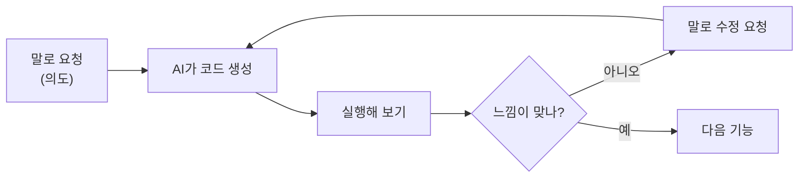
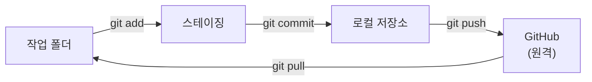
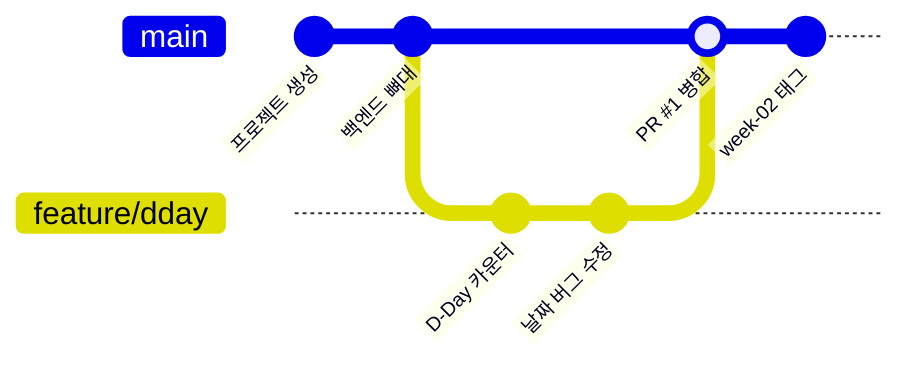
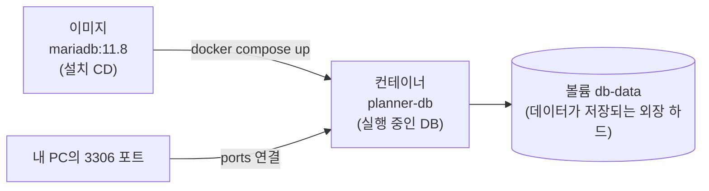
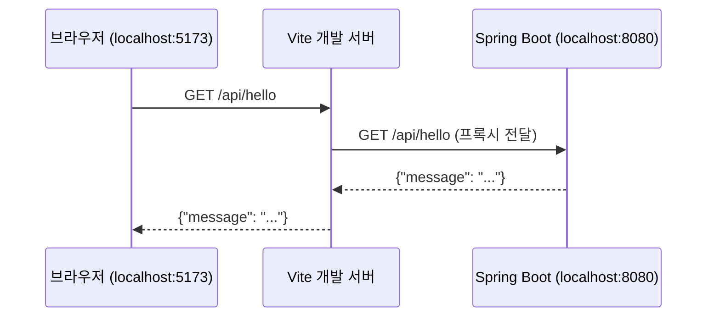
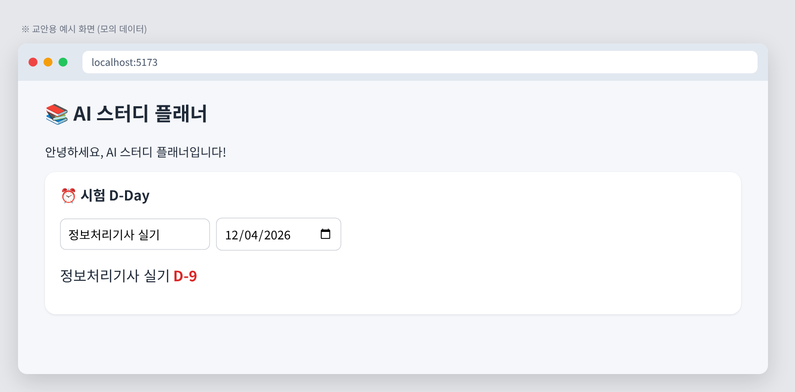
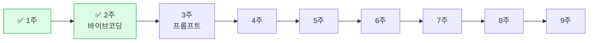

# 2주차 · 바이브코딩 (Vibe Coding) + Git·GitHub 기초

> **"코드는 AI가, 방향은 내가."**
>
> 오늘은 AI에게 말로 시켜서 프로젝트 뼈대를 세우고, 바이브코딩의 **속도와 함정**을 동시에 체험합니다. 그리고 모든 결과를 Git으로 기록해 GitHub에 올립니다.

---

## 0. 수업 진행표 (3시간)

| 시간 | 내용 | 형태 |
|---|---|---|
| 0:00 ~ 0:30 | 바이브코딩이란? 장점·함정·안전 수칙 | 설명 |
| 0:30 ~ 0:55 | Git·GitHub 핵심 개념 (그림으로 이해) | 설명 |
| 0:55 ~ 1:05 | 휴식 | |
| 1:05 ~ 2:05 | 실습 ①~④ 프로젝트 뼈대 만들기 (백엔드·프론트·DB) | 실습 |
| 2:05 ~ 2:35 | 실습 ⑤ 바이브코딩 체험: D-Day 카운터 | 실습 |
| 2:35 ~ 2:55 | 실습 ⑥ GitHub에 올리기 · 브랜치 · PR | 실습 |
| 2:55 ~ 3:00 | 회고 · 과제 | 정리 |

## 1. 학습 목표

1. 바이브코딩의 개념과 **"이해하지 못한 코드는 내 코드가 아니다"** 원칙을 설명할 수 있다.
2. Claude Code에게 자연어로 지시하여 **React + Spring Boot + MariaDB** 프로젝트 뼈대를 만들 수 있다.
3. Git의 3영역(작업 폴더·스테이징·저장소)과 GitHub 원격 저장소를 이해하고, **commit → push → PR** 흐름을 수행할 수 있다.
4. API 키 같은 비밀 정보를 `.env`와 `.gitignore`로 보호할 수 있다.

---

## 2. 개념 ① 바이브코딩이란?

### 2.1 정의

> **바이브코딩**: 원하는 결과를 자연어로 설명하고, AI가 생성한 코드를 **실행해 보며 결과(느낌)를 기준으로** 계속 수정을 요청하는 개발 방식.
>
> 2025년 초 안드레이 카르파시(Andrej Karpathy)가 "코드가 존재한다는 사실도 잊고 분위기(vibe)에 몸을 맡긴다"고 표현하며 널리 퍼졌습니다.

> 📖 **용어 풀이 — 기술 부채 (Technical Debt)**
>
> **뜻**: 지금 편하려고 대충 만든 코드 때문에 **나중에 치러야 하는 수정 비용**. 빚(부채)처럼 시간이 갈수록 이자가 붙습니다.
>
> **왜 알아야 하나**: 바이브코딩은 속도가 빠른 대신 기술 부채가 쌓이기 쉽습니다. "지금 빨리"와 "나중에 고치기 쉬움" 사이에서 **균형을 잡는 것**이 엔지니어의 일입니다.

### 2.2 비유: 택시 vs 직접 운전

| | 직접 코딩 (직접 운전) | 바이브코딩 (택시) |
|---|---|---|
| 속도 | 느림 | 매우 빠름 |
| 길을 아는가? | 안다 | **모를 수 있다** |
| 기사가 길을 잘못 들면? | 해당 없음 | **알아채지 못한다** |
| 잘 맞는 상황 | 핵심 로직, 보안 | 프로토타입, 화면 시안, 일회성 스크립트 |

### 2.3 바이브코딩 사이클



### 2.4 바이브코딩의 함정: "기술 부채의 복리"

코드를 이해하지 못한 채 수정을 거듭하면, 나중에 고치는 비용이 **복리**처럼 불어납니다.

$$
\text{수정 비용}(n) \approx C_0 \times (1 + r)^{n}
$$

* $C_0$: 처음 이해하고 고칠 때의 비용
* $r$: 한 번 "이해 없이" 수정할 때마다 늘어나는 혼란 비율
* $n$: 이해 없이 수정한 횟수

예를 들어 $r = 0.3$이고 $n = 10$이면 $(1.3)^{10} \approx 13.8$배, 즉 **처음보다 약 14배 고치기 어려운 코드**가 됩니다.

### 2.5 바이브코딩 안전 수칙 5가지

| # | 수칙 | 이유 |
|---|---|---|
| 1 | **작게 요청**하고 자주 실행한다 | 문제가 생긴 지점을 쉽게 찾는다 |
| 2 | 동작하면 **바로 커밋**한다 | 망가지면 되돌릴 수 있는 "세이브 포인트" |
| 3 | 생성된 코드를 **한 번은 읽는다** ("설명해 줘") | 이해하지 못한 코드는 고칠 수 없다 |
| 4 | **비밀 정보**(API 키, 비밀번호)를 프롬프트·코드에 넣지 않는다 | 유출 사고 방지 |
| 5 | 핵심 로직·보안은 바이브로 끝내지 않는다 | 3주차 이후 단계(프롬프트·하네스)로 보완 |

---

## 3. 개념 ② Git과 GitHub

> 📖 **용어 풀이 — Git과 GitHub는 다릅니다**
>
> **Git**: 내 PC에서 파일 변경 이력을 기록하는 **프로그램**. (인터넷 없이도 동작)
>
> **GitHub**: Git 기록을 인터넷에 올려 **공유·협업**하는 **웹 서비스**. (코드 저장소 + 포트폴리오 + 자동화)
>
> **왜 쓰나**: AI가 코드를 망가뜨려도 **이전 상태로 되돌릴 수 있고**, 9주 동안의 커밋 기록 자체가 취업용 **성장 증거**가 됩니다.

| 용어 | 뜻 | 비유 |
|---|---|---|
| **저장소** (Repository, repo) | Git이 관리하는 프로젝트 폴더 | 앨범 |
| **커밋** (Commit) | 변경 사항을 메시지와 함께 저장한 한 시점 | 앨범에 붙인 사진 한 장 |
| **브랜치** (Branch) | 원본을 건드리지 않고 작업하는 갈래 | 평행 세계 |
| **원격** (Remote, `origin`) | GitHub에 있는 저장소의 별명 | 클라우드 앨범 |
| **push / pull** | 내 기록을 원격에 올리기 / 원격 기록을 내려받기 | 업로드 / 다운로드 |
| **PR** (Pull Request) | 브랜치 변경을 main에 합쳐 달라는 검토 요청 | 결재 서류 |
| **태그** (Tag) | 특정 커밋에 붙이는 이름표 (`week-02`) | 책갈피 |

### 3.1 Git의 3영역 비유: "사진 찍기"

| Git 영역 | 비유 | 명령 |
|---|---|---|
| 작업 폴더 (Working Directory) | 무대 위의 사람들 | 파일 수정 |
| 스테이징 영역 (Staging Area) | **사진 찍을 사람을 프레임 안에 세우기** | `git add` |
| 로컬 저장소 (Repository) | **셔터를 눌러 앨범에 저장** | `git commit` |
| 원격 저장소 (GitHub) | 클라우드 앨범에 업로드 | `git push` |



### 3.2 브랜치와 PR (Pull Request)



* **브랜치**: 원본(main)을 건드리지 않고 실험하는 **평행 세계**
* **PR**: "내 평행 세계의 변경을 main에 합쳐도 될까요?"라고 **검토를 요청하는 문서**

### 3.3 커밋 메시지 규칙 (Conventional Commits)

| 타입 | 의미 | 예 |
|---|---|---|
| `feat` | 새 기능 | `feat: D-Day 카운터 컴포넌트 추가` |
| `fix` | 버그 수정 | `fix: D-Day 계산이 하루 어긋나는 문제 수정` |
| `docs` | 문서 | `docs: README 실행 방법 추가` |
| `refactor` | 동작 변화 없는 구조 개선 | `refactor: 날짜 계산을 utils로 분리` |
| `test` | 테스트 | `test: calcDday 단위 테스트 추가` |
| `chore` | 설정·빌드 | `chore: docker-compose에 MariaDB 추가` |

> 💡 9주차 포트폴리오에서 **커밋 기록 자체가 성장의 증거**가 됩니다. 의미 있는 메시지를 남기세요.

---

## 4. 실습: 프로젝트 뼈대 만들기

### 최종 폴더 구조 (오늘 목표)

```text
ai-study-planner/
├── backend/                 # Spring Boot (Java 21, Gradle)
│   ├── build.gradle
│   └── src/main/java/com/example/planner/
│       ├── PlannerApplication.java
│       └── HelloController.java
├── frontend/                # React + Vite + TypeScript
│   ├── vite.config.ts
│   └── src/
│       ├── App.tsx
│       └── components/DdayCounter.tsx
├── docker-compose.yml       # MariaDB
├── .env.example             # 환경 변수 견본 (Git에 올림)
├── .env                     # 실제 비밀 값 (Git에 올리지 않음!)
└── .gitignore
```

### 실습 ① 저장소 폴더 만들기

#### ⌨️ 직접 실행 — 프로젝트 폴더와 Git 저장소 만들기

```bash
mkdir ai-study-planner && cd ai-study-planner
git init
```

#### ✅ 결과 확인

```text
Initialized empty Git repository in /Users/me/ai-study-planner/.git/
```

`.git`이라는 숨김 폴더가 생기면 이 폴더는 이제 Git이 기록하는 **저장소**입니다.

### 실습 ② 바이브코딩으로 백엔드 뼈대 만들기

> 📖 **용어 풀이 — Spring Boot · Gradle · 의존성**
>
> **Spring Boot**: Java로 웹 서버(백엔드)를 빠르게 만드는 **프레임워크**. 프레임워크는 "집을 지을 때 미리 세워 둔 골조"처럼 기본 구조를 제공해 우리는 기능만 채우면 됩니다.
>
> **Gradle**: 필요한 라이브러리를 내려받고, 코드를 컴파일·실행·테스트해 주는 **빌드 도구**. (`./gradlew`로 실행)
>
> **의존성 (Dependency)**: 우리 프로젝트가 가져다 쓰는 **외부 라이브러리**. `build.gradle`에 적어 두면 Gradle이 자동으로 내려받습니다. "요리에 필요한 재료 목록"이라고 생각하세요.

#### ⌨️ 직접 실행 — 프로젝트 폴더에서 Claude Code 시작

```bash
claude
```

#### 🤖 Claude Code 프롬프트 — 바이브 방식으로 요청 (일부러 짧게)

```text
backend 폴더에 Spring Boot 프로젝트 만들어 줘. Java 21, Gradle, MariaDB 쓸 거야.
```

#### ✅ 결과 확인 — 옆 사람과 결과를 비교해 보세요

AI가 만든 결과를 확인해 보면, 사람마다 **결과가 다를 것**입니다. 이것이 바이브코딩의 첫 번째 교훈입니다: **모호한 요청 = 들쭉날쭉한 결과.**

| 비교 항목 | 나 | 옆 사람 |
|---|---|---|
| 빌드 도구 (Gradle / Maven) | | |
| Spring Boot 버전 (3.x / 4.x) | | |
| 패키지 이름 | | |
| 만들어진 파일 수 | | |

> 📖 **용어 풀이 — Spring Initializr**
>
> **뜻**: Spring 팀이 운영하는 **프로젝트 생성기** 웹사이트(start.spring.io). 옵션을 고르면 표준 구조의 빈 프로젝트를 zip으로 만들어 줍니다.
>
> **왜 쓰나**: AI에게 처음부터 만들게 하면 버전·구조가 제각각입니다. **공식 생성기로 같은 출발점**을 만든 뒤 AI에게 기능을 맡기는 것이 안전합니다. (사람이 정해야 할 것과 AI에게 맡길 것을 나누는 첫 연습)

#### 🤖 Claude Code 프롬프트 — 모두 같은 출발점 만들기

수업에서는 모두 같은 출발점을 갖기 위해 **Spring Initializr**를 사용합니다. Claude Code에게 이렇게 요청하세요.

```text
방금 만든 backend 폴더는 지워 줘. 대신 아래 명령으로 Spring Initializr에서 프로젝트를 내려받아 backend 폴더에 풀어 줘.
```

AI는 아래 명령을 실행하겠다고 **허락을 요청**합니다. 명령 내용을 읽어 보고 승인하세요. (AI가 다른 명령을 제안하면 "아래 명령을 그대로 써 줘"라고 다시 지시합니다. 직접 터미널에 입력해도 됩니다.)

```bash
curl https://start.spring.io/starter.zip \
  -d type=gradle-project -d language=java -d javaVersion=21 \
  -d groupId=com.example -d artifactId=planner -d name=planner \
  -d packageName=com.example.planner \
  -d dependencies=web,data-jpa,mariadb,validation,actuator,h2 \
  -o backend.zip
unzip backend.zip -d backend && rm backend.zip
```

> 💡 Windows PowerShell에서 `curl`이 동작하지 않으면 브라우저로 [start.spring.io](https://start.spring.io)에 접속해 같은 옵션(Gradle-Groovy, Java 21, 의존성 6개)을 선택하고 **GENERATE**로 내려받아 `backend` 폴더에 풀어도 됩니다.

#### ✅ 결과 확인 — backend 폴더 구조

```text
backend/
├── build.gradle            ← 의존성 목록
├── gradlew, gradlew.bat    ← Gradle 실행 스크립트 (설치 없이 사용)
├── settings.gradle
└── src/
    ├── main/java/com/example/planner/PlannerApplication.java   ← 프로그램 시작점
    ├── main/resources/application.properties                   ← 설정 파일
    └── test/java/com/example/planner/PlannerApplicationTests.java
```

#### 📄 참고 코드 — build.gradle 의존성 부분

생성된 `backend/build.gradle`의 의존성 부분은 대략 아래와 같습니다. (Spring Boot 4부터 웹 스타터 이름이 `spring-boot-starter-webmvc`로 바뀌었습니다. **Initializr가 만들어 준 버전과 이름을 그대로 사용하세요.**)

```groovy
dependencies {
    implementation 'org.springframework.boot:spring-boot-starter-actuator'
    implementation 'org.springframework.boot:spring-boot-starter-data-jpa'
    implementation 'org.springframework.boot:spring-boot-starter-validation'
    implementation 'org.springframework.boot:spring-boot-starter-webmvc'
    runtimeOnly 'com.h2database:h2'
    runtimeOnly 'org.mariadb.jdbc:mariadb-java-client'
    testImplementation 'org.springframework.boot:spring-boot-starter-data-jpa-test'
    testImplementation 'org.springframework.boot:spring-boot-starter-webmvc-test'
    // ... (Initializr가 추가한 나머지 테스트 의존성)
}
```

H2는 **테스트용 메모리 DB**입니다. 5주차에 테스트를 돌릴 때 사용합니다.

| 의존성 | 하는 일 |
|---|---|
| `webmvc` | 웹 요청(HTTP)을 받아 처리 — REST API 만들기 |
| `data-jpa` | Java 객체로 DB를 다루기 (SQL을 덜 쓰게 해 줌) |
| `validation` | 입력값 검사 ("제목은 비어 있으면 안 됨") |
| `actuator` | 서버 상태 확인 주소(`/actuator/health`) 제공 |
| `mariadb-java-client` | MariaDB에 접속하는 드라이버 |
| `h2` | 테스트용 메모리 DB |

#### 🤖 Claude Code 프롬프트 — 설정 파일과 첫 API 만들기

```text
backend의 application.properties를 지우고 application.yml을 만들어 줘.
- MariaDB 접속 정보는 환경 변수(DB_HOST, DB_PORT, DB_NAME, DB_USER, DB_PASSWORD)로 받고 기본값은 localhost:3306/planner, planner/planner1234
- JPA ddl-auto는 update, open-in-view는 false
- actuator는 health만 공개
- gemini.api-key, gemini.model 설정을 환경 변수 GEMINI_API_KEY, GEMINI_MODEL(기본값 gemini-flash-lite-latest)로 추가
그리고 com.example.planner 패키지에 GET /api/hello 가 {"message": "안녕하세요, AI 스터디 플래너입니다!"}를 돌려주는 HelloController를 만들어 줘.
```

#### 📄 참고 코드 — application.yml

`backend/src/main/resources/application.properties`를 삭제하고 **`application.yml`** 을 만듭니다.

> 📖 **용어 풀이 — YAML (`.yml`)**
>
> **뜻**: 들여쓰기로 계층을 표현하는 **설정 파일 형식**. `spring:` 아래에 두 칸 들여 쓴 항목은 spring의 하위 설정입니다.
>
> **주의**: 들여쓰기는 **스페이스**로만! 탭을 쓰면 오류가 납니다.

```yaml
spring:
  application:
    name: planner
  datasource:
    url: jdbc:mariadb://${DB_HOST:localhost}:${DB_PORT:3306}/${DB_NAME:planner}
    username: ${DB_USER:planner}
    password: ${DB_PASSWORD:planner1234}
  jpa:
    hibernate:
      ddl-auto: update        # 엔티티를 보고 테이블 자동 생성/수정 (학습용)
    open-in-view: false

server:
  port: 8080

management:
  endpoints:
    web:
      exposure:
        include: health       # /actuator/health 공개 (배포 시 상태 확인용)

gemini:
  api-key: ${GEMINI_API_KEY:}
  model: ${GEMINI_MODEL:gemini-flash-lite-latest}
```

> 💡 `${DB_HOST:localhost}`는 **"환경 변수 DB_HOST가 있으면 그 값, 없으면 localhost"** 라는 뜻입니다. 같은 코드를 내 PC·Docker·AWS에서 설정만 바꿔 쓸 수 있게 해 줍니다.

#### 📄 참고 코드 — HelloController.java

`backend/src/main/java/com/example/planner/HelloController.java`

> 📖 **용어 풀이 — 컨트롤러와 애너테이션(@)**
>
> **컨트롤러 (Controller)**: 특정 주소로 들어온 요청을 받아 **응답을 돌려주는 클래스**. 식당의 "주문 받는 직원".
>
> **애너테이션 (Annotation, `@...`)**: 코드에 붙이는 **이름표**. `@RestController`는 "이 클래스는 REST API 창구다", `@GetMapping("/hello")`는 "GET /hello 요청은 이 메서드가 처리한다"는 뜻입니다. Spring이 이 이름표를 보고 알아서 연결해 줍니다.

```java
package com.example.planner;

import java.util.Map;

import org.springframework.web.bind.annotation.GetMapping;
import org.springframework.web.bind.annotation.RequestMapping;
import org.springframework.web.bind.annotation.RestController;

@RestController
@RequestMapping("/api")
public class HelloController {

    @GetMapping("/hello")
    public Map<String, String> hello() {
        return Map.of("message", "안녕하세요, AI 스터디 플래너입니다!");
    }
}
```

### 실습 ③ MariaDB를 Docker로 실행하기

> 📖 **용어 풀이 — Docker · 이미지 · 컨테이너 · Docker Compose**
>
> **이미지 (Image)**: 프로그램 + 실행 환경을 담은 **설치 CD** 같은 것. 예: `mariadb:11.8`
>
> **컨테이너 (Container)**: 이미지를 실행한 **실제 프로그램**. 같은 이미지로 컨테이너를 여러 개 만들 수 있습니다.
>
> **Docker Compose**: 여러 컨테이너의 설정을 **`docker-compose.yml` 한 파일**에 적어 두고 한 명령으로 실행하는 도구.
>
> **왜 쓰나**: MariaDB를 PC에 직접 설치하면 운영체제마다 방법이 다르고 지우기도 어렵습니다. Docker로 실행하면 **모두 같은 명령 한 줄**로 똑같은 DB가 뜨고, 필요 없으면 깨끗이 지울 수 있습니다.



#### 🤖 Claude Code 프롬프트 — DB 컨테이너 설정 만들기

```text
프로젝트 루트에 MariaDB 11.8을 실행하는 docker-compose.yml을 만들어 줘.
- 서비스 이름 db, 컨테이너 이름 planner-db, 포트 3306 공개
- DB 이름 planner, 사용자 planner. 비밀번호는 .env 파일의 DB_PASSWORD, DB_ROOT_PASSWORD를 쓰고 없으면 기본값 사용
- 한글이 깨지지 않게 utf8mb4, 시간대 Asia/Seoul
- 데이터는 db-data 볼륨에 저장, healthcheck 추가
그리고 .env.example(견본, Git에 올림)과 .env(실제 값, Git에 올리지 않음)를 만들어 줘.
```

#### 📄 참고 코드 — docker-compose.yml

프로젝트 루트에 `docker-compose.yml`을 만듭니다.

```yaml
services:
  db:
    image: mariadb:11.8
    container_name: planner-db
    environment:
      MARIADB_ROOT_PASSWORD: ${DB_ROOT_PASSWORD:-root1234}
      MARIADB_DATABASE: planner
      MARIADB_USER: planner
      MARIADB_PASSWORD: ${DB_PASSWORD:-planner1234}
      TZ: Asia/Seoul
    command: ["--character-set-server=utf8mb4", "--collation-server=utf8mb4_unicode_ci"]
    ports:
      - "3306:3306"
    volumes:
      - db-data:/var/lib/mysql
    healthcheck:
      test: ["CMD", "healthcheck.sh", "--connect", "--innodb_initialized"]
      interval: 10s
      timeout: 5s
      retries: 10

volumes:
  db-data:
```

| 설정 | 뜻 |
|---|---|
| `image` | 사용할 이미지 (설치 CD) |
| `environment` | 컨테이너에 넘겨줄 환경 변수 (DB 이름·사용자·비밀번호) |
| `${DB_PASSWORD:-planner1234}` | `.env`에 값이 있으면 그 값, 없으면 `planner1234` |
| `ports: "3306:3306"` | **내 PC의 3306번 → 컨테이너의 3306번** 연결 (백엔드가 접속할 문) |
| `volumes` | 컨테이너를 지워도 데이터가 남도록 별도 저장소에 보관 |
| `healthcheck` | DB가 "정말로 준비됐는지" 주기적으로 검사 |

> 📖 **용어 풀이 — 포트 (Port)**
>
> **뜻**: 한 컴퓨터 안에서 프로그램을 구분하는 **문 번호**. 아파트(컴퓨터 주소) 안의 **호수**와 같습니다.
>
> **이 과정의 포트**: MariaDB `3306`, Spring Boot `8080`, Vite 개발 서버 `5173`, Docker 프론트 `3000`, 배포 서버 웹 `80`.

#### 📄 참고 코드 — .env.example / .env

비밀 값은 `.env` 파일에, 견본은 `.env.example`에 둡니다.

`.env.example` (Git에 **올립니다**)

```dotenv
DB_ROOT_PASSWORD=change-me
DB_PASSWORD=change-me
GEMINI_API_KEY=your-gemini-api-key
GEMINI_MODEL=gemini-flash-lite-latest
```

`.env` (Git에 **절대 올리지 않습니다**)

```dotenv
DB_ROOT_PASSWORD=root1234
DB_PASSWORD=planner1234
GEMINI_API_KEY=실제_발급받은_키
GEMINI_MODEL=gemini-flash-lite-latest
```

#### ⌨️ 직접 실행 — DB 띄우기

```bash
docker compose up -d
docker compose ps            # STATUS에 (healthy)가 보이면 준비 완료
```

#### ✅ 결과 확인 — DB 컨테이너 상태

```text
NAME         IMAGE          COMMAND                  SERVICE   STATUS                    PORTS
planner-db   mariadb:11.8   "docker-entrypoint.s…"   db        Up 30 seconds (healthy)   0.0.0.0:3306->3306/tcp
```

`(health: starting)`이면 10~30초 기다렸다가 다시 확인하세요. `(healthy)`가 되면 준비 완료입니다.

#### ⌨️ 직접 실행 — 백엔드 실행

이제 백엔드를 실행합니다.

```bash
cd backend
./gradlew bootRun            # Windows: .\gradlew.bat bootRun
```

#### ✅ 결과 확인 — 백엔드 실행 로그와 API 응답

실행한 터미널에 아래와 같은 줄이 보이면 서버가 켜진 것입니다. (이 터미널은 서버가 계속 돌아가야 하므로 닫지 마세요. `Ctrl+C`로 종료)

```text
  .   ____          _            __ _ _
 /\\ / ___'_ __ _ _(_)_ __  __ _ \ \ \ \
 ...
INFO  --- [main] o.s.b.w.e.tomcat.TomcatWebServer  : Tomcat started on port 8080 (http)
INFO  --- [main] c.e.planner.PlannerApplication     : Started PlannerApplication in 3.2 seconds
```

**새 터미널**을 하나 더 열어 확인합니다.

```bash
curl http://localhost:8080/api/hello
curl http://localhost:8080/actuator/health
```

```json
{"message":"안녕하세요, AI 스터디 플래너입니다!"}
{"status":"UP"}
```

### 실습 ④ 프론트엔드 만들기 (React + Vite + TypeScript)

> 📖 **용어 풀이 — React · TypeScript · Vite**
>
> **React**: 화면을 **컴포넌트(부품)** 단위로 만드는 JavaScript 라이브러리. 버튼·카드·목록을 레고처럼 조립합니다.
>
> **TypeScript**: JavaScript에 **타입(자료형)** 을 붙인 언어. `title: string`처럼 써 두면 실수를 코드 작성 단계에서 잡아 줍니다. AI가 만든 코드의 실수도 잡아 주는 **센서** 역할을 합니다(5주차).
>
> **Vite**: React 프로젝트를 만들고, 개발 서버를 띄우고, 배포용 파일로 묶어 주는 **빠른 빌드 도구**. 코드를 저장하면 브라우저에 즉시 반영됩니다.

#### ⌨️ 직접 실행 — React 프로젝트 생성

프로젝트 루트로 돌아와서:

```bash
npm create vite@latest frontend -- --template react-ts
cd frontend
npm install
```

#### 🤖 Claude Code 프롬프트 — 프록시 설정과 첫 화면

```text
frontend의 vite.config.ts에 개발 서버 프록시를 설정해서 /api 요청을 http://localhost:8080 으로 넘겨 줘.
그리고 App.tsx를 "📚 AI 스터디 플래너" 제목과, /api/hello에서 받아온 message를 보여 주는 화면으로 바꿔 줘.
백엔드에 연결이 안 되면 "백엔드에 연결할 수 없습니다. bootRun을 확인하세요."를 보여 줘.
```

#### 📄 참고 코드 — vite.config.ts

`frontend/vite.config.ts` — 개발 서버에서 `/api` 요청을 백엔드(8080)로 넘겨 줍니다(프록시).

```ts
import { defineConfig } from 'vite';
import react from '@vitejs/plugin-react';

export default defineConfig({
  plugins: [react()],
  server: {
    port: 5173,
    proxy: {
      '/api': 'http://localhost:8080',
    },
  },
});
```



> 💡 **왜 프록시를 쓰나요?** 브라우저는 보안상 "다른 주소(포트)"로 요청하는 것을 제한합니다(CORS). 프록시를 쓰면 브라우저 입장에서는 같은 주소로 보이므로 문제가 사라집니다. 8주차 배포에서는 Nginx가 같은 역할을 합니다.

> 📖 **용어 풀이 — 프록시 (Proxy) 와 CORS**
>
> **프록시**: 요청을 **대신 전달해 주는 중개인**. 브라우저는 Vite(5173)에게만 말하고, Vite가 뒤에서 Spring Boot(8080)에 전달합니다.
>
> **CORS**: 브라우저가 "다른 출처(주소·포트)"로 보내는 요청을 **기본적으로 막는 보안 규칙**. 프록시를 쓰면 같은 출처처럼 보여서 이 문제를 피할 수 있습니다.

#### 📄 참고 코드 — App.tsx

`frontend/src/App.tsx`를 아래로 교체합니다.

> 📖 **용어 풀이 — useState · useEffect**
>
> **useState**: 화면에 보여 줄 **값을 기억하는 상자**. 값이 바뀌면 화면이 자동으로 다시 그려집니다. (`message`)
>
> **useEffect**: 화면이 처음 나타난 **뒤에 할 일**을 적는 곳. 여기서는 백엔드에 `/api/hello`를 요청합니다.

```tsx
import { useEffect, useState } from 'react';
import './App.css';

export default function App() {
  const [message, setMessage] = useState('불러오는 중...');

  useEffect(() => {
    fetch('/api/hello')
      .then((res) => res.json())
      .then((data: { message: string }) => setMessage(data.message))
      .catch(() => setMessage('백엔드에 연결할 수 없습니다. bootRun을 확인하세요.'));
  }, []);

  return (
    <div className="app">
      <h1>📚 AI 스터디 플래너</h1>
      <p>{message}</p>
    </div>
  );
}
```

#### ⌨️ 직접 실행 — 개발 서버 실행

```bash
npm run dev
```

#### ✅ 결과 확인 — 풀스택 연결 성공

```text
  VITE v7.x.x  ready in 350 ms

  ➜  Local:   http://localhost:5173/
```

브라우저에서 `http://localhost:5173`을 열어 **"안녕하세요, AI 스터디 플래너입니다!"** 가 보이면 **풀스택 연결 성공**입니다! 🎉 (브라우저 → Vite → Spring Boot → 응답이 한 바퀴 돈 것)

| 화면에 보이는 문구 | 의미 | 할 일 |
|---|---|---|
| 안녕하세요, AI 스터디 플래너입니다! | 성공 | 다음 실습으로 |
| 불러오는 중... (계속) | 요청이 끝나지 않음 | 개발자 도구(F12) → Network 탭 확인 |
| 백엔드에 연결할 수 없습니다 | 백엔드가 꺼져 있거나 프록시 설정 오류 | `bootRun` 터미널 확인, `vite.config.ts` 확인 |

### 실습 ⑤ 바이브코딩 체험: D-Day 카운터

이제 진짜 바이브코딩을 해 봅니다. **코드를 직접 쓰지 말고 말로만** 만들어 보세요.

#### 🤖 Claude Code 프롬프트 — 1라운드: 바이브 요청

```text
프론트엔드에 시험 D-Day 카운터 컴포넌트를 만들어서 App에 붙여 줘. 예쁘게.
```

#### 🤖 Claude Code 프롬프트 — 2라운드: 느낌대로 수정 (한 줄씩 차례로 입력)

```text
시험 이름이랑 날짜를 입력할 수 있게 해 줘.
시험이 지나면 D+로 표시해 줘.
오늘이 시험날이면 "D-Day 🔥"라고 보여 줘.
```

#### ✅ 결과 확인 — 3라운드: 버그 사냥 (아래를 직접 테스트해 보세요)

| 테스트 | 기대 결과 | 내 결과 |
|---|---|---|
| 오늘 날짜 입력 | `D-Day` | |
| 내일 날짜 입력 | `D-1` | |
| 어제 날짜 입력 | `D+1` | |
| 밤 11시 59분에 내일 날짜 | `D-1` (D-0이 아님!) | |

많은 경우 AI가 처음 만든 코드는 **시간대(UTC)·시각 차이** 때문에 하루가 어긋납니다.

> 📖 **용어 풀이 — UTC와 시간대**
>
> **UTC**: 세계 표준시. 한국 시간(KST)은 **UTC보다 9시간 빠릅니다**(UTC+9).
>
> **왜 문제가 되나**: 컴퓨터가 날짜를 "UTC 자정"으로 해석하면 한국에서는 **오전 9시**가 되어, 시각에 따라 하루 차이가 생깁니다. 날짜 계산은 AI도 사람도 자주 틀리는 대표 영역입니다.

#### 📄 참고 코드 — DdayCounter.tsx (올바른 구현 예시)

아래는 올바른 구현의 예시입니다. 여러분의 AI 결과와 비교해 보세요.

`frontend/src/components/DdayCounter.tsx`

```tsx
import { useState } from 'react';

function calcDday(target: string, today: Date = new Date()): number {
  // 'YYYY-MM-DD'를 "현지 시각 자정"으로 해석해야 하루 오차가 생기지 않는다
  const [y, m, d] = target.split('-').map(Number);
  const targetDate = new Date(y, m - 1, d);
  const base = new Date(today.getFullYear(), today.getMonth(), today.getDate());
  return Math.round((targetDate.getTime() - base.getTime()) / 86_400_000);
}

function formatDday(diff: number): string {
  if (diff === 0) return 'D-Day 🔥';
  return diff > 0 ? `D-${diff}` : `D+${-diff}`;
}

export default function DdayCounter() {
  const [examName, setExamName] = useState('정보처리기사 실기');
  const [examDate, setExamDate] = useState('');

  return (
    <section className="card">
      <h2>⏰ 시험 D-Day</h2>
      <div className="row">
        <input value={examName} onChange={(e) => setExamName(e.target.value)} placeholder="시험 이름" />
        <input type="date" value={examDate} onChange={(e) => setExamDate(e.target.value)} />
      </div>
      {examDate && (
        <p className="dday">
          {examName} <strong>{formatDday(calcDday(examDate))}</strong>
        </p>
      )}
    </section>
  );
}
```

D-Day 계산 수식:

$$
\text{D} = \operatorname{round}\left(\frac{t_{\text{시험일 0시}} - t_{\text{오늘 0시}}}{86{,}400{,}000\ \text{ms}}\right)
$$

`new Date('2026-12-01')`처럼 **문자열을 그대로 넣으면 UTC 자정**으로 해석되어 한국(UTC+9)에서는 오전 9시가 됩니다. 이런 미묘한 버그를 **AI도, 사람도 쉽게 놓칩니다.** → 5주차에 **테스트(센서)** 로 잡는 법을 배웁니다.

App에 붙이기 (`App.tsx`의 `return` 안에 추가):

```tsx
import DdayCounter from './components/DdayCounter';
// ...
      <p>{message}</p>
      <DdayCounter />
```

#### 🤖 Claude Code 프롬프트 — 4라운드: AI에게 설명 요청 (안전 수칙 3번)

```text
DdayCounter.tsx 코드를 초보자도 이해할 수 있게 줄마다 설명해 줘. 특히 왜 Math.round를 쓰는지 알려 줘.
```

#### ✅ 결과 확인 — 오늘 만든 화면



### 실습 ⑥ Git 커밋하고 GitHub에 올리기

> 📖 **용어 풀이 — .gitignore**
>
> **뜻**: Git이 **기록하지 말아야 할 파일 목록**. 비밀 정보(`.env`), 자동 생성 폴더(`node_modules`, `build`)를 적습니다.
>
> **왜 쓰나**: `node_modules`는 수백 MB라 올릴 필요가 없고(`npm install`로 다시 생성), `.env`는 올리면 **API 키가 전 세계에 공개**됩니다. GitHub에 공개된 키는 몇 분 안에 자동 수집 프로그램에 털릴 수 있습니다.

#### 🤖 Claude Code 프롬프트 — .gitignore 작성 (가장 먼저!)

```text
프로젝트 루트에 .gitignore를 만들어 줘. .env와 *.pem 같은 비밀 파일, backend의 build·.gradle, frontend의 node_modules·dist, IDE 설정, .claude/settings.local.json을 제외해 줘.
```

#### 📄 참고 코드 — .gitignore

프로젝트 루트의 `.gitignore`:

```gitignore
# 비밀 정보
.env
*.pem

# Java / Gradle
backend/build/
backend/.gradle/
*.class

# Node
frontend/node_modules/
frontend/dist/

# IDE / OS
.idea/
.vscode/
*.iml
.DS_Store

# Claude Code 개인 설정
.claude/settings.local.json
```

#### ✅ 결과 확인 — `.env`가 무시되는지 확인

```bash
git status            # 목록에 .env가 보이면 안 됩니다!
git check-ignore .env # ".env"가 출력되면 정상적으로 무시되는 중
```

#### ⌨️ 직접 실행 — 첫 커밋

```bash
git add .
git commit -m "chore: 프로젝트 뼈대 생성 (Spring Boot, React, MariaDB)"
```

#### ⌨️ 직접 실행 — GitHub 저장소 만들고 push

1. GitHub → **New repository** → 이름 `ai-study-planner`, **Public**, README 체크 해제 → Create
2. 화면에 나온 주소로 연결합니다.

```bash
git remote add origin https://github.com/<내아이디>/ai-study-planner.git
git push -u origin main
```

> 💡 GitHub CLI(`gh`)가 있으면 한 줄로도 가능합니다: `gh repo create ai-study-planner --public --source=. --push`

#### ⌨️ 직접 실행 — 브랜치 → PR 흐름 체험

D-Day 기능을 브랜치에서 개선하고 PR로 합쳐 봅니다.

```bash
git switch -c feature/dday-style
# Claude Code에게: "D-Day가 7일 이하면 빨간색으로 보여 줘"
git add .
git commit -m "feat: D-Day 7일 이하일 때 강조 표시"
git push -u origin feature/dday-style
```

GitHub 웹에서 **Compare & pull request** → 설명 작성 → **Merge pull request**.

로컬을 최신으로 맞추고 태그를 답니다.

```bash
git switch main
git pull
git tag week-02
git push origin week-02
```

#### ✅ 결과 확인 — GitHub에서 확인할 것

| 위치 | 보여야 하는 것 |
|---|---|
| 저장소 첫 화면 | `backend/`, `frontend/`, `docker-compose.yml`, `.env.example`, `.gitignore` (**`.env`는 없어야 함!**) |
| Commits | `chore: 프로젝트 뼈대 생성 ...`, `feat: D-Day 7일 이하일 때 강조 표시` |
| Pull requests → Closed | 병합된 PR #1 |
| Tags (Releases 옆) | `week-02` |

#### 🤖 Claude Code 프롬프트 — 커밋 메시지를 AI에게 맡기기 (선택)

```text
지금 변경 사항을 보고 Conventional Commits 형식(한국어 설명)으로 커밋해 줘. 커밋하기 전에 메시지를 먼저 보여 줘.
```

AI는 `git diff`를 읽고(도구 사용) 메시지를 만듭니다. 메시지가 마음에 들면 승인하세요.

---

## 5. 회고: 바이브코딩 체크 (5분)

| 질문 | 나의 답 |
|---|---|
| AI가 만든 코드 중 **이해하지 못한 부분**이 있었나? | |
| 같은 요청인데 옆 사람과 결과가 **달랐던** 점은? | |
| 하루 어긋나는 버그를 **어떻게 발견**했나? 발견 못 했다면 왜? | |
| 다음 주에 **더 잘 요청**하려면 무엇을 바꿀까? | |

> 📌 **오늘의 결론**: 바이브코딩은 **빠른 출발**에는 최고지만, **품질의 보증**은 해 주지 않습니다. 다음 주에는 "잘 묻는 법"인 **프롬프트 엔지니어링**으로 결과를 안정시킵니다.

---

## 6. 자주 겪는 문제 (트러블슈팅)

| 증상 | 원인 | 해결 |
|---|---|---|
| `bootRun` 시 `Connection refused` (3306) | DB 컨테이너 미실행 | `docker compose up -d`, `docker compose ps`로 healthy 확인 |
| `Access denied for user 'planner'` | `.env`의 비밀번호와 컨테이너 생성 당시 비밀번호가 다름 | `docker compose down -v`(데이터 삭제 주의) 후 다시 `up -d` |
| 프론트에서 "백엔드에 연결할 수 없습니다" | 백엔드 미실행 또는 프록시 설정 누락 | `vite.config.ts`의 `proxy` 확인, 8080 실행 확인 |
| `./gradlew: Permission denied` | 실행 권한 없음 | `chmod +x gradlew` |
| 한글이 `???`로 저장됨 | DB 문자셋 | compose의 `utf8mb4` 옵션 확인 후 볼륨 재생성 |
| `.env`를 실수로 push함 | `.gitignore` 누락 | **즉시 키를 폐기·재발급**하고 저장소 기록에서 제거 (깃 기록에 남아 있으므로 삭제 커밋만으로는 부족) |

---

## 7. 과제

1. **필수**: `week-02` 태그가 달린 GitHub 저장소 주소 제출 (`.env`가 올라가지 않았는지 확인!)
2. **필수**: 바이브코딩 회고표(5절) 작성
3. **도전**: Claude Code에게 "뽀모도로 타이머(25분 공부/5분 휴식)" 컴포넌트를 바이브코딩으로 만들게 하고, **발견한 버그 1개와 해결 과정**을 PR 설명에 적어 보세요.

---

## 8. 지금까지의 진행 상황 & 다음 주 예고

### 8.1 2주차까지 진행 상황



| 구분 | 완료한 것 |
|---|---|
| 개념 | 바이브코딩의 장점·함정(기술 부채), Git 3영역·브랜치·PR, Conventional Commits |
| 백엔드 | Spring Boot 프로젝트, `application.yml`(환경 변수), `GET /api/hello` |
| 프론트엔드 | React + Vite + TypeScript, `/api` 프록시, D-Day 카운터 |
| 인프라 | Docker Compose로 MariaDB 실행, `.env`/`.env.example`, `.gitignore` |
| GitHub | 저장소 생성, 첫 PR 병합, `week-02` 태그 |

**현재 프로젝트 구조**

```text
ai-study-planner/
├── backend/   (Spring Boot: HelloController)
├── frontend/  (React: App, DdayCounter)
├── docker-compose.yml   (MariaDB)
├── .env.example  .gitignore
└── (.env — Git에는 없음)
```

### 8.2 다음 주(3주차) 예고 — 프롬프트 엔지니어링

* **배울 것**: 오늘 겪은 "같은 요청인데 결과가 제각각" 문제를 **잘 쓴 지시문(프롬프트)** 으로 해결합니다. 6요소 프롬프트로 **할 일·노트 CRUD API**를 만들고, 앱에 **Gemini를 연결해 AI 노트 요약** 기능을 추가합니다.
* **왜 배우나**: AI의 결과 품질은 **질문의 품질**을 넘지 못합니다. 같은 AI도 지시문만 바꾸면 결과가 확 달라지는 것을 실험으로 확인합니다.
* **미리 준비**: ① `GEMINI_API_KEY` 환경 변수 설정 확인 ② 공부 노트 2~3개(아무 과목) 준비 ③ `docker compose up -d`로 DB가 뜨는지 확인

---

## 9. 🇯🇵 일본 취업 대비 IT 용어 (2주차)

| 한국어 | 日本語 | 읽는 법 | 예문 (日本語) | 예문 해석 |
|---|---|---|---|---|
| 바이브코딩 | バイブコーディング | 바이부코-딘구 | バイブコーディングで試作品を素早く作りました。 | 바이브코딩으로 시제품을 빠르게 만들었습니다. |
| 시제품 | 試作 / プロトタイプ | しさく | 一週間でプロトタイプを作成しました。 | 일주일 만에 프로토타입을 만들었습니다. |
| 기술 부채 | 技術的負債 | ぎじゅつてきふさい | 技術的負債がたまらないようにリファクタリングしました。 | 기술 부채가 쌓이지 않도록 리팩터링했습니다. |
| 프론트엔드 / 백엔드 | フロントエンド / バックエンド | 후론토엔도 / 박쿠엔도 | フロントエンドはReact、バックエンドはSpring Bootを使用しました。 | 프론트엔드는 React, 백엔드는 Spring Boot를 사용했습니다. |
| 프레임워크 | フレームワーク | 후레-무와-쿠 | フレームワークの公式ドキュメントを参考にしました。 | 프레임워크의 공식 문서를 참고했습니다. |
| 저장소 | リポジトリ | 리포지토리 | GitHubにリポジトリを公開しています。 | GitHub에 저장소를 공개하고 있습니다. |
| 커밋 | コミット | 코밋토 | 意味のある単位でコミットするよう心がけました。 | 의미 있는 단위로 커밋하도록 신경 썼습니다. |
| 브랜치 | ブランチ | 부란치 | 機能ごとにブランチを分けて開発しました。 | 기능별로 브랜치를 나눠 개발했습니다. |
| 풀 리퀘스트 | プルリクエスト（プルリク） | 푸루리쿠에스토 | プルリクエストでセルフレビューを行いました。 | 풀 리퀘스트로 셀프 리뷰를 했습니다. |
| 병합 | マージ | 마-지 | レビュー後にmainブランチへマージしました。 | 리뷰 후 main 브랜치에 병합했습니다. |
| 컨테이너 | コンテナ | 콘테나 | データベースはDockerコンテナで起動しています。 | 데이터베이스는 Docker 컨테이너로 실행하고 있습니다. |
| 기밀 정보 | 機密情報 | きみつじょうほう | 機密情報は.envで管理し、Gitには含めていません。 | 기밀 정보는 .env로 관리하고 Git에는 포함하지 않았습니다. |

> 💬 **면접에서 이렇게 말해 보세요**
>
> 「AIが生成したコードはそのまま使わず、必ず動作確認してからコミットしました。」
>
> (AI가 생성한 코드는 그대로 쓰지 않고 반드시 동작을 확인한 뒤 커밋했습니다.)

[← 1주차](week01-overview.md) · [3주차: 프롬프트 엔지니어링 →](week03-prompt-engineering.md)
