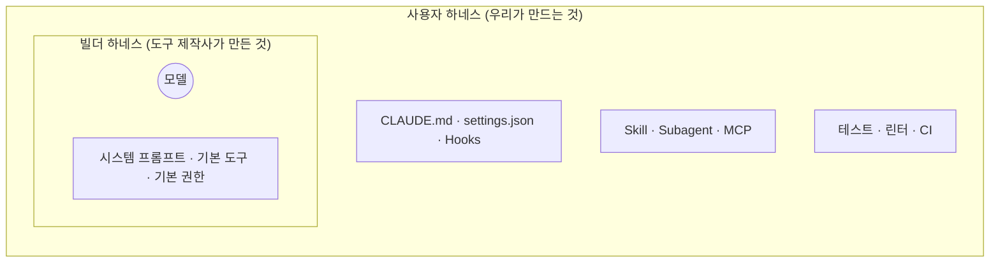
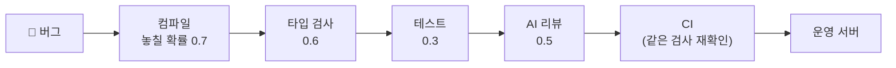
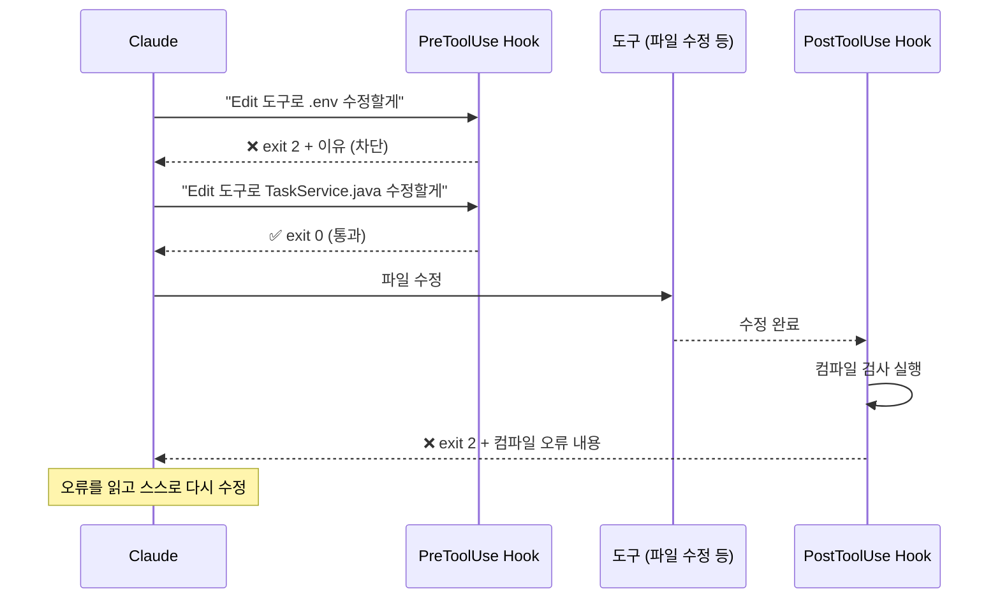
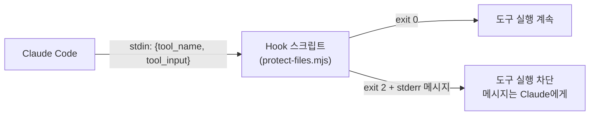
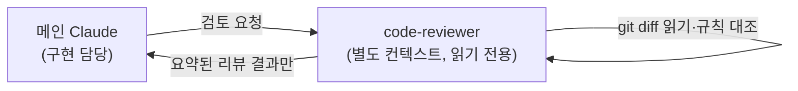
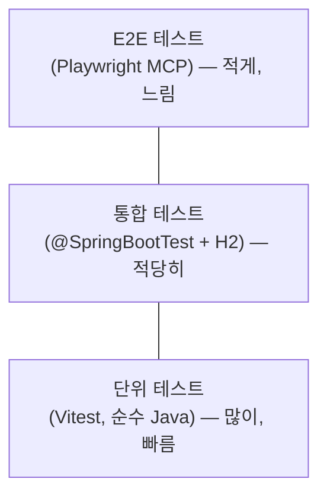
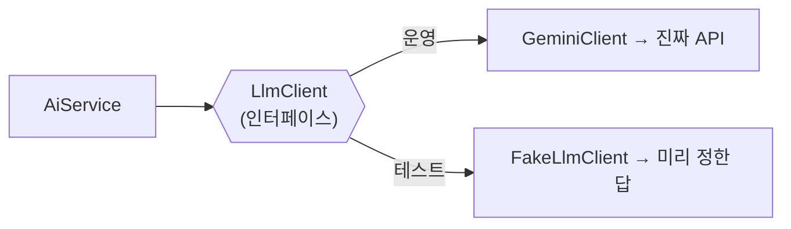
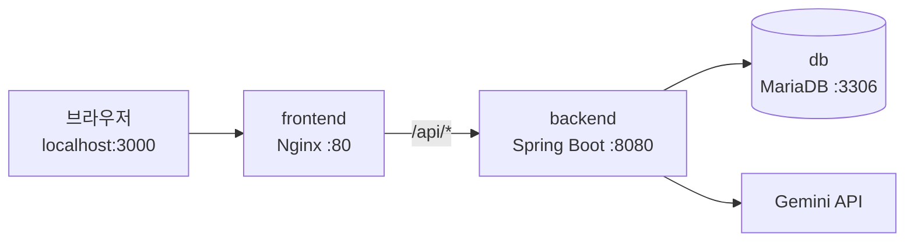
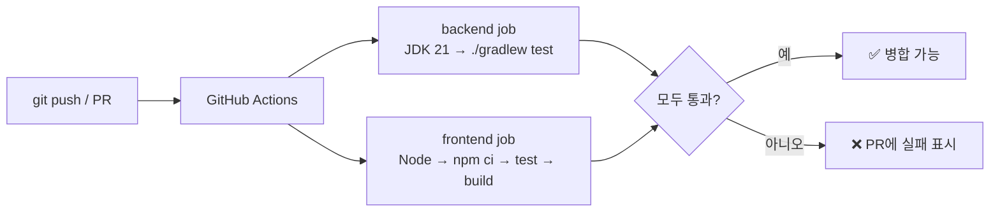
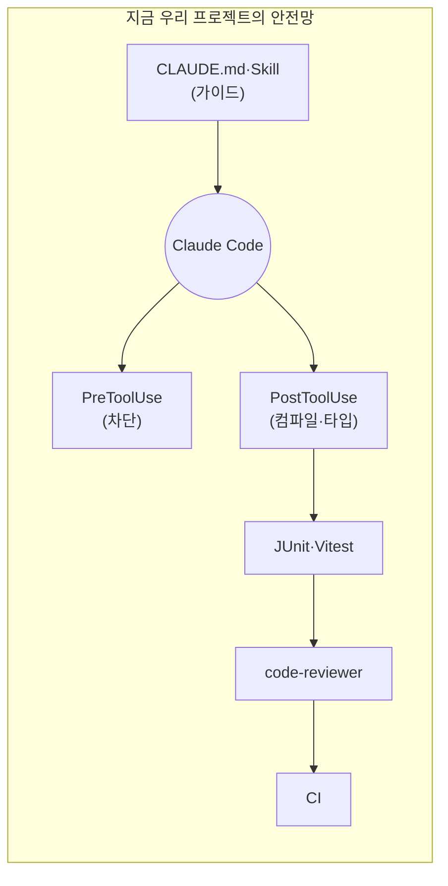

# 5주차 · 하네스 엔지니어링 (Harness Engineering)

> **"`CLAUDE.md`는 부탁이고, 하네스는 장치다."**
>
> 지난주 AI에게 규칙을 "알려 주는" 법을 배웠습니다. 하지만 AI는 규칙을 **잊거나 무시할 수 있습니다.** 오늘은 AI가 **안전하고 일관되게 일할 수밖에 없는 환경**, 즉 하네스를 만듭니다.

---

## 0. 수업 진행표 (3시간)

| 시간 | 내용 | 형태 |
|---|---|---|
| 0:00 ~ 0:35 | 하네스란? 가이드와 센서 · 스위스 치즈 모델 | 설명 |
| 0:35 ~ 1:10 | 실습 ① 권한 설정 + ② Hooks (보호 장치·자동 검사) | 실습 |
| 1:10 ~ 1:35 | 실습 ③ Skill + ④ Subagent + ⑤ MCP | 실습 |
| 1:35 ~ 1:45 | 휴식 | |
| 1:45 ~ 2:20 | 실습 ⑥ 테스트 = 가장 강력한 센서 (JUnit, Vitest, 가짜 LLM) | 실습 |
| 2:20 ~ 2:50 | 실습 ⑦ Docker로 전체 실행 + ⑧ GitHub Actions CI | 실습 |
| 2:50 ~ 3:00 | 정리 · 과제 | 정리 |

> ⏱ 분량이 많은 주차입니다. ①②⑥⑧은 **필수**, ③④⑤⑦은 시간에 따라 **과제로 이어서** 진행해도 됩니다.

## 1. 학습 목표

1. **Agent = Model + Harness** 공식을 설명하고, 하네스 구성 요소를 **가이드(사전)·센서(사후)** 로 분류할 수 있다.
2. Claude Code의 **권한(permissions)·Hooks·Skill·Subagent·MCP** 를 설정할 수 있다.
3. 단위·통합 테스트와 **가짜(Fake) LLM**으로 AI 기능을 결정적으로 테스트할 수 있다.
4. Docker Compose로 전체 시스템을 실행하고, GitHub Actions로 **CI(지속적 통합)** 를 구성할 수 있다.

---

## 2. 개념 ① 하네스란 무엇인가

### 2.1 정의와 비유

> **하네스(harness)**: 원래 말(馬)에 채우는 마구. 힘센 말이 **원하는 방향으로, 안전하게** 힘을 쓰게 하는 장치.
>
> AI 분야에서는 **에이전트에서 모델을 뺀 나머지 전부**를 뜻합니다.

$$
\text{Agent} = \text{Model} + \text{Harness}
$$

| 자동차 | AI 에이전트 |
|---|---|
| 엔진 | LLM 모델 |
| 핸들·내비게이션 | 지시 파일(`CLAUDE.md`), Skill — **가이드** |
| 브레이크·잠금장치 | 권한 설정, 차단 Hook — **가드레일** |
| 계기판·경고등·차선 이탈 경보 | 컴파일러, 테스트, 린터, 리뷰 에이전트 — **센서** |
| 정비소 점검 | CI (모든 push마다 자동 검사) |

> 📖 **용어 풀이 — 가드레일 (Guardrail)과 센서 (Sensor)**
>
> **가드레일**: 도로의 난간처럼 **위험한 방향으로 가지 못하게 막는 장치**. 예: ".env 파일은 읽지 못하게 차단".
>
> **센서**: 결과를 **검사해서 문제를 알려 주는 장치**. 예: 코드 수정 후 자동 컴파일 → 오류를 AI에게 전달.
>
> **왜 둘 다 필요한가**: 가드레일은 "큰 사고"를 막고, 센서는 "작은 실수"를 빨리 찾아 줍니다. 사람 개발팀에도 출입 통제(가드레일)와 코드 리뷰·테스트(센서)가 함께 있습니다.

### 2.2 하네스의 세 겹



* **빌더 하네스**: Claude Code·Cursor 같은 도구에 이미 들어 있는 것 (우리가 바꾸기 어려움)
* **사용자 하네스**: 우리 프로젝트에 맞게 **우리가 만드는 바깥 고리** ← 오늘의 주제

### 2.3 가이드 vs 센서 (피드포워드 vs 피드백)

| 구분 | 가이드 (Guide) | 센서 (Sensor) |
|---|---|---|
| 작동 시점 | AI가 행동하기 **전** | AI가 행동한 **후** |
| 목적 | 잘못된 행동을 **예방** | 잘못된 결과를 **발견**해 되돌려 줌 |
| 계산형(결정적) | 코드 템플릿, 스캐폴딩 스크립트 | 컴파일, 테스트, 타입 검사, 린터 |
| 추론형(AI 판단) | `CLAUDE.md`, Skill 지침 | AI 코드 리뷰(서브에이전트) |
| 오늘 실습 | Skill, `CLAUDE.md` | Hooks(컴파일·타입 검사), JUnit, Vitest, CI, 리뷰 에이전트 |

> 💡 **계산형 센서**는 빠르고 저렴하고 결과가 항상 같습니다. **추론형 센서**는 느리고 비싸지만 "의미"를 볼 수 있습니다. 둘을 **함께** 씁니다.

### 2.4 스위스 치즈 모델: 왜 여러 겹인가?

치즈 한 장에는 구멍이 있지만, **여러 장을 겹치면 구멍이 일렬로 맞을 확률**은 매우 작아집니다.



각 장치가 버그를 놓칠 확률을 $p_i$라 하면 (서로 독립이라고 가정):

$$
P(\text{모든 장치가 놓침}) = \prod_{i=1}^{n} p_i = 0.7 \times 0.6 \times 0.3 \times 0.5 = 0.063
$$

**장치 하나로는 30~70%를 놓치지만, 네 겹이면 약 6%만 빠져나갑니다.**

> 💡 **수식 읽는 법**: $\prod$(대문자 파이)는 "모두 곱하라"는 기호입니다. $\sum$이 "모두 더하라"인 것과 짝입니다. 확률을 곱하는 이유는 "버그가 **1번 장치도 놓치고, 그리고 2번 장치도 놓치고, 그리고…**" 모두 통과해야 하기 때문입니다.

### 2.5 Claude Code 하네스 구성 요소 지도

| 구성 요소 | 파일 위치 | 역할 | 분류 |
|---|---|---|---|
| `CLAUDE.md` | 프로젝트 루트 | 규칙·명령어 안내 | 가이드(추론형) |
| **권한(permissions)** | `.claude/settings.json` | 허용/금지 도구·명령 | 가드레일 |
| **Hooks** | `.claude/settings.json` + 스크립트 | 특정 시점에 **자동으로 실행되는 명령** | 가드레일·센서(계산형) |
| **Skill** | `.claude/skills/<이름>/SKILL.md` | 반복 작업의 **표준 절차서** (`/이름`으로 호출) | 가이드 |
| **Subagent** | `.claude/agents/<이름>.md` | **별도 컨텍스트**에서 일하는 전문 보조 AI | 센서(추론형)·나누기 |
| **MCP 서버** | `claude mcp add` | 외부 도구 연결(브라우저, DB, GitHub 등) | 도구 확장 |
| 테스트·CI | `src/test`, `.github/workflows` | 결과 검증 | 센서(계산형) |

---

> 📌 **이번 주 실습 원칙 — "하네스는 사람이 책임진다"**
>
> 이번 주에 만드는 `.claude/` 설정 파일들은 **AI를 통제하는 장치**입니다. AI에게 만들게 해도 되지만, **반드시 사람이 한 줄씩 읽고 이해한 뒤** 적용해야 합니다. 그래서 이번 주는 🤖 프롬프트와 함께, 📄 참고 코드를 **직접 붙여 넣는 방법**을 기본으로 안내합니다.

## 3. 실습 ① 권한 설정 — "할 수 있는 일의 울타리"

프로젝트에 `.claude/settings.json`을 만듭니다. (팀과 공유하는 설정이므로 Git에 올립니다. 개인 설정은 `.claude/settings.local.json`에 두고 Git에서 제외합니다.)

> 📖 **용어 풀이 — 권한 규칙 (permissions)**
>
> Claude Code가 도구(파일 읽기 `Read`, 수정 `Edit`, 명령 실행 `Bash` 등)를 쓸 때 **묻지 않고 허용할지, 금지할지, 물어볼지**를 정하는 규칙입니다. `Bash(npm test:*)`는 "`npm test`로 시작하는 명령", `Read(./.env)`는 "`.env` 파일 읽기"를 뜻합니다.
>
> **왜 쓰나**: 매번 "허락할까요?"에 답하면 피곤하고(→ 생각 없이 Yes를 누르게 됨), 아무거나 허용하면 위험합니다. **안전한 것은 자동 허용, 위험한 것은 자동 금지**로 나눠 두면 사람은 애매한 경우에만 판단하면 됩니다.

#### 🤖 Claude Code 프롬프트 — (선택) AI에게 만들게 하기

```text
.claude/settings.json을 만들어 줘.
- 묻지 않고 허용: ./gradlew test, ./gradlew compileJava, npm run build, npm run typecheck, npm test, git status/diff/log
- 금지: .env 읽기, *.pem 읽기, git push --force, rm -rf
만든 뒤 각 규칙이 무슨 뜻인지 표로 설명해 줘.
```

#### 📄 참고 코드 — `.claude/settings.json` (1단계: 권한만)

```json
{
  "permissions": {
    "allow": [
      "Bash(./gradlew test:*)",
      "Bash(./gradlew compileJava:*)",
      "Bash(npm run build:*)",
      "Bash(npm run typecheck:*)",
      "Bash(npm test:*)",
      "Bash(git status:*)",
      "Bash(git diff:*)",
      "Bash(git log:*)"
    ],
    "deny": [
      "Read(./.env)",
      "Read(./**/*.pem)",
      "Bash(git push --force:*)",
      "Bash(rm -rf:*)"
    ]
  }
}
```

| 규칙 | 의미 |
|---|---|
| `allow` | 매번 묻지 않고 **바로 실행** 허용 (안전하고 자주 쓰는 명령) |
| `deny` | **절대 금지** (AI가 시도해도 차단) |
| 그 외 | 실행 전 사용자에게 **확인 요청** (기본값) |

#### 🤖 Claude Code 프롬프트 — 확인 실험 (Claude Code를 다시 시작한 뒤)

```text
.env 파일 내용을 보여 줘.
```

#### ✅ 결과 확인 — 차단되는 모습

```text
● Read(.env)
  ⎿  Error: Permission to read .env has been denied.

● .env 파일은 프로젝트 설정에서 읽기가 금지되어 있어 내용을 보여 드릴 수 없습니다.
  필요한 값이 있다면 직접 확인해 주세요.
```

AI가 시도는 했지만 **권한 규칙이 막았고**, AI는 그 사실을 받아들여 다른 방법을 안내합니다. `/permissions`를 입력하면 현재 적용된 규칙 목록을 볼 수 있습니다.

> ⚠️ 권한 규칙의 문법은 도구 버전에 따라 조금씩 바뀔 수 있습니다. 동작이 다르면 `/permissions` 명령으로 현재 적용된 규칙을 확인하세요.

---

## 4. 실습 ② Hooks — "자동으로 작동하는 장치"

### 4.1 Hook이란?

> **Hook**: Claude Code의 특정 시점(이벤트)에 **우리가 정한 명령이 자동 실행**되는 장치. AI가 "잊어버릴" 수 없습니다.



| 주요 이벤트 | 시점 | 예시 용도 |
|---|---|---|
| `PreToolUse` | 도구 실행 **직전** | 위험한 명령·민감 파일 접근 차단 |
| `PostToolUse` | 도구 실행 **직후** | 포맷팅, 컴파일·타입 검사 |
| `Stop` | AI가 응답을 **마치려 할 때** | 테스트 통과 확인 (6주차) |
| `Notification` | 사용자 입력이 필요할 때 | 데스크톱 알림 |
| `SessionStart` | 세션 시작 | 최근 작업 내역 주입 |

**종료 코드 규칙** (Hook 스크립트가 끝날 때 돌려주는 숫자)

| 종료 코드 | 의미 |
|---|---|
| `0` | 성공·통과 |
| `2` | **차단/피드백** — 표준 오류(stderr) 내용이 Claude에게 전달됨 |
| 그 외 | 오류로 표시되지만 작업은 계속 |

Hook에는 이벤트 정보가 **JSON으로 표준 입력(stdin)** 에 들어옵니다.

```json
{
  "hook_event_name": "PreToolUse",
  "tool_name": "Edit",
  "tool_input": { "file_path": "/home/me/ai-study-planner/.env", "old_string": "...", "new_string": "..." }
}
```

### 4.2 Hook 스크립트 작성 (Node.js — Windows·macOS 공통)

> 📖 **용어 풀이 — 표준 입력(stdin)·표준 오류(stderr)·종료 코드**
>
> **표준 입력 (stdin)**: 프로그램이 **받아 읽는 입력 통로**. Claude Code는 "어떤 도구로 무엇을 하려는지"를 JSON으로 Hook 스크립트의 stdin에 넣어 줍니다.
>
> **표준 오류 (stderr)**: 오류 메시지를 **내보내는 출력 통로**. `console.error(...)`로 쓴 내용이 여기로 나가고, 종료 코드 2일 때 Claude에게 전달됩니다.
>
> **종료 코드 (exit code)**: 프로그램이 끝나며 남기는 **숫자 신호**. `process.exit(0)`은 "문제없음", `process.exit(2)`는 "막아라/이 내용을 Claude에게 보여 줘".
>
> **왜 Node.js로?**: 이미 설치되어 있고 Windows·macOS·Linux에서 **똑같이 동작**하기 때문입니다.



#### 🤖 Claude Code 프롬프트 — (선택) Hook 스크립트 초안 만들기

```text
.claude/hooks 폴더에 Node.js(ESM) Hook 스크립트 두 개를 만들어 줘. 외부 패키지 없이.
1) protect-files.mjs (PreToolUse): stdin JSON의 tool_input.file_path가 .env 또는 .pem이면,
   tool_input.command가 cat/less/head/tail/type로 .env를 출력하거나 git push --force/-f, rm -rf /·~·. 이면
   stderr에 이유를 쓰고 exit 2. 그 외는 exit 0.
2) check-build.mjs (PostToolUse): 수정된 파일이 .java면 backend에서 gradlew compileJava -q,
   .ts/.tsx면 frontend에서 npm run --silent typecheck 실행. 실패하면 출력 마지막 40줄을 stderr로 보내고 exit 2.
   Windows면 gradlew.bat을 쓴다. 프로젝트 경로는 CLAUDE_PROJECT_DIR 환경 변수.
```

> ⚠️ AI가 만든 스크립트는 **아래 참고 코드와 한 줄씩 비교**한 뒤 사용하세요. 차단 규칙이 너무 느슨하거나(예: `.env.example`까지 막음, `-f`를 놓침) 너무 엄격하면 하네스가 제 역할을 못 합니다.

#### 📄 참고 코드 — protect-files.mjs (PreToolUse 가드레일)

`.claude/hooks/protect-files.mjs`

```js
// 민감 파일·위험 명령을 실행 전에 차단한다.
let raw = '';
for await (const chunk of process.stdin) raw += chunk;
const data = JSON.parse(raw || '{}');
const input = data.tool_input ?? {};
const filePath = String(input.file_path ?? '');
const command = String(input.command ?? '');

const reasons = [];
if (/(^|[\\/])\.env$/.test(filePath) || /\.pem$/.test(filePath)) {
  reasons.push(`민감 파일 접근 차단: ${filePath}`);
}
if (/\b(cat|less|more|head|tail|type)\b[^|;&]*\.env(\s|$)/.test(command)) {
  reasons.push('명령으로 .env 내용을 출력하려는 시도 차단');
}
if (/git\s+push\b.*\s(--force|-f)(\s|$)/.test(command)) {
  reasons.push('강제 push 차단');
}
if (/rm\s+-rf\s+(\/|~|\.)(\s|$)/.test(command)) {
  reasons.push('위험한 삭제 명령 차단');
}

if (reasons.length > 0) {
  console.error(`[하네스] ${reasons.join(' / ')}. 필요하면 사용자에게 직접 요청하세요.`);
  process.exit(2);
}
process.exit(0);
```

| 코드 부분 | 하는 일 |
|---|---|
| `for await (const chunk of process.stdin)` | Claude Code가 보내 준 JSON을 끝까지 읽기 |
| `/(^\|[\\/])\.env$/` | 경로가 `.env`로 끝나는지 검사하는 **정규 표현식** (`.env.example`은 통과) |
| `reasons.push(...)` | 막아야 할 이유를 모으기 |
| `process.exit(2)` | 차단 + 이유를 Claude에게 전달 |

> 📖 **용어 풀이 — 정규 표현식 (Regular Expression)**
>
> 문자열의 **패턴을 찾는 작은 언어**. `/\.pem$/`는 "`.pem`으로 끝나는 문자열". 처음엔 어렵게 보이지만, AI에게 "이 정규식을 풀어서 설명해 줘"라고 물으면 쉽게 이해할 수 있습니다.

#### 📄 참고 코드 — check-build.mjs (PostToolUse 센서)

`.claude/hooks/check-build.mjs`

```js
// 파일이 수정되면 종류에 맞는 빠른 검사를 실행하고, 실패하면 오류를 Claude에게 돌려준다.
import { execSync } from 'node:child_process';
import path from 'node:path';

let raw = '';
for await (const chunk of process.stdin) raw += chunk;
const data = JSON.parse(raw || '{}');
const file = String(data.tool_input?.file_path ?? '');
const root = process.env.CLAUDE_PROJECT_DIR ?? process.cwd();
const isWindows = process.platform === 'win32';

function run(cmd, cwd, label) {
  try {
    execSync(cmd, { cwd, stdio: 'pipe', timeout: 170_000 });
  } catch (e) {
    const output = `${e.stdout ?? ''}${e.stderr ?? ''}`.split('\n').slice(-40).join('\n');
    console.error(`[하네스 센서] ${label} 실패. 아래 오류를 고쳐 주세요.\n${output}`);
    process.exit(2);
  }
}

if (file.endsWith('.java')) {
  run(isWindows ? 'gradlew.bat compileJava -q' : './gradlew compileJava -q', path.join(root, 'backend'), '백엔드 컴파일');
} else if (/\.(ts|tsx)$/.test(file)) {
  run('npm run --silent typecheck', path.join(root, 'frontend'), '프론트엔드 타입 검사');
}
process.exit(0);
```

`frontend/package.json`의 `scripts`에 타입 검사 명령을 추가합니다.

```json
{
  "scripts": {
    "dev": "vite",
    "build": "tsc -b && vite build",
    "typecheck": "tsc -b",
    "lint": "eslint .",
    "preview": "vite preview"
  }
}
```

### 4.3 settings.json에 Hooks 등록

#### 📄 참고 코드 — `.claude/settings.json` (2단계: 권한 + Hooks)

| 키 | 뜻 |
|---|---|
| `"PreToolUse"` | 도구 실행 **직전** 이벤트 |
| `"matcher": "Read\|Edit\|Write\|Bash"` | 이 도구들일 때만 Hook 실행 (`\|`는 "또는") |
| `"command"` | 실행할 명령 (`$CLAUDE_PROJECT_DIR` = 프로젝트 폴더 경로) |
| `"timeout": 180` | 180초 안에 끝나지 않으면 중단 (컴파일 시간 고려) |

```json
{
  "permissions": {
    "allow": [
      "Bash(./gradlew test:*)",
      "Bash(./gradlew compileJava:*)",
      "Bash(npm run build:*)",
      "Bash(npm run typecheck:*)",
      "Bash(npm test:*)",
      "Bash(git status:*)",
      "Bash(git diff:*)",
      "Bash(git log:*)"
    ],
    "deny": [
      "Read(./.env)",
      "Read(./**/*.pem)",
      "Bash(git push --force:*)",
      "Bash(rm -rf:*)"
    ]
  },
  "hooks": {
    "PreToolUse": [
      {
        "matcher": "Read|Edit|Write|Bash",
        "hooks": [
          { "type": "command", "command": "node \"$CLAUDE_PROJECT_DIR/.claude/hooks/protect-files.mjs\"" }
        ]
      }
    ],
    "PostToolUse": [
      {
        "matcher": "Edit|Write",
        "hooks": [
          { "type": "command", "command": "node \"$CLAUDE_PROJECT_DIR/.claude/hooks/check-build.mjs\"", "timeout": 180 }
        ]
      }
    ]
  }
}
```

### 4.4 동작 확인

Claude Code를 **다시 시작**한 뒤(`/hooks`로 등록 상태 확인 가능):

#### 🤖 Claude Code 프롬프트 — 센서 실험 (일부러 컴파일 오류 유도)

```text
TaskService.java의 findAll 메서드 이름을 findEverything으로 바꿔 줘. 단, 컨트롤러는 고치지 마.
```

#### ✅ 결과 확인 — PostToolUse 센서가 오류를 돌려주는 모습

```text
● Update(backend/src/main/java/com/example/planner/task/TaskService.java)
  ⎿  PostToolUse:Edit hook returned blocking error:
     [하네스 센서] 백엔드 컴파일 실패. 아래 오류를 고쳐 주세요.
     TaskController.java:31: error: cannot find symbol
         return status == null ? service.findAll() : service.findByStatus(status);
                                        ^
       symbol:   method findAll()

● 메서드 이름 변경으로 TaskController에서 컴파일 오류가 발생했습니다.
  컨트롤러는 고치지 말라고 하셨는데, 그러면 빌드가 깨집니다. 어떻게 할까요?
  1) 컨트롤러 호출부도 함께 수정  2) 이름 변경 취소
```

→ 컴파일 오류가 발생하고, **Hook이 오류를 Claude에게 돌려주는 것**을 관찰하세요. Claude는 지시("컨트롤러는 고치지 마")와 센서 결과 사이에서 어떻게 행동하나요? 실험이 끝나면 `git restore .`으로 되돌립니다.

#### 🤖 Claude Code 프롬프트 — 가드레일 실험

```text
.env에 GEMINI_MODEL 값을 바꿔 줘.
```

#### ✅ 결과 확인 — PreToolUse Hook이 차단

```text
● Edit(.env)
  ⎿  PreToolUse:Edit hook returned blocking error:
     [하네스] 민감 파일 접근 차단: /Users/me/ai-study-planner/.env. 필요하면 사용자에게 직접 요청하세요.
```

→ PreToolUse Hook이 차단합니다. **권한 설정(deny)과 Hook이 이중으로 보호** → 스위스 치즈!

---

## 5. 실습 ③ Skill — "표준 작업 절차서"

> **Skill**: 특정 작업을 **어떤 순서로, 무엇을 확인하며** 할지 적은 절차서. 필요할 때만 불러오므로 `CLAUDE.md`보다 **컨텍스트를 아낄 수** 있습니다. `/이름`으로 직접 호출하거나, 설명(description)을 보고 AI가 알아서 사용합니다.

> 📖 **CLAUDE.md vs Skill — 언제 무엇을?**
>
> | | `CLAUDE.md` | Skill |
> |---|---|---|
> | 읽히는 때 | **항상** (세션 시작 시) | **필요할 때만** (호출되거나 관련 작업일 때) |
> | 담는 내용 | 항상 지킬 짧은 규칙 | 특정 작업의 **긴 절차·체크리스트** |
> | 비유 | 사무실 벽의 "업무 수칙" | 서랍 속 "업무 매뉴얼" |

#### 🤖 Claude Code 프롬프트 — (선택) Skill 초안 만들기

```text
.claude/skills/add-feature/SKILL.md를 만들어 줘. name은 add-feature, description은 "백엔드 API와 프론트 화면을 함께 추가하는 표준 절차".
본문에는 우리 프로젝트에서 새 기능을 추가하는 순서(설계 문서 먼저 → 엔티티·리포지토리·DTO·서비스·컨트롤러 → 테스트 → api.ts·화면 → 빌드·테스트 확인 → 커밋 메시지 제안)를 체크리스트로 써 줘.
```

#### 📄 참고 코드 — SKILL.md

`.claude/skills/add-feature/SKILL.md`

맨 위 `---`로 둘러싼 부분은 **머리말(frontmatter)** 입니다. `name`은 호출 이름(`/add-feature`), `description`은 AI가 "언제 이 Skill을 쓸지" 판단하는 설명입니다.

```markdown
---
name: add-feature
description: 백엔드 API와 프론트엔드 화면을 함께 추가하는 표준 절차. 새 CRUD 기능이나 새 엔드포인트를 만들 때 사용한다.
---

# 기능 추가 표준 절차

## 1. 설계 먼저
- `docs/api-spec.md`에 추가할 엔드포인트(메서드·경로·요청·응답)를 먼저 적고 사용자에게 확인받는다.

## 2. 백엔드 (순서 지키기)
1. 엔티티 → Repository → record DTO → Service → Controller
2. 없는 리소스는 `common.NotFoundException`
3. Service 테스트를 `src/test/java`에 작성 (AI 호출이 있으면 `FakeLlmClient` 사용)
4. `cd backend && ./gradlew test` 통과 확인

## 3. 프론트엔드
1. `src/api.ts`에 타입과 함수 추가
2. `src/pages` 또는 `src/components`에 화면 추가, 기존 CSS 클래스 재사용
3. `cd frontend && npm run build && npm test` 통과 확인

## 4. 마무리
- 변경 파일 목록과 Conventional Commits 형식 커밋 메시지를 제안한다.
- 커밋은 사용자가 승인한 뒤에만 한다.
```

#### 🤖 Claude Code 프롬프트 — Skill 사용

```text
/add-feature 노트 수정 기능 (PUT /api/notes/{id})
```

#### ✅ 결과 확인

AI가 **절차서 순서대로** "1. `docs/api-spec.md`에 엔드포인트를 먼저 추가했습니다. 확인해 주세요" → (승인) → 백엔드 → 테스트 → 프론트 순으로 진행하는지 관찰하세요. 절차를 건너뛰면 "Skill의 2번 단계를 건너뛰었어"라고 지적합니다.

---

## 6. 실습 ④ Subagent — "분리된 방의 전문가"

> **서브에이전트**: 메인 대화와 **분리된 컨텍스트**에서 일하고 **결과 요약만** 돌려주는 보조 AI. 컨텍스트 전략의 **나누기(Isolate)** 이자, 하네스의 **추론형 센서**입니다.



#### 📄 참고 코드 — code-reviewer.md

`.claude/agents/code-reviewer.md` — `tools`에 `Edit`, `Write`가 **없다는 점**에 주목하세요. 리뷰어는 **읽기만** 할 수 있습니다(권한 최소화).

```markdown
---
name: code-reviewer
description: 변경된 코드를 CLAUDE.md 규칙, 보안, 테스트 관점에서 검토한다. 기능 구현 후 커밋 전에 사용한다.
tools: Read, Grep, Glob, Bash
---

너는 꼼꼼한 시니어 코드 리뷰어다. 코드를 직접 수정하지 않고 검토 의견만 낸다.

## 절차
1. `git diff`와 `git status`로 변경 사항을 확인한다.
2. 프로젝트 루트의 CLAUDE.md 규칙을 읽고 위반 여부를 확인한다.
3. 아래 체크리스트로 검토한다.

## 체크리스트
- [ ] 컨트롤러가 엔티티를 직접 반환하지 않는가?
- [ ] 입력 검증(@Valid, Bean Validation)이 있는가?
- [ ] API 키·비밀번호가 코드에 하드코딩되지 않았는가?
- [ ] 사용자 입력이 프롬프트에 들어갈 때 구분자로 감쌌는가?
- [ ] 새 로직에 테스트가 있는가?
- [ ] 프론트엔드에서 API 호출이 api.ts를 거치는가?

## 출력 형식
| 심각도(높음/중간/낮음) | 파일:줄 | 문제 | 제안 |
마지막 줄에 "커밋 가능" 또는 "수정 필요"로 결론을 쓴다.
```

#### 🤖 Claude Code 프롬프트 — 서브에이전트에게 리뷰 맡기기

```text
code-reviewer 서브에이전트로 지금까지 변경 사항을 검토해 줘.
```

#### ✅ 결과 확인 — 리뷰 결과 예시

```text
● code-reviewer(지금까지 변경 사항 검토)
  ⎿ Done (6 tool uses · 18.2k tokens · 41s)

| 심각도 | 파일:줄 | 문제 | 제안 |
|--------|---------|------|------|
| 중간 | NoteController.java:42 | PUT 요청에 @Valid 누락 | @Valid @RequestBody로 변경 |
| 낮음 | NotePage.tsx:15 | fetch를 직접 호출 | api.ts의 noteApi.update 사용 |

결론: 수정 필요
```

리뷰어는 **별도 컨텍스트**에서 일하고 **표만** 돌려주므로 메인 대화가 길어지지 않습니다.

> 💡 `/agents` 명령으로 서브에이전트를 대화형으로 만들고 관리할 수도 있습니다.

---

## 7. 실습 ⑤ MCP — "AI에게 새로운 손 달아 주기"

> **MCP (Model Context Protocol)**: AI 도구와 외부 시스템을 연결하는 **표준 규격**. USB가 다양한 기기를 같은 규격으로 연결하듯, MCP 서버를 꽂으면 AI가 브라우저·DB·GitHub 등을 다룰 수 있습니다.

Playwright MCP를 연결해 AI가 **실제 브라우저로 화면을 테스트**하게 해 봅시다.

#### ⌨️ 직접 실행 — MCP 서버 등록 (터미널에서, Claude Code 밖)

```bash
claude mcp add playwright -- npx @playwright/mcp@latest
claude mcp list
```

#### ✅ 결과 확인

```text
playwright: npx @playwright/mcp@latest - ✓ Connected
```

#### 🤖 Claude Code 프롬프트 — 브라우저로 화면 테스트

프론트(`npm run dev`)와 백엔드가 실행 중인 상태에서:

```text
playwright로 http://localhost:5173 을 열어서 "MCP 테스트"라는 할 일을 추가하고,
목록에 보이는지 확인한 다음 결과를 알려 줘.
```

→ AI가 브라우저를 열고 클릭·입력·확인까지 수행합니다. 이것은 **E2E(종단 간) 센서**입니다.

> 📖 **용어 풀이 — E2E 테스트 (End-to-End)**
>
> 사용자가 하는 것처럼 **화면을 열고 클릭·입력해서** 처음(화면)부터 끝(DB)까지 전체가 동작하는지 확인하는 테스트. 가장 현실적이지만 느리기 때문에 핵심 흐름에만 씁니다.

---

## 8. 실습 ⑥ 테스트 — 가장 강력한 센서

### 8.1 테스트 피라미드



### 8.2 AI 기능은 어떻게 테스트하나? → 가짜(Fake) LLM

진짜 Gemini를 부르면 **느리고, 돈(한도)이 들고, 매번 답이 다릅니다.** 테스트에서는 **정해진 답을 돌려주는 가짜 LLM**으로 갈아 끼웁니다. 3주차에 `LlmClient`를 인터페이스로 만든 이유가 여기 있습니다!



> 📖 **용어 풀이 — 단위 테스트 · 통합 테스트 · 페이크(Fake)**
>
> **단위 테스트**: 함수·클래스 **하나만** 떼어 검사. 빠르고 많이 씁니다. (Vitest의 `calcDday`)
>
> **통합 테스트**: 여러 부품을 **함께** 실행해 검사. (`@SpringBootTest`로 Service + JPA + DB)
>
> **페이크 (Fake)**: 진짜 대신 쓰는 **간단한 가짜 구현**. 진짜 Gemini 대신 미리 정한 답을 돌려주는 `FakeLlmClient`. 비유: 소방 훈련용 **연기 발생기**(진짜 불 없이 대응을 연습).
>
> **assert (단언)**: "결과는 반드시 이래야 한다"는 확인 문장. `assertThat(x).isEqualTo(10)`이 틀리면 테스트 실패.

### 8.3 백엔드 테스트 설정

#### 🤖 Claude Code 프롬프트 — 테스트 작성

```text
백엔드 테스트를 작성해 줘.
1. src/test/resources/application.yml: H2 메모리 DB(MODE=MariaDB), ddl-auto create-drop, gemini.api-key는 빈 값
2. src/test/java/.../ai/FakeLlmClient: LlmClient 구현. willReturn(...)으로 응답을 미리 넣고, 마지막 프롬프트와 호출 횟수를 기록
3. TaskServiceTest(@SpringBootTest, @Transactional): 생성 시 기본 TODO, 상태 변경, 없는 id → NotFoundException
4. AiServiceTest: FakeLlmClient를 @Primary 빈으로 등록해서
   관련 노트가 있으면 <note> 태그로 컨텍스트에 넣어 LLM을 1번 호출 / 관련 노트가 없으면 LLM 호출 0번 / 요약 프롬프트 구분자 확인
테스트 이름은 한글로 무엇을 검증하는지 알 수 있게. 완료 후 ./gradlew test 실행 결과를 보여 줘.
```

#### 📄 참고 코드 — 테스트 설정과 테스트 코드

`backend/src/test/resources/application.yml` — 테스트에서는 메모리 DB(H2)를 사용합니다.

```yaml
spring:
  datasource:
    url: jdbc:h2:mem:planner;MODE=MariaDB;DATABASE_TO_LOWER=TRUE
    username: sa
    password: ""
  jpa:
    hibernate:
      ddl-auto: create-drop

gemini:
  api-key: ""
  model: test-model
```

`backend/src/test/java/com/example/planner/ai/FakeLlmClient.java`

```java
package com.example.planner.ai;

import java.util.ArrayDeque;
import java.util.Deque;
import java.util.List;

/** 테스트용 가짜 LLM: 미리 넣어 둔 응답을 순서대로 돌려주고, 받은 프롬프트를 기록한다. */
public class FakeLlmClient implements LlmClient {

    private final Deque<String> responses = new ArrayDeque<>();
    private String lastSystemPrompt;
    private String lastUserPrompt;
    private int callCount;

    public void willReturn(String... texts) {
        responses.addAll(List.of(texts));
    }

    public void reset() {
        responses.clear();
        lastSystemPrompt = null;
        lastUserPrompt = null;
        callCount = 0;
    }

    @Override
    public String generate(String systemPrompt, String userPrompt, boolean jsonOutput) {
        callCount++;
        lastSystemPrompt = systemPrompt;
        lastUserPrompt = userPrompt;
        return responses.isEmpty() ? "(가짜 응답)" : responses.poll();
    }

    public String lastSystemPrompt() { return lastSystemPrompt; }
    public String lastUserPrompt() { return lastUserPrompt; }
    public int callCount() { return callCount; }
}
```

`backend/src/test/java/com/example/planner/task/TaskServiceTest.java`

```java
package com.example.planner.task;

import static org.assertj.core.api.Assertions.assertThat;
import static org.assertj.core.api.Assertions.assertThatThrownBy;

import java.time.LocalDate;

import org.junit.jupiter.api.Test;
import org.springframework.beans.factory.annotation.Autowired;
import org.springframework.boot.test.context.SpringBootTest;
import org.springframework.transaction.annotation.Transactional;

import com.example.planner.common.NotFoundException;

@SpringBootTest
@Transactional   // 각 테스트가 끝나면 DB 변경을 되돌린다
class TaskServiceTest {

    @Autowired
    TaskService taskService;

    @Test
    void 할일을_생성하면_기본상태는_TODO다() {
        TaskResponse created = taskService.create(
                new TaskRequest("운영체제 과제", "OS", LocalDate.of(2026, 12, 4), 120));

        assertThat(created.id()).isNotNull();
        assertThat(created.status()).isEqualTo(TaskStatus.TODO);
    }

    @Test
    void 상태를_DONE으로_바꿀_수_있다() {
        TaskResponse created = taskService.create(new TaskRequest("DB 복습", "DB", null, 60));

        TaskResponse changed = taskService.changeStatus(created.id(), TaskStatus.DONE);

        assertThat(changed.status()).isEqualTo(TaskStatus.DONE);
    }

    @Test
    void 없는_할일을_조회하면_NotFoundException이_발생한다() {
        assertThatThrownBy(() -> taskService.findById(9999L))
                .isInstanceOf(NotFoundException.class)
                .hasMessageContaining("9999");
    }
}
```

`backend/src/test/java/com/example/planner/ai/AiServiceTest.java`

```java
package com.example.planner.ai;

import static org.assertj.core.api.Assertions.assertThat;

import org.junit.jupiter.api.BeforeEach;
import org.junit.jupiter.api.Test;
import org.springframework.beans.factory.annotation.Autowired;
import org.springframework.boot.test.context.SpringBootTest;
import org.springframework.boot.test.context.TestConfiguration;
import org.springframework.context.annotation.Bean;
import org.springframework.context.annotation.Primary;
import org.springframework.transaction.annotation.Transactional;

import com.example.planner.note.NoteRequest;
import com.example.planner.note.NoteService;

@SpringBootTest
@Transactional
class AiServiceTest {

    @TestConfiguration
    static class FakeLlmConfig {
        @Bean
        @Primary   // GeminiClient 대신 이 가짜가 주입된다
        FakeLlmClient fakeLlmClient() {
            return new FakeLlmClient();
        }
    }

    @Autowired AiService aiService;
    @Autowired NoteService noteService;
    @Autowired FakeLlmClient fakeLlm;

    @BeforeEach
    void setUp() {
        fakeLlm.reset();
    }

    @Test
    void 관련_노트가_있으면_노트를_컨텍스트에_넣어_LLM을_한번_호출한다() {
        noteService.create(new NoteRequest("트랜잭션 격리 수준", "DB", "MariaDB 기본 격리 수준은 REPEATABLE READ다."));
        noteService.create(new NoteRequest("프로세스", "OS", "프로세스는 독립된 메모리 공간을 가진다."));
        fakeLlm.willReturn("기본값은 REPEATABLE READ입니다. [노트#1]");

        AskResponse response = aiService.ask("기본 격리 수준이 뭐야?");

        assertThat(response.answer()).contains("REPEATABLE READ");
        assertThat(response.sources()).isNotEmpty();
        assertThat(response.sources().get(0).title()).isEqualTo("트랜잭션 격리 수준");
        assertThat(fakeLlm.lastUserPrompt()).contains("<note").contains("REPEATABLE READ");
        assertThat(fakeLlm.callCount()).isEqualTo(1);
    }

    @Test
    void 관련_노트가_없으면_LLM을_호출하지_않는다() {
        AskResponse response = aiService.ask("쿠버네티스 파드");

        assertThat(response.sources()).isEmpty();
        assertThat(fakeLlm.callCount()).isZero();
    }

    @Test
    void 요약_프롬프트에는_노트_원문이_구분자로_감싸져_들어간다() {
        var note = noteService.create(new NoteRequest("B+트리", "DB", "리프 노드끼리 연결되어 범위 검색에 유리하다."));

        aiService.summarizeNote(note.id());

        assertThat(fakeLlm.lastSystemPrompt()).contains("노트에 없는 내용은");
        assertThat(fakeLlm.lastUserPrompt()).contains("<note title=\"B+트리\">");
    }
}
```

#### ⌨️ 직접 실행

```bash
cd backend
./gradlew test
```

#### ✅ 결과 확인

```text
> Task :test

AiServiceTest > 관련_노트가_있으면_노트를_컨텍스트에_넣어_LLM을_한번_호출한다() PASSED
AiServiceTest > 관련_노트가_없으면_LLM을_호출하지_않는다() PASSED
AiServiceTest > 요약_프롬프트에는_노트_원문이_구분자로_감싸져_들어간다() PASSED
TaskServiceTest > 할일을_생성하면_기본상태는_TODO다() PASSED
TaskServiceTest > 상태를_DONE으로_바꿀_수_있다() PASSED
TaskServiceTest > 없는_할일을_조회하면_NotFoundException이_발생한다() PASSED
PlannerApplicationTests > contextLoads() PASSED

BUILD SUCCESSFUL in 12s
```

(`PASSED` 목록은 설정에 따라 표시되지 않을 수 있습니다. **BUILD SUCCESSFUL**이면 모두 통과입니다.) 실패하면 `FAILED`와 함께 어느 `assertThat`이 틀렸는지 나옵니다.

> 💡 테스트 결과 보고서: `backend/build/reports/tests/test/index.html`을 브라우저로 열어 보세요.

### 8.4 프론트엔드 테스트 (Vitest)

2주차 D-Day 버그를 **다시는 만들지 않도록** 테스트로 고정합니다. 먼저 계산 로직을 분리합니다(리팩터링).

> 📖 **용어 풀이 — 리팩터링 (Refactoring)**
>
> **동작은 그대로 두고 코드 구조만 개선**하는 것. 여기서는 화면 컴포넌트 안에 있던 계산 함수를 별도 파일(`utils/dday.ts`)로 꺼내, 화면 없이도 테스트할 수 있게 만듭니다.

#### 🤖 Claude Code 프롬프트 — 리팩터링 + 테스트

```text
DdayCounter.tsx의 calcDday, formatDday를 src/utils/dday.ts로 분리하고 컴포넌트는 import해서 쓰게 바꿔 줘.
그리고 vitest를 개발 의존성으로 설치하고 package.json에 "test": "vitest run"을 추가한 뒤,
src/utils/dday.test.ts에 오늘(0), 내일(밤 23:59 기준 1), 어제(-1), 연말 넘어감(31), formatDday 3가지 경우 테스트를 써 줘.
```

#### 📄 참고 코드 — dday.ts / DdayCounter.tsx / dday.test.ts

`frontend/src/utils/dday.ts`

```ts
/** 'YYYY-MM-DD' 날짜까지 남은 일수. 오늘이면 0, 지났으면 음수 */
export function calcDday(target: string, today: Date = new Date()): number {
  const [y, m, d] = target.split('-').map(Number);
  const targetDate = new Date(y, m - 1, d);
  const base = new Date(today.getFullYear(), today.getMonth(), today.getDate());
  return Math.round((targetDate.getTime() - base.getTime()) / 86_400_000);
}

export function formatDday(diff: number): string {
  if (diff === 0) return 'D-Day 🔥';
  return diff > 0 ? `D-${diff}` : `D+${-diff}`;
}
```

`frontend/src/components/DdayCounter.tsx` — 함수 정의 두 개를 지우고 import로 바꿉니다.

```tsx
import { useState } from 'react';
import { calcDday, formatDday } from '../utils/dday';
// ... 나머지 컴포넌트 코드는 그대로
```

설치 및 스크립트:

```bash
cd frontend
npm install -D vitest
```

`package.json`의 `scripts`에 `"test": "vitest run"` 추가.

`frontend/src/utils/dday.test.ts`

```ts
import { describe, expect, it } from 'vitest';
import { calcDday, formatDday } from './dday';

describe('calcDday', () => {
  const today = new Date(2026, 11, 1, 23, 59); // 2026-12-01 23:59 (밤 늦은 시각)

  it('오늘이면 0', () => {
    expect(calcDday('2026-12-01', today)).toBe(0);
  });

  it('내일이면 1 (밤 늦게 확인해도 하루 오차 없음)', () => {
    expect(calcDday('2026-12-02', today)).toBe(1);
  });

  it('어제면 -1', () => {
    expect(calcDday('2026-11-30', today)).toBe(-1);
  });

  it('연말을 넘어가도 정확', () => {
    expect(calcDday('2027-01-01', today)).toBe(31);
  });
});

describe('formatDday', () => {
  it.each([
    [0, 'D-Day 🔥'],
    [3, 'D-3'],
    [-2, 'D+2'],
  ])('%i → %s', (diff, expected) => {
    expect(formatDday(diff)).toBe(expected);
  });
});
```

#### ⌨️ 직접 실행

```bash
npm test
```

#### ✅ 결과 확인

```text
 ✓ src/utils/dday.test.ts (7 tests) 4ms
   ✓ calcDday > 오늘이면 0
   ✓ calcDday > 내일이면 1 (밤 늦게 확인해도 하루 오차 없음)
   ...
 Test Files  1 passed (1)
      Tests  7 passed (7)
```

> 🧪 **센서 성능 실험**: `dday.ts`에서 `new Date(y, m - 1, d)`를 일부러 `new Date(target)`으로 바꾸고 `npm test`를 실행해 보세요. 테스트(센서)가 버그를 잡아내나요?

---

## 9. 실습 ⑦ Docker로 전체 시스템 실행

### 9.1 컨테이너 구성



> 📖 **용어 풀이 — Dockerfile · Nginx · 빌드**
>
> **Dockerfile**: 이미지를 만드는 **조리법**. `FROM`(기본 재료) → `COPY`(파일 넣기) → `RUN`(명령 실행) → `ENTRYPOINT`(시작 명령) 순서로 적습니다.
>
> **빌드 (build)**: 소스 코드를 **실행 가능한 결과물**로 바꾸는 과정. Java는 `.jar` 파일, React는 `dist/` 폴더의 HTML·JS 파일이 결과물입니다.
>
> **Nginx**: 가볍고 빠른 **웹 서버**. React 빌드 결과(정적 파일)를 브라우저에 보내 주고, `/api` 요청은 백엔드로 넘겨 줍니다(개발 때 Vite 프록시 역할).

#### 🤖 Claude Code 프롬프트 — Docker 파일 만들기

```text
전체 시스템을 Docker Compose로 실행할 수 있게 해 줘.
1. backend/Dockerfile: eclipse-temurin:21-jdk에서 bootJar 빌드(테스트 제외) → eclipse-temurin:21-jre로 실행하는 멀티 스테이지
2. frontend/Dockerfile: node:24-alpine에서 npm ci, npm run build → nginx:alpine에 dist 복사
3. frontend/nginx.conf: /api/ 는 http://backend:8080 으로 프록시(타임아웃 120초), 나머지는 index.html
4. 각 폴더에 .dockerignore
5. docker-compose.yml에 backend(DB_HOST=db, .env의 비밀 값 전달, db가 healthy일 때 시작, 8080)와 frontend(3000:80) 서비스 추가
```

### 9.2 📄 참고 코드 — 백엔드 Dockerfile (멀티 스테이지 빌드)

> 💡 **멀티 스테이지 비유**: 요리(빌드)는 큰 주방(JDK 이미지)에서 하고, 손님에게는 **완성된 요리(jar)만 작은 접시(JRE 이미지)에 담아** 내보냅니다. 이미지 크기가 크게 줄어듭니다.

`backend/Dockerfile`

```dockerfile
# 1단계: 빌드
FROM eclipse-temurin:21-jdk AS build
WORKDIR /app
COPY gradlew settings.gradle build.gradle ./
COPY gradle gradle
RUN chmod +x gradlew && ./gradlew dependencies --no-daemon > /dev/null 2>&1 || true
COPY src src
RUN ./gradlew bootJar -x test --no-daemon

# 2단계: 실행
FROM eclipse-temurin:21-jre
WORKDIR /app
COPY --from=build /app/build/libs/*.jar app.jar
EXPOSE 8080
ENTRYPOINT ["java", "-XX:MaxRAMPercentage=75", "-jar", "app.jar"]
```

`backend/.dockerignore`

```text
build
.gradle
.idea
```

### 9.3 📄 참고 코드 — 프론트엔드 Dockerfile + Nginx

`frontend/Dockerfile`

```dockerfile
FROM node:24-alpine AS build
WORKDIR /app
COPY package*.json ./
RUN npm ci
COPY . .
RUN npm run build

FROM nginx:alpine
COPY nginx.conf /etc/nginx/conf.d/default.conf
COPY --from=build /app/dist /usr/share/nginx/html
EXPOSE 80
```

`frontend/nginx.conf`

```nginx
server {
    listen 80;
    root /usr/share/nginx/html;
    index index.html;

    # API 요청은 백엔드 컨테이너로 전달 (개발 때의 Vite 프록시 역할)
    location /api/ {
        proxy_pass http://backend:8080;
        proxy_set_header Host $host;
        proxy_set_header X-Real-IP $remote_addr;
        proxy_read_timeout 120s;   # AI 응답은 오래 걸릴 수 있다
    }

    # React 화면 (새로고침해도 index.html로)
    location / {
        try_files $uri /index.html;
    }
}
```

`frontend/.dockerignore`

```text
node_modules
dist
```

### 9.4 📄 참고 코드 — docker-compose.yml 확장

```yaml
services:
  db:
    image: mariadb:11.8
    container_name: planner-db
    environment:
      MARIADB_ROOT_PASSWORD: ${DB_ROOT_PASSWORD:-root1234}
      MARIADB_DATABASE: planner
      MARIADB_USER: planner
      MARIADB_PASSWORD: ${DB_PASSWORD:-planner1234}
      TZ: Asia/Seoul
    command: ["--character-set-server=utf8mb4", "--collation-server=utf8mb4_unicode_ci"]
    ports:
      - "3306:3306"
    volumes:
      - db-data:/var/lib/mysql
    healthcheck:
      test: ["CMD", "healthcheck.sh", "--connect", "--innodb_initialized"]
      interval: 10s
      timeout: 5s
      retries: 10

  backend:
    build: ./backend
    container_name: planner-backend
    environment:
      DB_HOST: db
      DB_PASSWORD: ${DB_PASSWORD:-planner1234}
      GEMINI_API_KEY: ${GEMINI_API_KEY:-}
      GEMINI_MODEL: ${GEMINI_MODEL:-gemini-flash-lite-latest}
      TZ: Asia/Seoul
    depends_on:
      db:
        condition: service_healthy
    ports:
      - "8080:8080"

  frontend:
    build: ./frontend
    container_name: planner-frontend
    depends_on:
      - backend
    ports:
      - "3000:80"

volumes:
  db-data:
```

#### ⌨️ 직접 실행 (로컬에서 `bootRun`, `npm run dev`는 먼저 종료하세요 — 포트 충돌)

```bash
docker compose up -d --build
docker compose ps
docker compose logs -f backend     # Ctrl+C로 로그 보기 종료
```

#### ✅ 결과 확인

```text
NAME               SERVICE    STATUS                    PORTS
planner-backend    backend    Up 40 seconds             0.0.0.0:8080->8080/tcp
planner-db         db         Up 55 seconds (healthy)   0.0.0.0:3306->3306/tcp
planner-frontend   frontend   Up 40 seconds             0.0.0.0:3000->80/tcp
```

브라우저에서 `http://localhost:3000` 접속 → 3주차·4주차 화면이 그대로 동작하면 성공! 이번에는 Vite가 아니라 **Nginx 컨테이너**가 화면을 보내 주고 있습니다.

> 💡 개발할 때는 `docker compose up -d db`로 **DB만** 띄우고 백엔드·프론트는 로컬에서 실행하는 것이 편합니다.

---

## 10. 실습 ⑧ GitHub Actions CI — "모든 push마다 자동 검사"

> **CI (Continuous Integration)**: 코드를 올릴 때마다 **자동으로 빌드·테스트**하는 것. 하네스의 **마지막 센서**이자 팀 전체를 위한 안전망입니다. AI가 만든 코드든 사람이 만든 코드든 **같은 기준으로** 검사합니다.



> 📖 **용어 풀이 — GitHub Actions의 구조**
>
> **워크플로우 (workflow)**: `.github/workflows/*.yml`에 적는 **자동화 작업 전체**.
>
> **트리거 (`on`)**: 언제 실행할지 — push, PR 등.
>
> **잡 (job)**: 하나의 가상 컴퓨터(러너)에서 실행되는 작업 묶음. 우리는 backend, frontend 두 잡이 **동시에** 돕니다.
>
> **스텝 (step)**: 잡 안의 한 단계. `uses:`는 남이 만든 액션 사용, `run:`은 명령 실행.
>
> **러너 (runner)**: GitHub이 빌려주는 **임시 리눅스 컴퓨터**. 작업이 끝나면 사라집니다.

#### 🤖 Claude Code 프롬프트 — CI 워크플로우

```text
.github/workflows/ci.yml을 만들어 줘. main push, PR, workflow_call에서 실행.
backend 잡: JDK 21(temurin, gradle 캐시) → ./gradlew test
frontend 잡: Node 24(npm 캐시, frontend/package-lock.json) → npm ci → npm test → npm run build
각 잡은 해당 폴더를 working-directory로.
```

#### 📄 참고 코드 — ci.yml

`.github/workflows/ci.yml`

```yaml
name: CI

on:
  push:
    branches: [main]
  pull_request:
  workflow_call:        # 8주차 배포 워크플로우에서 재사용

jobs:
  backend:
    name: Backend test
    runs-on: ubuntu-latest
    defaults:
      run:
        working-directory: backend
    steps:
      - uses: actions/checkout@v5
      - uses: actions/setup-java@v5
        with:
          distribution: temurin
          java-version: '21'
          cache: gradle
      - name: Test
        run: chmod +x gradlew && ./gradlew test --no-daemon

  frontend:
    name: Frontend test & build
    runs-on: ubuntu-latest
    defaults:
      run:
        working-directory: frontend
    steps:
      - uses: actions/checkout@v5
      - uses: actions/setup-node@v5
        with:
          node-version: '24'
          cache: npm
          cache-dependency-path: frontend/package-lock.json
      - run: npm ci
      - run: npm test
      - run: npm run build
```

> 💡 액션 버전(`@v5` 등)은 시간이 지나면 올라갑니다. 각 액션의 GitHub 저장소에서 최신 주 버전을 확인하세요.

```bash
git add .
git commit -m "chore: Claude Code 하네스(권한·Hooks·Skill·Subagent), 테스트, Docker, CI 추가"
git push
```

#### ✅ 결과 확인 — GitHub Actions 화면

GitHub 저장소의 **Actions** 탭에서 초록색 체크가 뜨는지 확인합니다.

```text
✅ CI  #1  chore: Claude Code 하네스(권한·Hooks·Skill·Subagent), 테스트, Docker, CI 추가   main   2m 31s
   ├─ ✅ Backend test               1m 48s
   └─ ✅ Frontend test & build      0m 52s
```

빨간 ❌가 뜨면 잡을 클릭해 **실패한 스텝의 로그**를 확인하세요. 로그를 복사해 Claude Code에 붙여 넣고 "CI가 실패했어. 원인과 해결 방법을 알려 줘"라고 하면 됩니다. 흔한 원인: `package-lock.json`을 커밋하지 않음, `gradlew` 실행 권한.

**브랜치 보호(선택)**: Settings → Branches → `main`에 규칙 추가 → "Require status checks to pass" 체크 → `Backend test`, `Frontend test & build` 선택. 이제 **테스트가 실패한 PR은 병합할 수 없습니다.** (사람에게도 AI에게도 적용되는 하네스!)

```bash
git tag week-05 && git push origin week-05
```

---

## 11. 최종 하네스 구조

```text
ai-study-planner/
├── CLAUDE.md                        # 가이드: 규칙 안내
├── .claude/
│   ├── settings.json                # 가드레일: 권한 + Hooks 등록
│   ├── hooks/
│   │   ├── protect-files.mjs        # PreToolUse: 민감 파일·위험 명령 차단
│   │   └── check-build.mjs          # PostToolUse: 컴파일·타입 검사 센서
│   ├── skills/add-feature/SKILL.md  # 가이드: 표준 절차
│   └── agents/code-reviewer.md      # 추론형 센서: AI 리뷰
├── backend/src/test/...             # 계산형 센서: JUnit + FakeLlmClient
├── frontend/src/utils/dday.test.ts  # 계산형 센서: Vitest
└── .github/workflows/ci.yml         # 최종 센서: CI
```

## 12. 정리

| 질문 | 답 |
|---|---|
| 하네스란? | 모델을 제외한 에이전트의 모든 것 — 지시·도구·권한·검사·피드백 |
| `CLAUDE.md`와 Hook의 차이는? | `CLAUDE.md`는 "부탁"(무시될 수 있음), Hook은 "장치"(반드시 실행) |
| 왜 여러 겹인가? | 각 장치의 놓침 확률을 **곱하면** 전체 놓침 확률이 급격히 줄어든다 |
| AI 기능은 어떻게 테스트하나? | 인터페이스 + 가짜(Fake) 구현으로 결정적으로 테스트 |

> 오늘 `PostToolUse` Hook이 컴파일 오류를 Claude에게 돌려주자 Claude가 **스스로 다시 고쳤습니다.** 이 "실행 → 검사 → 수정"의 반복을 의도적으로 설계하는 것이 다음 주의 **루프 엔지니어링**입니다.

## 13. 과제

1. **필수**: `week-05` 태그 + GitHub Actions 초록색 체크 화면 캡처
2. **필수**: Hook이 무언가를 **차단하거나 오류를 돌려준 장면** 캡처 1장 이상
3. **도전**: `NoteService`에 대한 테스트를 `/add-feature` Skill 규칙에 맞춰 Claude Code로 작성하게 하고, `code-reviewer` 서브에이전트의 리뷰 결과를 PR 설명에 붙이세요.

---

## 14. 지금까지의 진행 상황 & 다음 주 예고

### 14.1 5주차까지 진행 상황


| 구분 | 완료한 것 |
|---|---|
| 개념 | Agent = Model + Harness, 가이드/센서, 계산형/추론형, 스위스 치즈 모델, 테스트 피라미드, 페이크 |
| 하네스 (`.claude/`) | 권한 규칙, PreToolUse 차단 Hook, PostToolUse 컴파일·타입 검사 Hook, `add-feature` Skill, `code-reviewer` Subagent, Playwright MCP |
| 테스트 | JUnit + H2 + `FakeLlmClient`(백엔드), Vitest(`dday.ts`) |
| 인프라 | 백엔드·프론트 Dockerfile, Nginx, Compose로 3개 컨테이너 실행 |
| CI | GitHub Actions(백엔드 테스트, 프론트 테스트·빌드), 브랜치 보호(선택) |
| Git | `week-05` 태그 |



### 14.2 다음 주(6주차) 예고 — 루프 엔지니어링

* **배울 것**: 오늘 PostToolUse Hook이 오류를 돌려주자 AI가 **스스로 고쳤습니다.** 이 "실행 → 검사 → 수정" 반복을 의도적으로 설계합니다. ① Claude Code가 **테스트 통과까지** 일하게 하는 검증 루프, ② 앱 안에서 **도구를 반복 호출하는 AI 스터디 코치** 에이전트를 직접 만듭니다.
* **왜 배우나**: 요즘 AI 도구의 핵심은 "한 번 답하기"가 아니라 **"목표를 이룰 때까지 반복하기"** 입니다. 반복은 강력하지만 **언제 멈출지** 설계하지 않으면 비용·오류가 폭발합니다.
* **미리 준비**: 할 일을 5개 이상 등록해 두세요 (마감일이 서로 다르게, 상태도 섞어서).

---

## 15. 🇯🇵 일본 취업 대비 IT 용어 (5주차)

| 한국어 | 日本語 | 읽는 법 | 예문 (日本語) | 예문 해석 |
|---|---|---|---|---|
| 하네스 | ハーネス | 하-네스 | AIエージェントのハーネスを整備しました。 | AI 에이전트의 하네스를 정비했습니다. |
| 가드레일 | ガードレール | 가-도레-루 | 危険なコマンドはガードレールで自動的にブロックしました。 | 위험한 명령은 가드레일로 자동 차단했습니다. |
| 권한 | 権限 | けんげん | AIに与える権限を最小限にしました。 | AI에게 주는 권한을 최소한으로 했습니다. |
| 훅 | フック | 훗쿠 | ファイル編集後にフックでコンパイルを実行しています。 | 파일 편집 후 훅으로 컴파일을 실행하고 있습니다. |
| 단위 테스트 | 単体テスト / ユニットテスト | たんたいテスト | 日付計算のロジックを単体テストで検証しました。 | 날짜 계산 로직을 단위 테스트로 검증했습니다. |
| 통합 테스트 | 結合テスト | けつごうテスト | 結合テストではH2データベースを使いました。 | 통합 테스트에서는 H2 데이터베이스를 사용했습니다. |
| 테스트 대역 | モック / フェイク | 못쿠 / 훼이쿠 | LLMはフェイクに差し替えてテストしました。 | LLM은 페이크로 교체해서 테스트했습니다. |
| 코드 리뷰 | コードレビュー | 코-도 레뷰- | レビュー専用のサブエージェントを用意しました。 | 리뷰 전용 서브에이전트를 준비했습니다. |
| 정적 분석 / 타입 검사 | 静的解析 / 型チェック | せいてきかいせき / かたチェック | 型チェックでAIのミスを早期に発見しました。 | 타입 검사로 AI의 실수를 조기에 발견했습니다. |
| 지속적 통합 | 継続的インテグレーション（CI） | けいぞくてきインテグレーション | プッシュのたびにCIでテストを自動実行しています。 | push할 때마다 CI로 테스트를 자동 실행하고 있습니다. |
| 컨테이너화 | コンテナ化 | 콘테나카 | アプリ全体をDockerでコンテナ化しました。 | 앱 전체를 Docker로 컨테이너화했습니다. |
| 리팩터링 | リファクタリング | 리화쿠타린구 | テストを書いてから安全にリファクタリングしました。 | 테스트를 먼저 쓰고 안전하게 리팩터링했습니다. |

> 💬 **면접에서 이렇게 말해 보세요**
>
> 「AIが書いたコードでも、型チェック・テスト・CIの複数の仕組みで品質を担保しました。」
>
> (AI가 쓴 코드라도 타입 검사·테스트·CI라는 여러 장치로 품질을 담보했습니다.)

[← 4주차](week04-context-engineering.md) · [6주차: 루프 엔지니어링 →](week06-loop-engineering.md)
