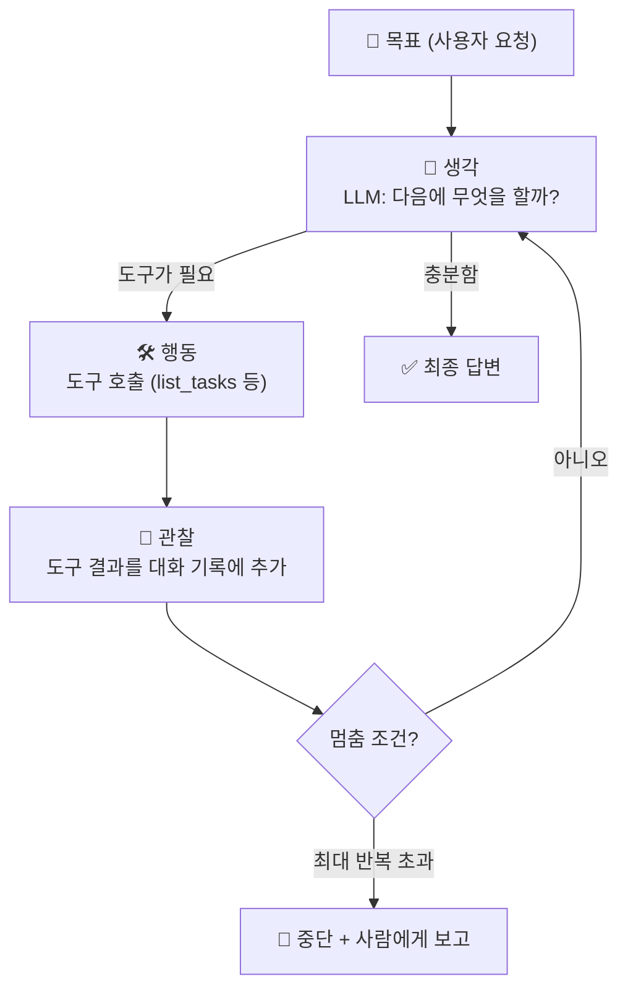
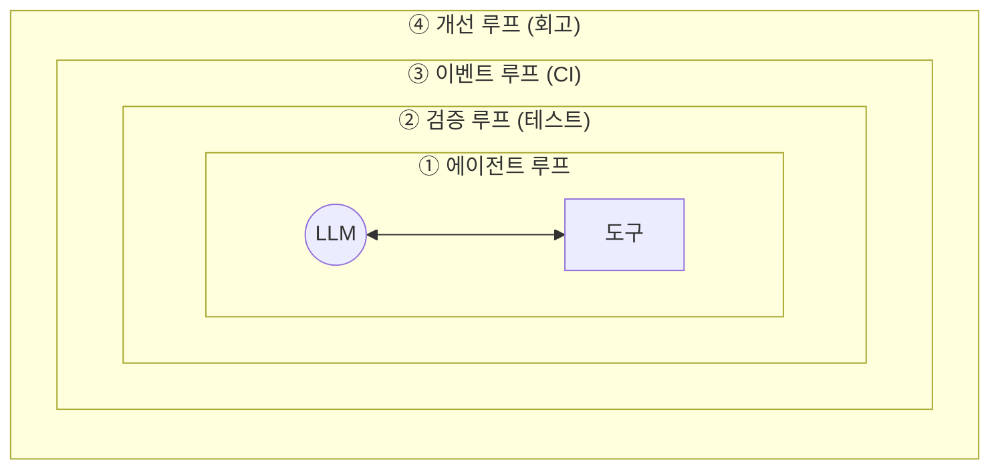
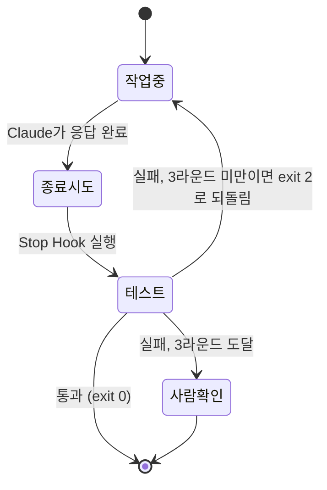
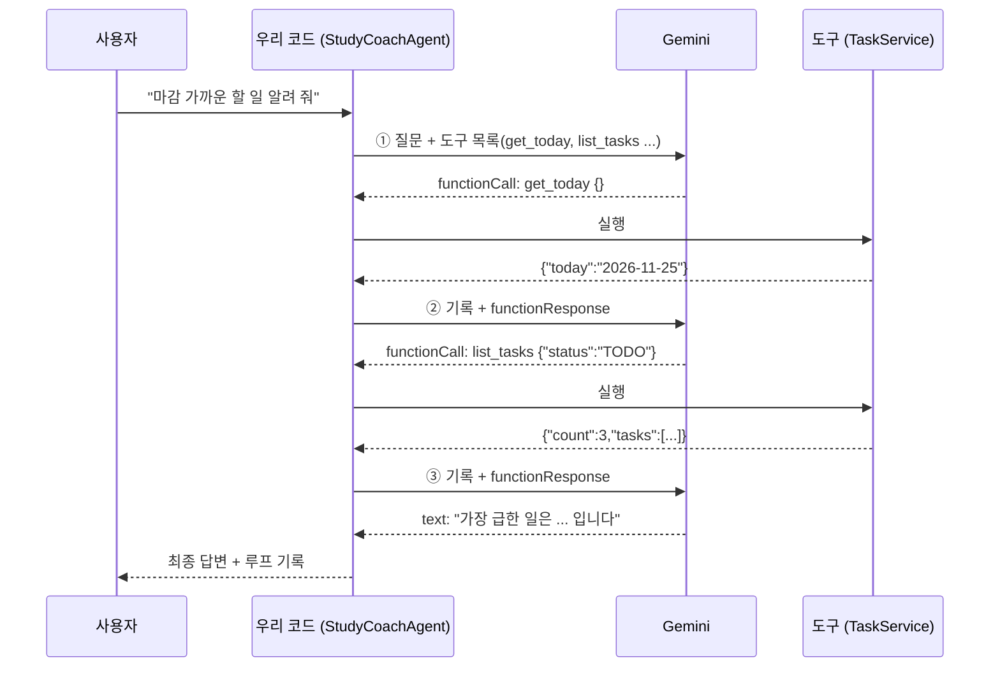
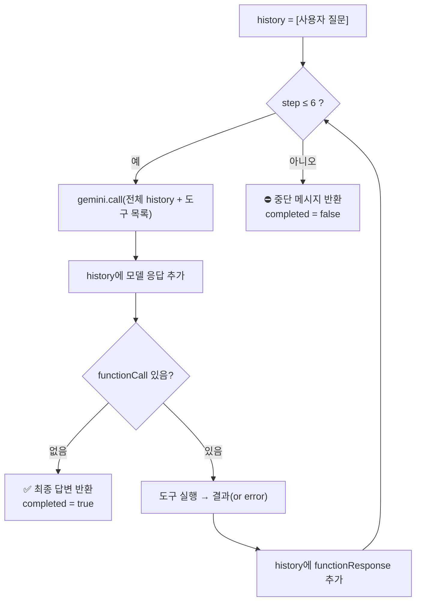
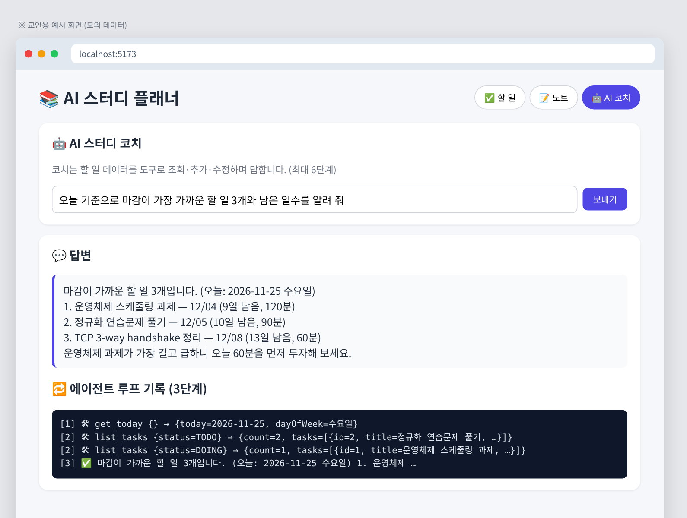
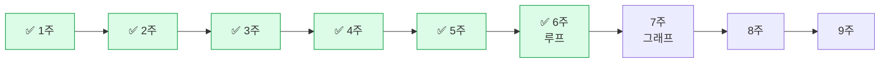

# 6주차 · 루프 엔지니어링 (Loop Engineering)

> **"한 번에 맞히는 AI는 없다. 스스로 확인하고 고치게 만들 뿐이다."**
>
> 지난주 Hook이 컴파일 오류를 돌려주자 Claude가 스스로 고쳤습니다. 오늘은 이 **"행동 → 관찰 → 판단"의 반복을 의도적으로 설계**합니다. 그리고 앱 안에 **도구를 반복 호출하는 AI 스터디 코치 에이전트**를 직접 만듭니다.

---

## 0. 수업 진행표 (3시간)

| 시간 | 내용 | 형태 |
|---|---|---|
| 0:00 ~ 0:40 | 루프의 구조 · 4가지 루프 · 설계 질문 4개 · 실패 패턴 | 설명 |
| 0:40 ~ 1:15 | 실습 A. 개발 루프: Stop Hook 검증기 + 헤드리스 수정 루프 | 실습 |
| 1:15 ~ 1:25 | 휴식 | |
| 1:25 ~ 1:45 | Function Calling 원리 (JSON으로 따라가기) | 설명 |
| 1:45 ~ 2:45 | 실습 B. 앱 루프: AI 스터디 코치 에이전트 구현 + 테스트 | 실습 |
| 2:45 ~ 3:00 | 실습 C. 프론트엔드 코치 화면 · 정리 | 실습 |

## 1. 학습 목표

1. 에이전트 루프(ReAct)의 **생각 → 행동 → 관찰** 구조를 그림으로 설명할 수 있다.
2. 루프 설계의 4가지 질문(**무엇을 재시도 / 무엇으로 검증 / 언제 멈춤 / 언제 사람에게**)에 답할 수 있다.
3. Claude Code의 **Stop Hook**과 **헤드리스 모드(`claude -p`)** 로 "테스트가 통과할 때까지" 도는 개발 루프를 만들 수 있다.
4. Gemini **Function Calling**으로 도구를 반복 호출하는 에이전트 루프를 Java로 직접 구현하고, **가짜 모델로 테스트**할 수 있다.

---

## 2. 개념 ① 루프란 무엇인가

### 2.1 정의

> **루프 엔지니어링**: AI가 목표를 이룰 때까지 **반복 실행되는 흐름**을 설계하고, **검증 방법과 멈춤 조건**을 정하는 일. 개발자의 역할이 "AI에게 지시하는 사람"에서 **"AI를 지시·확인·안내하는 자동 시스템을 설계하는 사람"** 으로 바뀝니다.

### 2.2 비유: 자율주행 로봇 청소기

| 로봇 청소기 | AI 에이전트 |
|---|---|
| 센서로 주변 확인 | **관찰** (도구 결과, 테스트 결과) |
| 어디로 갈지 판단 | **생각** (LLM 추론) |
| 바퀴를 움직임 | **행동** (도구 호출, 파일 수정) |
| 먼지 센서가 "깨끗함" 표시 | **검증 통과 → 종료** |
| 배터리 20% 이하 → 충전대 복귀 | **최대 반복·비용 한도 → 중단** |
| 끼어서 못 움직임 → 앱 알림 | **사람에게 도움 요청** |

> 📖 **용어 풀이 — 에이전트 (Agent)와 루프 (Loop)**
>
> **에이전트**: 한 번 답하고 끝나는 챗봇과 달리, **목표를 이루기 위해 스스로 다음 행동을 정하고 도구를 쓰는** AI 프로그램. Claude Code가 대표적인 예입니다.
>
> **루프**: 프로그래밍의 `for`·`while`처럼 **같은 과정을 반복**하는 구조. 에이전트는 "생각 → 행동 → 관찰"을 반복합니다.
>
> **왜 반복이 필요한가**: 사람도 한 번에 완벽한 코드를 쓰지 못하고 "실행 → 오류 확인 → 수정"을 반복합니다. AI도 마찬가지로, **결과를 보고 고칠 기회**를 줘야 품질이 올라갑니다.

### 2.3 에이전트 루프 (ReAct: Reasoning + Acting)



점화식으로 쓰면:

$$
s_{t+1} = s_t \oplus \text{observe}\big(\text{act}(\text{LLM}(s_t))\big), \qquad \text{종료: } \text{LLM}(s_t) = \text{답변} \ \lor\ t = t_{\max}
$$

* $s_t$: $t$번째 반복 시점의 상태(대화 기록 전체)
* $\oplus$: 기록에 이어 붙이기

> 📖 **용어 풀이 — ReAct**
>
> **Re**asoning(추론) + **Act**ing(행동). 2022년 논문에서 제안된 방식으로, LLM이 "생각을 말로 정리 → 도구로 행동 → 결과를 보고 다시 생각"을 번갈아 하게 합니다. 오늘날 대부분의 에이전트(Claude Code 포함)가 이 구조를 기반으로 합니다.

### 2.4 네 가지 루프 (안쪽부터 바깥쪽으로)

| 루프 | 주기 | 무엇이 반복되나 | 오늘 실습 |
|---|---|---|---|
| **① 에이전트 루프** | 초~분 | 모델 ↔ 도구 호출 | 실습 B (스터디 코치) |
| **② 검증 루프** | 분 | 작업 → 테스트 → 수정 | 실습 A (Stop Hook, 수정 루프) |
| **③ 이벤트 루프** | 시간 | push·PR·일정 같은 **사건**이 루프를 시작 | 5주차 CI, 8주차 배포 |
| **④ 개선 루프** | 일~주 | 실패 기록을 보고 **하네스 자체를 개선** | 회고 → `CLAUDE.md`·Hook 수정 |



### 2.5 루프 설계의 4가지 질문

| 질문 | 나쁜 설계 | 좋은 설계 (오늘 실습) |
|---|---|---|
| **무엇을 재시도?** | 전부 처음부터 | 실패한 부분만, 실패 로그를 근거로 |
| **무엇으로 검증?** | AI의 "다 했습니다" | **테스트 통과**, 도구 결과 (계산형 검증기) |
| **언제 멈춤?** | 될 때까지 무한히 | 검증 통과 **또는** 최대 N회 |
| **언제 사람에게?** | 묻지 않음 | N회 실패 시, 되돌릴 수 없는 작업 전 |

> 📌 **"검증기를 먼저 설계하라."** 검증 방법이 없는 루프는 **확신에 찬 오답**을 반복할 뿐입니다.

### 2.6 비용은 반복 횟수보다 빠르게 늘어난다

루프는 매 반복마다 **이전 기록 전체**를 다시 모델에 보냅니다. 처음 입력이 $T_0$ 토큰이고 반복마다 $\Delta$ 토큰씩 기록이 늘면, $n$번 반복의 총 입력 토큰은:

$$
\text{총 토큰} = \sum_{k=0}^{n-1} (T_0 + k\Delta) = nT_0 + \Delta \cdot \frac{n(n-1)}{2}
$$

$T_0 = 1{,}000$, $\Delta = 500$일 때:

| 반복 $n$ | 총 입력 토큰 |
|---|---|
| 3 | 4,500 |
| 6 | 13,500 |
| 12 | 45,000 |
| 24 | 162,000 |

반복이 2배가 되면 비용은 **3~4배**가 됩니다. 그래서 **최대 반복 횟수**는 선택이 아니라 필수입니다.

### 2.7 루프의 실패 패턴

| 패턴 | 증상 | 대책 |
|---|---|---|
| **무한 루프** | 같은 도구를 계속 호출 | 최대 반복 횟수, 같은 호출 반복 감지 |
| **조기 종료** | 안 끝났는데 "완료했습니다" | 계산형 검증기(테스트)로 종료 판정 |
| **진동** | A 고치면 B 깨지고, B 고치면 A 깨짐 | 전체 테스트로 검증, N회 후 사람에게 |
| **보상 해킹** | 테스트를 **지우거나 건너뛰어** 통과시킴 | 테스트 파일 수정 금지 규칙·Hook, 리뷰 |
| **환각 도구 호출** | 없는 도구·잘못된 인자 | 오류를 관찰 결과로 돌려주어 스스로 수정하게 |

---

> 📖 **용어 풀이 — 보상 해킹 (Reward Hacking)**
>
> **뜻**: AI가 **진짜 목표 대신 "검사 통과"만 노리는** 꼼수. 예: 테스트를 고치라고 했더니 **테스트를 지워서** 통과시킴.
>
> **비유**: "시험 점수 올려"라고 했더니 공부 대신 **채점표를 고치는** 학생.
>
> **대책**: 검사 기준(테스트)을 AI가 못 바꾸게 막고(하네스), 사람이 결과를 리뷰합니다.

## 3. 실습 A. 개발 루프 — "테스트가 통과할 때까지"

### A-1. Stop Hook 검증기

Claude가 **응답을 끝내려는 순간** 테스트를 실행하고, 실패하면 **종료를 막고 오류를 돌려줍니다.** 단, **최대 3라운드**까지만.



> 📖 **용어 풀이 — Stop Hook**
>
> Claude가 **응답을 마치려는 순간** 실행되는 Hook. 5주차의 PostToolUse가 "파일을 고칠 때마다" 검사했다면, Stop은 "**다 했다고 말하기 직전**"에 최종 검사합니다. 종료 코드 2를 돌려주면 Claude는 **끝내지 못하고** 오류를 읽고 계속 작업합니다. → 검증 루프 완성!

#### 🤖 Claude Code 프롬프트 — (선택) Stop Hook 초안 만들기

```text
.claude/hooks/stop-gate.mjs를 만들어 줘 (Node.js ESM, 외부 패키지 없이).
- git status --porcelain으로 변경 파일이 없으면 바로 exit 0
- backend에서 gradlew test -q 실행(Windows면 gradlew.bat), 통과하면 카운터 파일 삭제 후 exit 0
- 실패하면 세션별 카운터(os.tmpdir()의 파일, stdin JSON의 session_id 사용)를 1 올리고,
  "테스트를 삭제·@Disabled 하지 말고 main 코드를 고쳐라" + 로그 마지막 60줄을 stderr로 보내고 exit 2
- 카운터가 3에 도달하면 "사람의 확인이 필요합니다"를 stderr로 보내고 exit 1 (루프 종료)
그리고 .claude/settings.json의 hooks에 Stop 이벤트로 등록해 줘. 기존 Hook은 그대로 둬.
```

#### 📄 참고 코드 — stop-gate.mjs

`.claude/hooks/stop-gate.mjs`

```js
// Stop Hook: 응답을 마치기 전에 백엔드 테스트로 검증한다. (최대 MAX_ROUNDS번 되돌려 보냄)
import { execSync } from 'node:child_process';
import fs from 'node:fs';
import os from 'node:os';
import path from 'node:path';

const MAX_ROUNDS = 3;

let raw = '';
for await (const chunk of process.stdin) raw += chunk;
const data = JSON.parse(raw || '{}');
const root = process.env.CLAUDE_PROJECT_DIR ?? process.cwd();
const counterFile = path.join(os.tmpdir(), `claude-stop-gate-${data.session_id ?? 'default'}.txt`);

// 변경된 파일이 없으면 검증할 것도 없다
const changed = execSync('git status --porcelain', { cwd: root }).toString().trim();
if (!changed) process.exit(0);

const round = fs.existsSync(counterFile) ? Number(fs.readFileSync(counterFile, 'utf8')) : 0;
const isWindows = process.platform === 'win32';

try {
  execSync(isWindows ? 'gradlew.bat test -q' : './gradlew test -q', {
    cwd: path.join(root, 'backend'),
    stdio: 'pipe',
    timeout: 600_000,
  });
  fs.rmSync(counterFile, { force: true });   // 통과: 카운터 초기화
  process.exit(0);
} catch (e) {
  const log = `${e.stdout ?? ''}${e.stderr ?? ''}`.split('\n').slice(-60).join('\n');
  if (round >= MAX_ROUNDS) {
    fs.rmSync(counterFile, { force: true });
    console.error(`[루프 검증기] ${MAX_ROUNDS}회 수정 후에도 테스트가 실패합니다. 사람의 확인이 필요합니다.`);
    process.exit(1);                          // 루프 종료 → 사람에게
  }
  fs.writeFileSync(counterFile, String(round + 1));
  console.error(
    `[루프 검증기 ${round + 1}/${MAX_ROUNDS}] 백엔드 테스트가 실패했습니다.\n` +
      `테스트 코드를 삭제하거나 @Disabled로 건너뛰지 말고, main 코드의 원인을 고치세요.\n${log}`,
  );
  process.exit(2);                            // 종료 차단 → Claude가 계속 작업
}
```

#### 📄 참고 코드 — settings.json에 추가할 부분

`.claude/settings.json`의 `hooks`에 **Stop** 이벤트를 추가합니다. (기존 PreToolUse·PostToolUse는 그대로, `"PostToolUse": [...]` 뒤에 쉼표를 찍고 추가)

```json
    "Stop": [
      {
        "hooks": [
          { "type": "command", "command": "node \"$CLAUDE_PROJECT_DIR/.claude/hooks/stop-gate.mjs\"", "timeout": 600 }
        ]
      }
    ]
```

`CLAUDE.md`에도 한 줄 추가합니다. (가이드 + 센서 = 이중 장치)

```markdown
- 테스트를 통과시키기 위해 테스트 코드를 삭제·수정·@Disabled 처리하지 않는다. 테스트 변경이 필요하면 먼저 묻는다.
```

### A-2. 버그 심기 실험

일부러 버그를 심고 루프가 고치는지 봅니다.

#### ⌨️ 직접 실행 — 버그 심기 (AI 몰래, 편집기로 직접)

`Tokenizer.java`에서 한 글자를 바꿉니다.

```java
// 원래:  for (int i = 0; i + 2 <= word.length(); i++) {
for (int i = 0; i + 2 < word.length(); i++) {   // 🐛 마지막 2-그램을 빠뜨림
```

```bash
cd backend && ./gradlew test     # AiServiceTest가 실패하는지 먼저 확인
```

#### 🤖 Claude Code 프롬프트 — 버그를 알려 주지 않고 다른 일 시키기

Claude Code를 **다시 시작**(Hook 반영)한 뒤, 버그 얘기는 하지 않고 다른 일을 시킵니다.

```text
TaskService에 마감일이 지난 할 일 개수를 세는 countOverdue() 메서드를 추가해 줘.
```

#### ✅ 결과 확인 — Stop Hook이 루프를 만드는 모습 (예시)

```text
● countOverdue() 메서드를 추가했습니다. 마감일이 오늘보다 이전이고 DONE이 아닌 할 일 개수를 셉니다.

  ⎿ Stop hook feedback:
    [루프 검증기 1/3] 백엔드 테스트가 실패했습니다.
    테스트 코드를 삭제하거나 @Disabled로 건너뛰지 말고, main 코드의 원인을 고치세요.
    AiServiceTest > 관련_노트가_있으면_노트를_컨텍스트에_넣어_LLM을_한번_호출한다() FAILED
        java.lang.AssertionError: Expecting actual not to be empty

● 테스트가 실패해서 원인을 찾겠습니다. 이번 변경과는 무관한 AiServiceTest가 실패합니다.
● Read(backend/src/main/java/com/example/planner/ai/rag/Tokenizer.java)
● 2-그램을 만드는 반복 조건이 `i + 2 < word.length()`라서 마지막 2글자를 빠뜨립니다. `<=`로 고치겠습니다.
● Update(Tokenizer.java)
● 수정 후 테스트가 모두 통과했습니다.
```

관찰 포인트:

1. Claude가 작업을 마치려 할 때 Stop Hook이 테스트 실패를 돌려주는가?
2. Claude가 **테스트를 고치려 하는가, main 코드를 고치려 하는가?** (보상 해킹 여부)
3. 몇 라운드 만에 통과하는가?

### A-3. 헤드리스 수정 루프 (`claude -p`)

Claude Code는 대화창 없이 **명령 한 줄로 실행**할 수도 있습니다(헤드리스 모드). 이를 셸 스크립트의 `for` 문에 넣으면 **루프를 코드로 설계**할 수 있습니다.

> 📖 **용어 풀이 — 헤드리스 (Headless) 모드**
>
> **뜻**: 화면(대화창) 없이 **명령 한 줄로 실행하고 결과만 받는** 방식. `claude -p "지시"`처럼 씁니다. (`-p` = print, 결과를 출력하고 종료)
>
> **왜 쓰나**: 사람이 대화하지 않아도 되므로 **스크립트·CI·예약 작업** 안에 AI를 넣을 수 있습니다. 루프를 "사람의 대화"가 아니라 **코드로 설계**하는 첫걸음입니다.
>
> **`--allowedTools`**: 이 실행에서 쓸 수 있는 도구를 제한합니다. 사람이 지켜보지 않으므로 **권한을 더 좁게** 주는 것이 원칙입니다.

#### 📄 참고 코드 — fix-loop.sh (이 파일은 사람이 직접 작성·검토 권장)

`scripts/fix-loop.sh`

```bash
#!/usr/bin/env bash
# 테스트가 통과할 때까지 Claude Code를 헤드리스로 반복 실행한다. (최대 MAX회)
set -u
MAX=${1:-3}
LOG=$(mktemp)
cd "$(dirname "$0")/../backend"

for i in $(seq 1 "$MAX"); do
  echo "=== [$i/$MAX] 테스트 실행 ==="
  if ./gradlew test -q > "$LOG" 2>&1; then
    echo "✅ 테스트 통과! (수정 시도 $((i - 1))회)"
    exit 0
  fi
  echo "❌ 실패 → Claude에게 수정 요청"
  tail -n 60 "$LOG" | claude -p \
    "위 입력은 backend 테스트 실패 로그다. 테스트 코드는 수정하지 말고 main 코드의 원인을 찾아 최소한으로 고쳐라. 고친 내용을 3줄로 요약하라." \
    --allowedTools "Read,Edit,Grep,Glob,Bash(./gradlew test:*)"
done

echo "⛔ ${MAX}회 반복 후에도 실패했습니다. 사람이 확인하세요."
exit 1
```

#### ⌨️ 직접 실행 — 버그를 다시 심고 수정 루프 돌리기

A-2에서 버그가 이미 고쳐졌다면 `Tokenizer.java`에 같은 버그를 **다시 심은 뒤** 실행합니다.

```bash
chmod +x scripts/fix-loop.sh
./scripts/fix-loop.sh 3
```

#### ✅ 결과 확인 (예시)

```text
=== [1/3] 테스트 실행 ===
❌ 실패 → Claude에게 수정 요청
Tokenizer.java의 2-그램 반복 조건(i + 2 < length)이 마지막 글자 쌍을 빠뜨리고 있었습니다.
조건을 i + 2 <= length로 수정했습니다.
테스트 코드는 변경하지 않았습니다.
=== [2/3] 테스트 실행 ===
✅ 테스트 통과! (수정 시도 1회)
```

| 구성 요소 | 스크립트의 어느 부분? |
|---|---|
| 검증기 | `./gradlew test` |
| 재시도 대상 | 실패 로그 마지막 60줄 |
| 멈춤 조건 | 통과 또는 `MAX`회 |
| 사람에게 넘김 | 마지막 `exit 1` 메시지 |
| 권한 제한(하네스) | `--allowedTools` |

> ⚠️ Windows는 Git Bash 또는 WSL에서 실행하세요. 실험이 끝나면 심은 버그가 고쳐졌는지 `git diff`로 확인하고 커밋합니다.

---

## 4. 개념 ② Function Calling — LLM이 "도구"를 쓰는 원리

### 4.1 오해와 진실

> ❌ "LLM이 직접 DB를 조회한다"
>
> ✅ LLM은 **"이 도구를 이런 인자로 불러 주세요"라는 JSON을 출력**할 뿐이고, **실제 실행은 우리 코드**가 합니다. 그 결과를 다시 LLM에게 보여 주는 것을 반복하는 것이 에이전트 루프입니다.



> 📖 **용어 풀이 — Function Calling (함수 호출 / 도구 호출)**
>
> **뜻**: LLM에게 "이런 함수(도구)들이 있다"고 **설명서를 주면**, LLM이 필요할 때 **"이 함수를 이 인자로 불러 줘"라는 JSON**을 출력하는 기능.
>
> **비유**: 레스토랑 손님(LLM)이 메뉴판(도구 설명서)을 보고 **주문서**(functionCall)를 쓰면, 주방(우리 코드)이 요리(실행)해서 가져다주는 것.
>
> **왜 쓰나**: LLM은 **오늘 날짜도, 우리 DB도 모릅니다.** 도구를 주면 추측 대신 **실제 데이터를 확인**하고, 할 일 추가처럼 **실제 행동**도 할 수 있습니다.

### 4.2 JSON으로 따라가기

**① 요청: 도구 목록을 함께 보낸다**

```json
{
  "systemInstruction": { "parts": [{ "text": "너는 AI 스터디 코치다 ..." }] },
  "contents": [
    { "role": "user", "parts": [{ "text": "마감 가까운 할 일 알려 줘" }] }
  ],
  "tools": [{
    "functionDeclarations": [
      { "name": "get_today", "description": "오늘 날짜와 요일을 알려 준다." },
      {
        "name": "list_tasks",
        "description": "할 일 목록을 조회한다.",
        "parameters": {
          "type": "object",
          "properties": {
            "status": { "type": "string", "enum": ["TODO", "DOING", "DONE"] }
          }
        }
      }
    ]
  }]
}
```

**② 응답: 텍스트 대신 "도구 호출 요청"이 온다**

```json
{
  "candidates": [{
    "content": {
      "role": "model",
      "parts": [{ "functionCall": { "name": "get_today", "args": {} }, "thoughtSignature": "..." }]
    }
  }]
}
```

**③ 다음 요청: 모델의 응답을 기록에 그대로 넣고, 도구 결과를 덧붙인다**

```json
"contents": [
  { "role": "user",  "parts": [{ "text": "마감 가까운 할 일 알려 줘" }] },
  { "role": "model", "parts": [{ "functionCall": { "name": "get_today", "args": {} }, "thoughtSignature": "..." }] },
  { "role": "user",  "parts": [{ "functionResponse": { "name": "get_today", "response": { "today": "2026-11-25", "dayOfWeek": "수요일" } } }] }
]
```

> ⚠️ 최신 Gemini 모델은 응답에 `thoughtSignature`(사고 과정 서명)를 붙일 수 있고, 다음 요청에 **모델 응답을 원본 그대로** 돌려보내야 합니다. 그래서 우리 코드는 모델 응답(`Content`)을 **손대지 않고** 기록에 추가합니다. (3주차 `Part` record에 `thoughtSignature` 필드를 넣어 둔 이유!)

### 4.3 좋은 도구 설계 원칙

| 원칙 | 예 |
|---|---|
| 이름은 **동사_명사** | `list_tasks`, `create_task` |
| 설명에 **언제 쓰는지** 적기 | "날짜 계산이 필요할 때 먼저 호출한다" |
| 인자는 **최소한**, 가능하면 `enum` | `status: TODO/DOING/DONE` |
| 결과는 **작고 구조화된 JSON** | 필요한 필드만, 개수 포함 |
| 실패해도 **예외 대신 오류 JSON** | `{"error": "id=99 할 일 없음"}` → 모델이 스스로 수정 |
| 위험한 도구는 **만들지 않거나** 확인 단계 | 전체 삭제 도구는 제공하지 않음 |

---

## 5. 실습 B. AI 스터디 코치 에이전트 구현

#### 🤖 Claude Code 프롬프트 — 에이전트 구현 (계획 모드 권장)

```text
앱 안에 Gemini Function Calling으로 도구를 반복 호출하는 "AI 스터디 코치" 에이전트를 만들어 줘.
1. ai.gemini.GeminiApi 인터페이스(call(GeminiRequest) → GeminiResponse)를 만들고 GeminiClient가 구현하게 해.
2. agent.AgentTool 인터페이스: name, description, parameters(JSON Schema Map, 인자 없으면 null), execute(args), declaration()
3. agent.tools: get_today(오늘 날짜·요일, Asia/Seoul), list_tasks(status 선택), create_task(title 필수, subject, dueDate, estimatedMinutes),
   update_task_status(id, status). 결과는 작은 Map, null 값은 빈 문자열
4. agent.StudyCoachAgent: 최대 6단계 루프. 매 단계 전체 기록을 보내고, 모델 응답은 원본 그대로 기록에 추가(thoughtSignature 보존),
   functionCall이 없으면 최종 답변으로 종료, 있으면 모두 실행해서 functionResponse를 role=user로 추가.
   도구 예외·없는 도구는 {"error": ...}로 돌려준다. 단계별 기록(AgentStep)을 결과에 포함.
5. POST /api/ai/coach {message} → {answer, steps, completed}
6. 진짜 모델 없이 각본대로 응답하는 가짜 GeminiApi로 StudyCoachAgentTest 작성(정상 종료, 최대 반복 중단, 없는 도구)
```

### B-1. 📄 참고 — 파일 구성
### B-1. 파일 구성

```text
backend/src/main/java/com/example/planner/
├── ai/gemini/
│   ├── GeminiApi.java            # (신규) generateContent 호출 인터페이스
│   └── GeminiClient.java         # implements GeminiApi 추가
└── agent/
    ├── AgentTool.java            # 도구 인터페이스
    ├── AgentStep.java            # 루프 기록 1줄
    ├── AgentResult.java          # 최종 결과
    ├── StudyCoachAgent.java      # ★ 에이전트 루프
    ├── AgentController.java      # POST /api/ai/coach
    └── tools/
        ├── GetTodayTool.java
        ├── ListTasksTool.java
        ├── CreateTaskTool.java
        └── UpdateTaskStatusTool.java
```

### B-2. 📄 참고 코드 — GeminiApi 인터페이스 (테스트 가능하게 만들기)

`ai/gemini/GeminiApi.java`

```java
package com.example.planner.ai.gemini;

import com.example.planner.ai.gemini.GeminiDtos.GeminiRequest;
import com.example.planner.ai.gemini.GeminiDtos.GeminiResponse;

/** Gemini generateContent 호출. 테스트에서는 각본대로 응답하는 가짜로 교체한다. */
@FunctionalInterface
public interface GeminiApi {

    GeminiResponse call(GeminiRequest request);
}
```

`ai/gemini/GeminiClient.java` — 클래스 선언과 `call` 메서드만 바꿉니다.

```java
public class GeminiClient implements LlmClient, GeminiApi {
    // ...
    @Override
    public GeminiResponse call(GeminiRequest request) {
        // (기존 코드 그대로)
    }
```

### B-3. 📄 참고 코드 — 도구 정의

> 📖 **용어 풀이 — JSON Schema**
>
> 데이터의 **모양을 설명하는 규칙**. `{"type": "object", "properties": {"status": {"type": "string", "enum": [...]}}}`는 "status라는 문자열 필드가 있고 값은 셋 중 하나"라는 뜻입니다. LLM은 이 설명을 보고 **올바른 인자**를 만듭니다.

`agent/AgentTool.java`

```java
package com.example.planner.agent;

import java.util.Map;

import com.example.planner.ai.gemini.GeminiDtos.FunctionDeclaration;

/** 에이전트가 사용할 수 있는 도구 하나 */
public interface AgentTool {

    /** 모델이 부를 이름 (동사_명사) */
    String name();

    /** 언제·왜 쓰는지 — 모델은 이 설명을 보고 도구를 고른다 */
    String description();

    /** 인자 JSON Schema. 인자가 없으면 null */
    Map<String, Object> parameters();

    /** 실제 실행. 결과는 모델에게 보여 줄 작은 JSON(Map) */
    Map<String, Object> execute(Map<String, Object> args);

    default FunctionDeclaration declaration() {
        return new FunctionDeclaration(name(), description(), parameters());
    }
}
```

`agent/tools/GetTodayTool.java`

```java
package com.example.planner.agent.tools;

import java.time.LocalDate;
import java.time.ZoneId;
import java.time.format.TextStyle;
import java.util.Locale;
import java.util.Map;

import org.springframework.stereotype.Component;

import com.example.planner.agent.AgentTool;

@Component
public class GetTodayTool implements AgentTool {

    @Override
    public String name() {
        return "get_today";
    }

    @Override
    public String description() {
        return "오늘 날짜(YYYY-MM-DD)와 요일을 알려 준다. 날짜·마감 계산이 필요하면 가장 먼저 호출한다.";
    }

    @Override
    public Map<String, Object> parameters() {
        return null; // 인자 없음 (Gemini는 빈 properties를 허용하지 않으므로 생략)
    }

    @Override
    public Map<String, Object> execute(Map<String, Object> args) {
        LocalDate today = LocalDate.now(ZoneId.of("Asia/Seoul"));
        return Map.of(
                "today", today.toString(),
                "dayOfWeek", today.getDayOfWeek().getDisplayName(TextStyle.FULL, Locale.KOREAN));
    }
}
```

`agent/tools/ListTasksTool.java`

```java
package com.example.planner.agent.tools;

import java.util.LinkedHashMap;
import java.util.List;
import java.util.Map;

import org.springframework.stereotype.Component;

import com.example.planner.agent.AgentTool;
import com.example.planner.task.TaskResponse;
import com.example.planner.task.TaskService;
import com.example.planner.task.TaskStatus;

@Component
public class ListTasksTool implements AgentTool {

    private final TaskService taskService;

    public ListTasksTool(TaskService taskService) {
        this.taskService = taskService;
    }

    @Override
    public String name() {
        return "list_tasks";
    }

    @Override
    public String description() {
        return "학생의 할 일 목록을 마감일 순으로 조회한다. status로 필터링할 수 있고, 생략하면 전체를 조회한다.";
    }

    @Override
    public Map<String, Object> parameters() {
        return Map.of(
                "type", "object",
                "properties", Map.of(
                        "status", Map.of(
                                "type", "string",
                                "enum", List.of("TODO", "DOING", "DONE"),
                                "description", "조회할 상태 (선택)")));
    }

    @Override
    public Map<String, Object> execute(Map<String, Object> args) {
        Object status = args.get("status");
        List<TaskResponse> tasks = status == null
                ? taskService.findAll()
                : taskService.findByStatus(TaskStatus.valueOf(status.toString()));
        return Map.of("count", tasks.size(), "tasks", tasks.stream().map(ListTasksTool::toMap).toList());
    }

    /** 모델에게 보여 줄 형태로 변환 (null 값은 빈 문자열로) */
    static Map<String, Object> toMap(TaskResponse t) {
        Map<String, Object> m = new LinkedHashMap<>();
        m.put("id", t.id());
        m.put("title", t.title());
        m.put("subject", t.subject() == null ? "" : t.subject());
        m.put("dueDate", t.dueDate() == null ? "" : t.dueDate().toString());
        m.put("status", t.status().name());
        m.put("estimatedMinutes", t.estimatedMinutes());
        return m;
    }
}
```

`agent/tools/CreateTaskTool.java`

```java
package com.example.planner.agent.tools;

import java.time.LocalDate;
import java.util.List;
import java.util.Map;

import org.springframework.stereotype.Component;

import com.example.planner.agent.AgentTool;
import com.example.planner.task.TaskRequest;
import com.example.planner.task.TaskResponse;
import com.example.planner.task.TaskService;

@Component
public class CreateTaskTool implements AgentTool {

    private final TaskService taskService;

    public CreateTaskTool(TaskService taskService) {
        this.taskService = taskService;
    }

    @Override
    public String name() {
        return "create_task";
    }

    @Override
    public String description() {
        return "새 할 일을 등록한다. 사용자가 명확히 추가를 요청했을 때만 사용한다.";
    }

    @Override
    public Map<String, Object> parameters() {
        return Map.of(
                "type", "object",
                "properties", Map.of(
                        "title", Map.of("type", "string", "description", "할 일 제목 (100자 이내)"),
                        "subject", Map.of("type", "string", "description", "과목명"),
                        "dueDate", Map.of("type", "string", "description", "마감일 YYYY-MM-DD"),
                        "estimatedMinutes", Map.of("type", "integer", "description", "예상 소요 시간(분), 0~600")),
                "required", List.of("title"));
    }

    @Override
    public Map<String, Object> execute(Map<String, Object> args) {
        String title = String.valueOf(args.get("title"));
        String subject = args.get("subject") == null ? null : args.get("subject").toString();
        LocalDate dueDate = args.get("dueDate") == null || args.get("dueDate").toString().isBlank()
                ? null : LocalDate.parse(args.get("dueDate").toString());
        int minutes = args.get("estimatedMinutes") instanceof Number n ? n.intValue() : 60;

        TaskResponse created = taskService.create(new TaskRequest(title, subject, dueDate, minutes));
        return Map.of("created", ListTasksTool.toMap(created));
    }
}
```

`agent/tools/UpdateTaskStatusTool.java`

```java
package com.example.planner.agent.tools;

import java.util.List;
import java.util.Map;

import org.springframework.stereotype.Component;

import com.example.planner.agent.AgentTool;
import com.example.planner.task.TaskResponse;
import com.example.planner.task.TaskService;
import com.example.planner.task.TaskStatus;

@Component
public class UpdateTaskStatusTool implements AgentTool {

    private final TaskService taskService;

    public UpdateTaskStatusTool(TaskService taskService) {
        this.taskService = taskService;
    }

    @Override
    public String name() {
        return "update_task_status";
    }

    @Override
    public String description() {
        return "할 일의 상태를 바꾼다. id는 반드시 list_tasks 결과에서 확인한 값을 사용한다.";
    }

    @Override
    public Map<String, Object> parameters() {
        return Map.of(
                "type", "object",
                "properties", Map.of(
                        "id", Map.of("type", "integer", "description", "할 일 id"),
                        "status", Map.of("type", "string", "enum", List.of("TODO", "DOING", "DONE"))),
                "required", List.of("id", "status"));
    }

    @Override
    public Map<String, Object> execute(Map<String, Object> args) {
        long id = ((Number) args.get("id")).longValue();
        TaskStatus status = TaskStatus.valueOf(args.get("status").toString());
        TaskResponse updated = taskService.changeStatus(id, status);
        return Map.of("updated", ListTasksTool.toMap(updated));
    }
}
```

### B-4. 📄 참고 코드 — 루프 기록과 결과

`agent/AgentStep.java`

```java
package com.example.planner.agent;

/**
 * 루프 기록 한 줄.
 * @param type TOOL(도구 호출) / ANSWER(최종 답변) / STOP(강제 중단)
 */
public record AgentStep(int step, String type, String action, String observation) {
}
```

`agent/AgentResult.java`

```java
package com.example.planner.agent;

import java.util.List;

/** @param completed false면 멈춤 조건(최대 반복)으로 중단된 것 */
public record AgentResult(String answer, List<AgentStep> steps, boolean completed) {
}
```

### B-5. 📄 참고 코드 — ★ 에이전트 루프

코드를 읽기 전에 흐름부터 봅시다.



`agent/StudyCoachAgent.java`

```java
package com.example.planner.agent;

import java.util.ArrayList;
import java.util.List;
import java.util.Map;
import java.util.Objects;
import java.util.function.Function;
import java.util.stream.Collectors;

import org.springframework.stereotype.Service;

import com.example.planner.ai.gemini.GeminiApi;
import com.example.planner.ai.gemini.GeminiDtos.Content;
import com.example.planner.ai.gemini.GeminiDtos.FunctionCall;
import com.example.planner.ai.gemini.GeminiDtos.GeminiRequest;
import com.example.planner.ai.gemini.GeminiDtos.GenerationConfig;
import com.example.planner.ai.gemini.GeminiDtos.Part;
import com.example.planner.ai.gemini.GeminiDtos.Tool;

@Service
public class StudyCoachAgent {

    /** 멈춤 조건: 최대 반복 횟수 (무료 등급 한도와 비용을 고려) */
    static final int MAX_STEPS = 6;

    private static final String SYSTEM_PROMPT = """
            너는 대학생을 돕는 'AI 스터디 코치'다. 학생의 할 일 데이터를 도구로 조회·추가·수정하며 돕는다.

            [규칙]
            - 날짜 계산이 필요하면 반드시 get_today를 먼저 호출한다. 날짜를 추측하지 않는다.
            - 할 일에 대해 답하기 전에 반드시 list_tasks로 실제 데이터를 확인한다. 없는 할 일을 지어내지 않는다.
            - 할 일 추가·상태 변경은 사용자가 요청했을 때만 한다.
            - 도구가 error를 돌려주면 원인을 고려해 인자를 고치거나, 사용자에게 필요한 정보를 묻는다.
            - 필요한 도구 호출이 끝나면 한국어로 간결하게 최종 답변한다. 일정 제안은 목록으로 정리한다.
            """;

    private final GeminiApi gemini;
    private final Map<String, AgentTool> tools;

    public StudyCoachAgent(GeminiApi gemini, List<AgentTool> toolList) {
        this.gemini = gemini;
        this.tools = toolList.stream().collect(Collectors.toMap(AgentTool::name, Function.identity()));
    }

    public AgentResult run(String userMessage) {
        List<Content> history = new ArrayList<>();
        history.add(Content.user(userMessage));
        List<AgentStep> steps = new ArrayList<>();
        List<Tool> toolSpecs = List.of(new Tool(tools.values().stream().map(AgentTool::declaration).toList()));

        for (int step = 1; step <= MAX_STEPS; step++) {
            // 🧠 생각: 지금까지의 기록 전체를 보내고 다음 행동을 묻는다
            GeminiRequest request = new GeminiRequest(
                    Content.system(SYSTEM_PROMPT), List.copyOf(history), toolSpecs, new GenerationConfig(0.2, null));
            Content modelTurn = gemini.call(request).firstContent();
            history.add(modelTurn);   // thoughtSignature가 담긴 원본 그대로 보관

            List<FunctionCall> calls = modelTurn.parts() == null ? List.of()
                    : modelTurn.parts().stream().map(Part::functionCall).filter(Objects::nonNull).toList();

            // ✅ 도구 호출이 없으면 = 최종 답변 → 루프 종료
            if (calls.isEmpty()) {
                String answer = modelTurn.joinedText();
                steps.add(new AgentStep(step, "ANSWER", null, answer));
                return new AgentResult(answer, steps, true);
            }

            // 🛠 행동 + 👀 관찰: 요청된 도구를 모두 실행하고 결과를 기록에 추가
            List<Part> results = new ArrayList<>();
            for (FunctionCall call : calls) {
                Map<String, Object> output = execute(call);
                steps.add(new AgentStep(step, "TOOL",
                        call.name() + " " + (call.args() == null ? "{}" : call.args()), String.valueOf(output)));
                results.add(Part.ofFunctionResponse(call.id(), call.name(), output));
            }
            history.add(new Content("user", results));
        }

        // ⛔ 멈춤 조건: 최대 반복 도달
        String message = "최대 반복 횟수(" + MAX_STEPS + "회)에 도달해 작업을 멈췄습니다. 요청을 더 작게 나눠 주세요.";
        steps.add(new AgentStep(MAX_STEPS, "STOP", null, message));
        return new AgentResult(message, steps, false);
    }

    /** 도구 실행. 실패해도 예외를 던지지 않고 오류를 '관찰 결과'로 돌려준다 */
    private Map<String, Object> execute(FunctionCall call) {
        AgentTool tool = tools.get(call.name());
        if (tool == null) {
            return Map.of("error", "존재하지 않는 도구입니다: " + call.name());
        }
        try {
            return tool.execute(call.args() == null ? Map.of() : call.args());
        } catch (RuntimeException e) {
            return Map.of("error", e.getClass().getSimpleName() + ": " + String.valueOf(e.getMessage()));
        }
    }
}
```

코드와 루프 개념의 대응:

| 루프 개념 | 코드 위치 |
|---|---|
| 상태 $s_t$ | `history` (대화 기록) |
| 생각 | `gemini.call(request)` |
| 행동 | `execute(call)` |
| 관찰 | `history.add(new Content("user", results))` |
| 종료(성공) | `calls.isEmpty()` → 답변 반환 |
| 종료(한도) | `for` 문 `MAX_STEPS` |
| 오류 복구 | 예외 → `{"error": ...}` 관찰 결과 |
| 추적 가능성 | `steps` (화면에 표시) |

### B-6. 📄 참고 코드 — 컨트롤러

`agent/AgentController.java`

```java
package com.example.planner.agent;

import org.springframework.web.bind.annotation.PostMapping;
import org.springframework.web.bind.annotation.RequestBody;
import org.springframework.web.bind.annotation.RequestMapping;
import org.springframework.web.bind.annotation.RestController;

import jakarta.validation.Valid;
import jakarta.validation.constraints.NotBlank;
import jakarta.validation.constraints.Size;

@RestController
@RequestMapping("/api/ai")
public class AgentController {

    private final StudyCoachAgent agent;

    public AgentController(StudyCoachAgent agent) {
        this.agent = agent;
    }

    public record CoachRequest(@NotBlank @Size(max = 500) String message) {
    }

    @PostMapping("/coach")
    public AgentResult coach(@Valid @RequestBody CoachRequest request) {
        return agent.run(request.message());
    }
}
```

### B-7. 📄 참고 코드 — 루프 테스트: 각본대로 움직이는 가짜 Gemini

진짜 모델 없이도 **루프의 논리**(도구 실행, 기록 전달, 멈춤 조건)를 검증할 수 있습니다.

`backend/src/test/java/com/example/planner/agent/StudyCoachAgentTest.java`

```java
package com.example.planner.agent;

import static org.assertj.core.api.Assertions.assertThat;

import java.util.ArrayDeque;
import java.util.ArrayList;
import java.util.Deque;
import java.util.List;
import java.util.Map;

import org.junit.jupiter.api.Test;

import com.example.planner.ai.gemini.GeminiApi;
import com.example.planner.ai.gemini.GeminiDtos.Candidate;
import com.example.planner.ai.gemini.GeminiDtos.Content;
import com.example.planner.ai.gemini.GeminiDtos.FunctionCall;
import com.example.planner.ai.gemini.GeminiDtos.GeminiRequest;
import com.example.planner.ai.gemini.GeminiDtos.GeminiResponse;
import com.example.planner.ai.gemini.GeminiDtos.Part;

class StudyCoachAgentTest {

    /** 정해진 응답을 순서대로 돌려주는 가짜 Gemini */
    static class ScriptedGemini implements GeminiApi {
        final Deque<GeminiResponse> script = new ArrayDeque<>();
        final List<GeminiRequest> received = new ArrayList<>();

        @Override
        public GeminiResponse call(GeminiRequest request) {
            received.add(request);
            return script.poll();
        }
    }

    /** 호출 횟수를 세는 가짜 도구 */
    static class FakeTodayTool implements AgentTool {
        int calls;
        public String name() { return "get_today"; }
        public String description() { return "오늘 날짜"; }
        public Map<String, Object> parameters() { return null; }
        public Map<String, Object> execute(Map<String, Object> args) {
            calls++;
            return Map.of("today", "2026-11-25");
        }
    }

    static GeminiResponse text(String text) {
        return new GeminiResponse(List.of(new Candidate(new Content("model", List.of(Part.ofText(text))), "STOP")));
    }

    static GeminiResponse toolCall(String name) {
        Part part = new Part(null, null, new FunctionCall(null, name, Map.of()), null, null);
        return new GeminiResponse(List.of(new Candidate(new Content("model", List.of(part)), "STOP")));
    }

    @Test
    void 도구를_호출하고_결과를_전달한_뒤_최종답변으로_끝난다() {
        ScriptedGemini gemini = new ScriptedGemini();
        gemini.script.add(toolCall("get_today"));
        gemini.script.add(text("오늘은 2026-11-25입니다."));
        FakeTodayTool tool = new FakeTodayTool();

        AgentResult result = new StudyCoachAgent(gemini, List.of(tool)).run("오늘 며칠이야?");

        assertThat(result.completed()).isTrue();
        assertThat(result.answer()).contains("2026-11-25");
        assertThat(tool.calls).isEqualTo(1);
        assertThat(gemini.received).hasSize(2);
        // 두 번째 요청의 세 번째 메시지 = 도구 실행 결과(functionResponse)
        Part observation = gemini.received.get(1).contents().get(2).parts().get(0);
        assertThat(observation.functionResponse().name()).isEqualTo("get_today");
        assertThat(observation.functionResponse().response()).containsEntry("today", "2026-11-25");
    }

    @Test
    void 모델이_도구만_계속_호출하면_최대반복에서_멈춘다() {
        GeminiApi alwaysTool = request -> toolCall("get_today");
        FakeTodayTool tool = new FakeTodayTool();

        AgentResult result = new StudyCoachAgent(alwaysTool, List.of(tool)).run("무한 루프 유도");

        assertThat(result.completed()).isFalse();
        assertThat(tool.calls).isEqualTo(StudyCoachAgent.MAX_STEPS);
        assertThat(result.steps().get(result.steps().size() - 1).type()).isEqualTo("STOP");
    }

    @Test
    void 없는_도구를_부르면_오류를_관찰결과로_돌려주고_루프는_계속된다() {
        ScriptedGemini gemini = new ScriptedGemini();
        gemini.script.add(toolCall("delete_everything"));
        gemini.script.add(text("그 작업은 할 수 없습니다."));

        AgentResult result = new StudyCoachAgent(gemini, List.of(new FakeTodayTool())).run("다 지워");

        assertThat(result.completed()).isTrue();
        assertThat(result.steps().get(0).observation()).contains("존재하지 않는 도구");
    }
}
```

#### ⌨️ 직접 실행

```bash
cd backend && ./gradlew test
```

#### ✅ 결과 확인

```text
StudyCoachAgentTest > 도구를_호출하고_결과를_전달한_뒤_최종답변으로_끝난다() PASSED
StudyCoachAgentTest > 모델이_도구만_계속_호출하면_최대반복에서_멈춘다() PASSED
StudyCoachAgentTest > 없는_도구를_부르면_오류를_관찰결과로_돌려주고_루프는_계속된다() PASSED
BUILD SUCCESSFUL
```

진짜 Gemini를 한 번도 부르지 않고 **루프의 논리**(도구 실행, 기록 전달, 멈춤 조건, 오류 복구)를 검증했습니다.

### B-8. ✅ 결과 확인 — 실제 모델로 실행

#### ⌨️ 직접 실행

```bash
curl -s -X POST localhost:8080/api/ai/coach -H "Content-Type: application/json" \
  -d '{"message":"오늘 기준으로 마감이 가장 가까운 할 일 3개와 남은 일수를 알려 줘"}'
```

#### ✅ 결과 확인 — 응답 예 (모델에 따라 다름)

```json
{
  "answer": "마감이 가까운 할 일입니다.\n1. 운영체제 과제 — 12/04 (9일 남음)\n...",
  "steps": [
    { "step": 1, "type": "TOOL", "action": "get_today {}", "observation": "{today=2026-11-25, dayOfWeek=수요일}" },
    { "step": 2, "type": "TOOL", "action": "list_tasks {status=TODO}", "observation": "{count=3, tasks=[...]}" },
    { "step": 3, "type": "ANSWER", "action": null, "observation": "마감이 가까운 할 일입니다. ..." }
  ],
  "completed": true
}
```

---

## 6. 실습 C. 프론트엔드: 코치 화면

#### 🤖 Claude Code 프롬프트 — 코치 화면

```text
"🤖 AI 코치" 탭을 추가해 줘.
- src/api.ts에 AgentStep, AgentResult 타입과 aiApi.coach(message)
- pages/CoachPage.tsx: 입력창 + 보내기, 예시 질문 버튼 3개, 답변(ai-box),
  "🔁 에이전트 루프 기록" (trace 클래스, 단계마다 🛠 도구 이름+인자 → 결과 앞 120자 / ✅ 답변 / ⛔ 중단)
- completed가 false면 제목을 "⚠️ 중단됨"으로
```

#### 📄 참고 코드 — api.ts 추가분

`src/api.ts`에 **추가**:

```ts
export interface AgentStep {
  step: number;
  type: 'TOOL' | 'ANSWER' | 'STOP';
  action: string | null;
  observation: string | null;
}

export interface AgentResult {
  answer: string;
  steps: AgentStep[];
  completed: boolean;
}
```

`aiApi`에 한 줄 추가:

```ts
  coach: (message: string) => post<AgentResult>('/api/ai/coach', { message }),
```

#### 📄 참고 코드 — CoachPage.tsx / App.tsx

`src/pages/CoachPage.tsx`

```tsx
import { useState } from 'react';
import { aiApi } from '../api';
import type { AgentResult } from '../api';

const EXAMPLES = [
  '오늘 기준으로 마감이 가장 가까운 할 일 3개와 남은 일수를 알려 줘',
  '다음 주 수요일까지 네트워크 과제(90분)를 추가해 줘',
  '진행 중인 할 일을 보여 주고, 오늘 끝낼 순서를 추천해 줘',
];

const short = (text: string | null, max = 120) =>
  !text ? '' : text.length > max ? `${text.slice(0, max)}…` : text;

export default function CoachPage() {
  const [message, setMessage] = useState('');
  const [result, setResult] = useState<AgentResult | null>(null);
  const [loading, setLoading] = useState(false);
  const [error, setError] = useState<string | null>(null);

  async function run(text: string) {
    if (!text.trim()) return;
    setMessage(text);
    setLoading(true);
    setError(null);
    setResult(null);
    try {
      setResult(await aiApi.coach(text));
    } catch (e) {
      setError((e as Error).message);
    } finally {
      setLoading(false);
    }
  }

  return (
    <>
      <section className="card">
        <h2>🤖 AI 스터디 코치</h2>
        <p className="muted">코치는 할 일 데이터를 도구로 조회·추가·수정하며 답합니다. (최대 6단계)</p>
        <form
          className="row"
          onSubmit={(e) => {
            e.preventDefault();
            void run(message);
          }}
        >
          <input style={{ flex: 1 }} value={message} onChange={(e) => setMessage(e.target.value)} placeholder="코치에게 부탁하기" />
          <button className="primary" disabled={loading}>{loading ? '생각하는 중...' : '보내기'}</button>
        </form>
        <div className="row" style={{ marginTop: 8 }}>
          {EXAMPLES.map((ex) => (
            <button key={ex} className="ghost" disabled={loading} onClick={() => void run(ex)}>{ex}</button>
          ))}
        </div>
        {error && <p className="error">{error}</p>}
      </section>

      {result && (
        <section className="card">
          <h2>{result.completed ? '💬 답변' : '⚠️ 중단됨'}</h2>
          <div className="ai-box">{result.answer}</div>
          <h3>🔁 에이전트 루프 기록 ({result.steps.length}단계)</h3>
          <div className="trace">
            {result.steps.map((s, i) => (
              <div key={i}>
                [{s.step}] {s.type === 'TOOL' ? '🛠' : s.type === 'ANSWER' ? '✅' : '⛔'} {s.action ?? s.type}
                {s.type === 'TOOL' && <> → {short(s.observation)}</>}
              </div>
            ))}
          </div>
        </section>
      )}
    </>
  );
}
```

`src/App.tsx`의 탭에 코치를 추가합니다.

```tsx
import CoachPage from './pages/CoachPage';

type Tab = 'tasks' | 'notes' | 'coach';

const TABS: { key: Tab; label: string }[] = [
  { key: 'tasks', label: '✅ 할 일' },
  { key: 'notes', label: '📝 노트' },
  { key: 'coach', label: '🤖 AI 코치' },
];
// ... main 안에
        {tab === 'coach' && <CoachPage />}
```

#### ✅ 결과 확인 — 코치 화면



* **루프 기록**에서 AI가 `get_today` → `list_tasks` 순으로 **스스로 도구를 골라** 쓴 것을 확인하세요.
* "다음 주 수요일까지 네트워크 과제 추가해 줘"를 실행한 뒤 **✅ 할 일 탭**에 실제로 추가되었는지 확인하세요. (AI가 말로만 "추가했습니다"라고 한 것이 아니라 **진짜 도구가 실행**되었는지 검증)

### 커밋

```bash
git add .
git commit -m "feat: 도구 호출 루프 기반 AI 스터디 코치 에이전트와 Stop Hook 검증 루프 추가"
git tag week-06 && git push && git push origin week-06
```

---

## 7. 관찰 활동: 루프를 "읽는" 연습

예시 요청 3개를 실행하고 루프 기록을 분석하세요.

| 요청 | 단계 수 | 사용한 도구 순서 | 불필요한 호출이 있었나? | 결과가 정확했나? |
|---|---|---|---|---|
| 마감 가까운 할 일 3개 | | | | |
| 네트워크 과제 추가 | | | | |
| 진행 중 일 순서 추천 | | | | |

**토론**: 시스템 프롬프트의 "날짜 계산이 필요하면 반드시 get_today를 먼저 호출한다"를 지우면 어떻게 될까요? (직접 실험해 보세요 → 프롬프트 + 도구 설계 + 멈춤 조건이 **함께** 루프의 품질을 결정합니다.)

---

## 8. 정리

| 질문 | 답 |
|---|---|
| 루프의 세 박자는? | 생각(LLM) → 행동(도구) → 관찰(결과를 기록에 추가) |
| 루프 설계 4질문은? | 무엇을 재시도 / 무엇으로 검증 / 언제 멈춤 / 언제 사람에게 |
| 왜 최대 반복이 필수인가? | 무한 루프 방지 + 비용이 반복 횟수보다 빠르게(제곱으로) 증가 |
| LLM이 도구를 직접 실행하나? | 아니다. 호출 요청 JSON을 출력할 뿐, 실행은 우리 코드 |
| 루프 로직은 어떻게 테스트하나? | 각본대로 응답하는 가짜 모델로 결정적으로 |

> 루프는 강력하지만 **AI가 다음 행동을 전부 결정**합니다. "분석 → 초안 → 검증 → 수정"처럼 **순서가 정해진 업무**라면, 흐름을 사람이 설계하는 편이 더 안전합니다. → 다음 주 **그래프 엔지니어링**.

## 9. 과제

1. **필수**: `week-06` 태그 push, 코치 화면의 루프 기록 캡처 2장 (도구 2개 이상 사용한 사례)
2. **필수**: 관찰 활동표(7절) 작성
3. **도전 ①**: 같은 도구를 같은 인자로 2번 연속 호출하면 루프를 멈추는 **반복 감지기**를 `StudyCoachAgent`에 추가하고 테스트를 작성하세요.
4. **도전 ②**: `fix-loop.sh` 실행 중에는 `src/test` 파일 수정을 막는 PreToolUse Hook을 만들어 **보상 해킹**을 차단해 보세요. (힌트: 환경 변수 `LOOP_MODE=1`일 때만 차단)

---

## 10. 지금까지의 진행 상황 & 다음 주 예고

### 10.1 6주차까지 진행 상황



| 구분 | 완료한 것 |
|---|---|
| 개념 | 에이전트 루프(ReAct), 4가지 루프, 설계 4질문, 루프 비용(제곱 증가), 실패 패턴(보상 해킹 등), Function Calling |
| 개발 루프 | Stop Hook 검증기(최대 3라운드), 헤드리스 `fix-loop.sh`(`claude -p`) |
| 백엔드 | `GeminiApi`, `AgentTool` + 도구 4개, `StudyCoachAgent`(최대 6단계), `POST /api/ai/coach`, 루프 테스트 |
| 프론트엔드 | AI 코치 탭(루프 기록 표시) |
| Git | `week-06` 태그 |

| AI 기능 | 사용한 엔지니어링 | 엔드포인트 |
|---|---|---|
| 노트 요약 | 프롬프트 | `POST /api/ai/summary` |
| 노트 Q&A | 컨텍스트(RAG) | `POST /api/ai/ask` |
| AI 코치 | **루프(Function Calling)** | `POST /api/ai/coach` |

### 10.2 다음 주(7주차) 예고 — 그래프 엔지니어링

* **배울 것**: 루프는 AI가 다음 행동을 **모두 스스로** 정해서 유연하지만 예측이 어렵습니다. 업무 흐름을 **노드·엣지·상태로 된 그래프**로 미리 설계하고, AI는 정해진 노드 안에서만 일하게 만듭니다. 라이브러리 없이 **그래프 엔진을 직접 만들고**, "분석 → 초안 → 코드 검증 → 수정" 학습계획 워크플로우를 구현합니다.
* **왜 배우나**: 실무 AI 서비스는 "AI가 알아서"보다 **"정해진 절차 + 검증"** 을 더 많이 씁니다. 비용·품질·디버깅이 모두 예측 가능해지기 때문입니다.
* **미리 준비**: 실제로 준비 중인 시험(또는 과목) 하나를 정해 두세요 — 그 시험의 학습계획을 AI로 만들어 봅니다.

---

## 11. 🇯🇵 일본 취업 대비 IT 용어 (6주차)

| 한국어 | 日本語 | 읽는 법 | 예문 (日本語) | 예문 해석 |
|---|---|---|---|---|
| 루프 / 반복 처리 | ループ / 繰り返し処理 | くりかえししょり | テストが通るまで修正を繰り返すループを設計しました。 | 테스트가 통과할 때까지 수정을 반복하는 루프를 설계했습니다. |
| 도구 호출 | ツール呼び出し（Function Calling） | ツールよびだし | ツール呼び出しで実際のタスクデータを参照させました。 | 도구 호출로 실제 할 일 데이터를 참조하게 했습니다. |
| 자율적 | 自律的 | じりつてき | エージェントが自律的に次の行動を決めます。 | 에이전트가 자율적으로 다음 행동을 정합니다. |
| 종료 조건 | 終了条件 | しゅうりょうじょうけん | 無限ループを防ぐため終了条件を明確にしました。 | 무한 루프를 막기 위해 종료 조건을 명확히 했습니다. |
| 최대 반복 횟수 | 最大反復回数 | さいだいはんぷくかいすう | 最大反復回数を6回に制限しています。 | 최대 반복 횟수를 6회로 제한하고 있습니다. |
| 무한 루프 | 無限ループ | むげんループ | 無限ループに陥った場合は人に報告します。 | 무한 루프에 빠지면 사람에게 보고합니다. |
| 재시도 | リトライ / 再試行 | さいしこう | 失敗時は原因を渡してリトライさせました。 | 실패 시 원인을 넘겨 재시도하게 했습니다. |
| 검증 | 検証 | けんしょう | AIの「完了しました」ではなくテストで検証しました。 | AI의 "완료했습니다"가 아니라 테스트로 검증했습니다. |
| 실행 이력 / 로그 | 実行履歴 / ログ | じっこうりれき | エージェントの実行履歴を画面に表示しました。 | 에이전트의 실행 이력을 화면에 표시했습니다. |
| 비용 | コスト / 費用 | ひよう | 反復回数が増えるとコストが急増することを確認しました。 | 반복 횟수가 늘면 비용이 급증하는 것을 확인했습니다. |
| 사람의 개입 | 人の介入（ヒューマン・イン・ザ・ループ） | ひとのかいにゅう | 一定回数失敗したら人の介入を求める設計です。 | 일정 횟수 실패하면 사람의 개입을 요청하는 설계입니다. |
| 헤드리스 실행 | ヘッドレス実行 | 헷도레스 짓코- | スクリプトからヘッドレス実行でAIを呼び出しました。 | 스크립트에서 헤드리스 실행으로 AI를 호출했습니다. |

> 💬 **면접에서 이렇게 말해 보세요**
>
> 「エージェントには最大反復回数と検証の仕組みを入れ、暴走しないように設計しました。」
>
> (에이전트에는 최대 반복 횟수와 검증 장치를 넣어 폭주하지 않도록 설계했습니다.)

[← 5주차](week05-harness-engineering.md) · [7주차: 그래프 엔지니어링 →](week07-graph-engineering.md)
