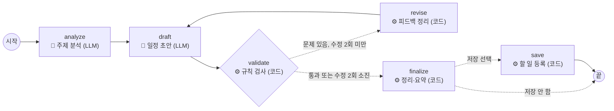
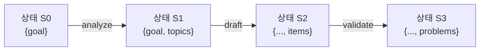
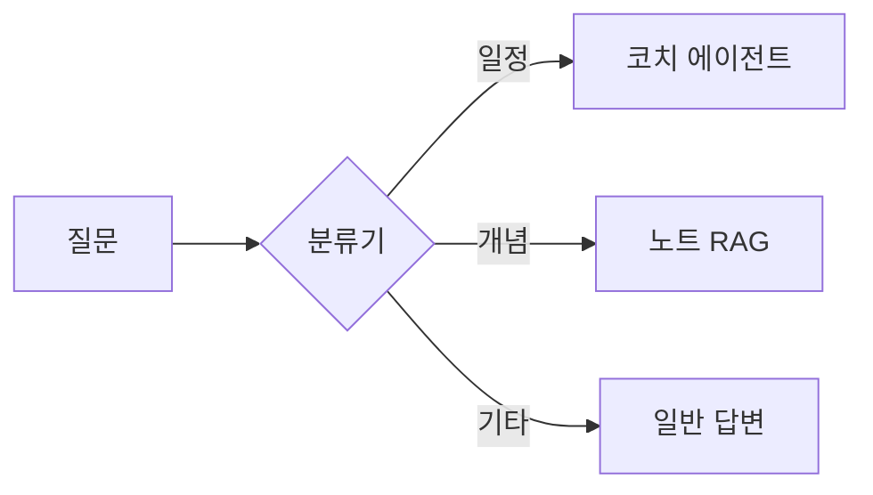
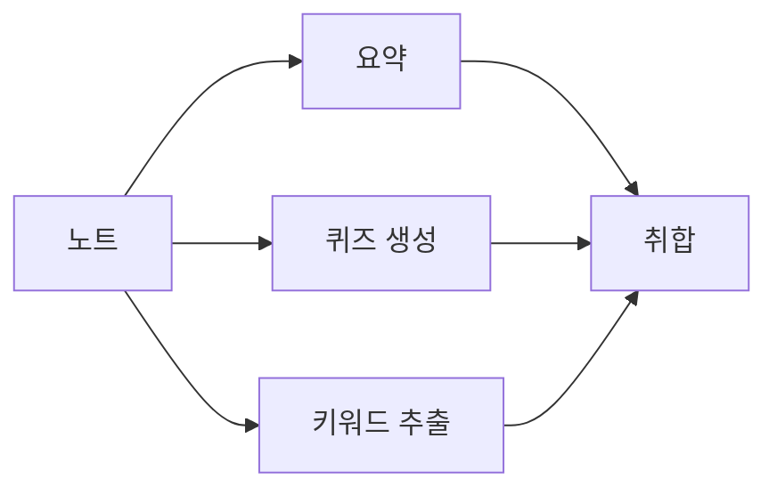
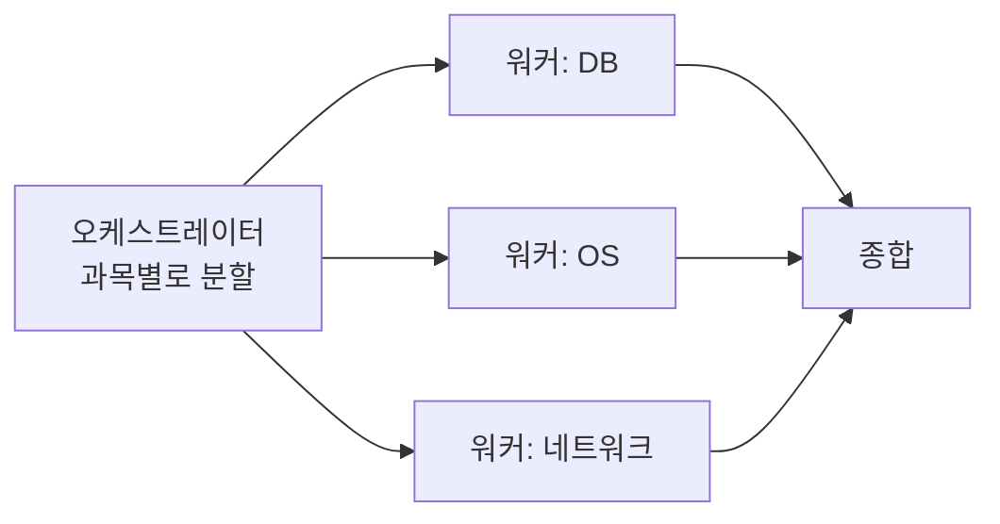
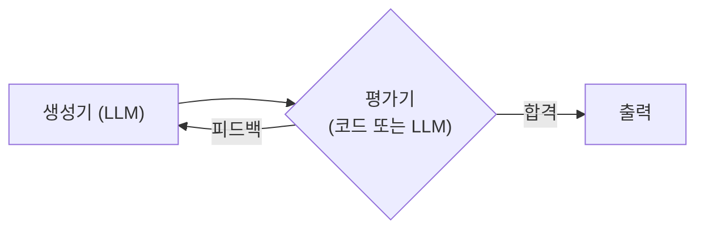
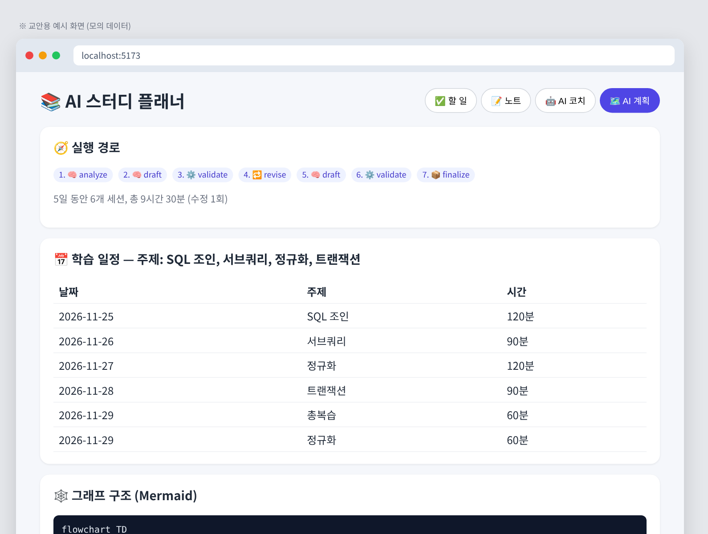
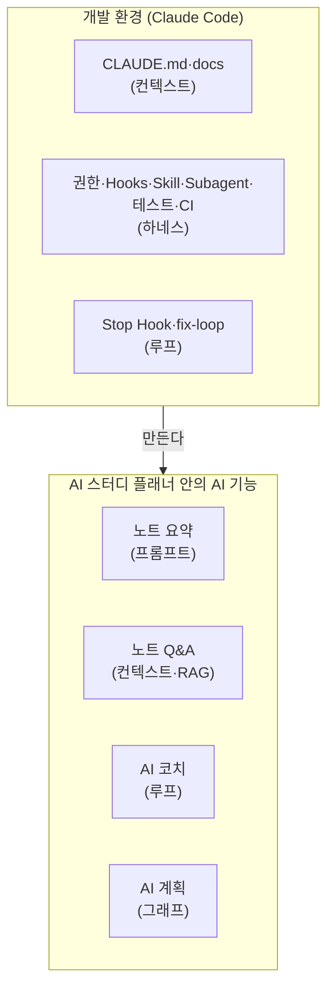
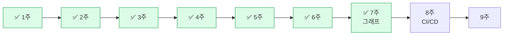

# 7주차 · 그래프 엔지니어링 (Graph Engineering)

> **"AI에게 길을 맡기지 말고, 길을 설계하라."**
>
> 지난주 루프 에이전트는 **다음 행동을 AI가 모두 결정**했습니다. 유연하지만 예측하기 어렵습니다. 오늘은 업무 흐름을 **노드·엣지·상태로 이루어진 그래프**로 설계하고, AI는 **정해진 노드 안에서만** 일하게 만듭니다.

---

## 0. 수업 진행표 (3시간)

| 시간 | 내용 | 형태 |
|---|---|---|
| 0:00 ~ 0:45 | 루프 vs 그래프 · 노드/엣지/상태 · 5가지 워크플로우 패턴 | 설명 |
| 0:45 ~ 1:25 | 실습 ① 그래프 엔진(StateGraph) 직접 만들기 + 테스트 | 실습 |
| 1:25 ~ 1:35 | 휴식 | |
| 1:35 ~ 2:35 | 실습 ② 학습계획 생성 워크플로우 (분석→초안→검증→수정→확정→저장) | 실습 |
| 2:35 ~ 2:55 | 실습 ③ 프론트엔드 계획 화면 | 실습 |
| 2:55 ~ 3:00 | 정리 · 과제 | 정리 |

## 1. 학습 목표

1. 루프와 그래프의 차이를 **자율성 vs 예측 가능성** 관점에서 설명할 수 있다.
2. 그래프의 세 요소(**노드·엣지·상태**)와 조건부 엣지, 순환, 최대 단계를 설명할 수 있다.
3. 대표 워크플로우 패턴 5가지(체이닝·라우팅·병렬화·오케스트레이터·평가-최적화)를 그림으로 구분할 수 있다.
4. 라이브러리 없이 Java로 **StateGraph 엔진**을 만들고, 이를 이용해 **"LLM 판단 + 코드 검증"이 섞인 워크플로우**를 구현할 수 있다.

---

## 2. 개념 ① 왜 그래프인가?

### 2.1 비유: 자유여행 vs 패키지여행

| | 루프 에이전트 (자유여행) | 그래프 워크플로우 (패키지여행) |
|---|---|---|
| 다음 일정은 누가? | 여행자(AI)가 그때그때 | **여행사(설계자)가 미리** |
| 장점 | 예상 못 한 상황에 유연 | 일정·비용·품질이 **예측 가능** |
| 단점 | 엉뚱한 곳에서 시간 낭비 | 계획에 없는 상황에 약함 |
| 잘 맞는 일 | 탐색, 질의응답, 열린 문제 | **절차가 정해진 업무**, 승인·검증이 필요한 일 |

### 2.2 같은 일을 두 방식으로

**루프 방식**: "학습 계획을 세워 줘" → AI가 알아서 도구를 부르고, 알아서 검토하고, 알아서 끝낸다(고 믿는다).

**그래프 방식**:



> 📌 **핵심 원칙: 판단은 LLM에게, 확인은 코드에게.**
>
> "하루 공부 시간이 한도를 넘는가?" 같은 질문은 LLM에게 물을 필요가 없습니다. **코드로 100% 정확하게** 검사할 수 있습니다.

> 📖 **용어 풀이 — 그래프 (Graph)와 워크플로우 (Workflow)**
>
> **그래프**: 수학·컴퓨터에서 **점(노드)과 선(엣지)으로 관계를 나타낸 구조**. 지하철 노선도가 대표적인 그래프입니다(역 = 노드, 선로 = 엣지).
>
> **워크플로우**: 일이 처리되는 **순서와 흐름**. "기안 → 팀장 검토 → 반려 시 수정 → 승인"처럼요.
>
> **그래프 엔지니어링**: 워크플로우를 그래프로 그려서 **그대로 실행되는 코드**로 만드는 것. 그림(설계도)과 코드가 1:1로 대응하므로 **설명·디버깅·변경**이 쉬워집니다.

### 2.3 그래프의 세 요소

$$
G = (V,\ E,\ S)
$$

| 요소 | 의미 | 비유 (회사 결재) | 우리 코드 |
|---|---|---|---|
| **노드 V** | 일을 하는 단위 (LLM 호출 또는 일반 코드) | 담당자 | `addNode("draft", this::draft)` |
| **엣지 E** | 다음에 어디로 갈지 | 결재 라인 화살표 | `addEdge("analyze", "draft")` |
| **조건부 엣지** | 상태를 보고 갈 곳을 고름 | "반려되면 기안자에게" | `addConditionalEdges("validate", router, ...)` |
| **상태 S** | 노드들이 함께 읽고 쓰는 데이터 | 결재 서류철 | `PlanState` |

실행 규칙을 식으로 쓰면:

$$
S_{k+1} = f_{v_k}(S_k), \qquad v_{k+1} = \text{route}_{v_k}(S_{k+1}), \qquad \text{종료: } v_{k+1} = \text{END} \ \lor\ k \ge k_{\max}
$$

**수식 읽는 법**: "$k$번째에 노드 $v_k$에 있으면, 그 노드의 함수 $f$가 상태 $S$를 고쳐 $S_{k+1}$을 만든다. 그다음 라우터가 새 상태를 보고 다음 노드 $v_{k+1}$을 고른다. END에 도착하거나 최대 단계를 넘으면 멈춘다."



상태는 **노드를 지날 때마다 정보가 쌓이는 서류철**입니다. 각 노드는 서류철을 받아서 **자기 칸만 채우고** 다음 노드로 넘깁니다.

### 2.4 순환(cycle)과 안전장치

`validate → revise → draft → validate` 처럼 **되돌아가는 엣지**가 있으면 그래프에 순환이 생깁니다. 순환은 "다시 하기"를 표현하는 강력한 도구지만, 루프와 마찬가지로 **멈춤 장치**가 필요합니다.

| 안전장치 | 위치 | 우리 구현 |
|---|---|---|
| 업무 수준 한도 | 라우터 | 수정은 최대 2회 (`MAX_REVISIONS`) |
| 엔진 수준 한도 | 실행기 | 최대 20단계 넘으면 예외 (`maxSteps`) |
| 구조 검사 | 컴파일 시 | 나가는 엣지가 없는 노드, 없는 노드로 가는 엣지 → 오류 |
| 경로 검사 | 실행 시 | 라우터가 **선언하지 않은 노드**로 보내면 예외 |

> 📖 **용어 풀이 — 결정적 (Deterministic) vs 비결정적**
>
> **결정적**: 같은 입력이면 **항상 같은 결과**. 일반 코드(`if 합계 > 120`)가 그렇습니다.
>
> **비결정적**: 같은 입력이어도 **결과가 달라질 수 있음**. LLM 응답이 그렇습니다.
>
> **그래프 설계 원칙**: 비결정적인 LLM 노드 뒤에 **결정적인 코드 검증 노드**를 두어 품질을 보장합니다. "창의적인 일은 AI, 확인은 코드".

### 2.5 대표 워크플로우 패턴 5가지

**① 프롬프트 체이닝 (Chaining)** — 앞 단계 결과가 다음 단계 입력

```mermaid
flowchart LR
    I["입력"] --> A["LLM 1<br/>개요"] --> G{"코드 검사"} --> B["LLM 2<br/>본문"] --> O["출력"]
```



**② 라우팅 (Routing)** — 입력을 분류해 전문 경로로



**③ 병렬화 (Parallelization)** — 독립적인 일을 동시에, 결과 취합



**④ 오케스트레이터-워커 (Orchestrator-Workers)** — 관리자 LLM이 일을 쪼개 나눠 줌



**⑤ 평가-최적화 (Evaluator-Optimizer)** — 생성 → 평가 → 피드백 → 재생성



> 오늘 만들 학습계획 그래프 = **① 체이닝 + ⑤ 평가-최적화(코드 평가기) + 조건부 라우팅**의 조합입니다.

### 2.6 루프 · 그래프 비교 정리

| 기준 | 루프 (6주차 코치) | 그래프 (7주차 계획) |
|---|---|---|
| 흐름 결정 | LLM | 설계자(코드) |
| LLM 호출 횟수 | 1 ~ 6회 (예측 어려움) | 2 ~ 4회 (상한이 명확) |
| 검증 | 모델의 자기 판단 + 도구 결과 | **노드 단위 코드 검증** |
| 디버깅 | 대화 기록을 읽어야 함 | **어느 노드에서** 문제인지 바로 보임 |
| 테스트 | 시나리오 각본 | 노드별 단위 테스트 + 경로 테스트 |
| 섞어 쓰기 | 그래프의 노드 하나 안에 루프 에이전트를 넣을 수 있다 | |

---

## 3. 실습 ① 그래프 엔진 직접 만들기

업계에서는 LangGraph 같은 라이브러리를 많이 쓰지만, 원리는 **100줄 남짓**입니다. 직접 만들어 보면 어떤 라이브러리든 읽을 수 있게 됩니다.

> 📖 **용어 풀이 — 제네릭 `StateGraph<S>`와 함수형 인터페이스**
>
> **`<S>` (제네릭)**: "상태의 타입은 쓰는 쪽에서 정한다"는 뜻. 학습계획에는 `StateGraph<PlanState>`, 테스트에는 `StateGraph<Counter>`처럼 **엔진 하나를 여러 곳에** 씁니다.
>
> **`UnaryOperator<S>`**: "S를 받아 S를 돌려주는 함수" — 노드 하나. **`Function<S, String>`**: "S를 받아 다음 노드 이름을 돌려주는 함수" — 라우터.
>
> **`c -> { c.value++; return c; }`**: 이름 없는 함수(**람다**). 노드 내용을 짧게 쓸 수 있습니다.

#### 🤖 Claude Code 프롬프트 — 그래프 엔진 (계획 모드 권장)

```text
com.example.planner.graph 패키지에 라이브러리 없이 작은 상태 그래프 엔진 StateGraph<S>를 만들어 줘. (Spring 의존 없이 순수 Java)
- addNode(name, UnaryOperator<S>), addEdge(from, to), addConditionalEdges(from, router, 가능한 대상들...), setEntryPoint(name)
- END 상수, compile(): 시작 노드 확인, 나가는 엣지 없는 노드·존재하지 않는 대상 노드를 오류로
- invoke(state, maxSteps, trace): END까지 실행, 방문 노드를 trace에 기록, maxSteps 초과 시 예외,
  조건부 엣지가 선언하지 않은 노드로 가면 예외
- toMermaid(): 구조를 Mermaid flowchart 문자열로 (조건부 엣지는 점선)
그리고 StateGraphTest(직선, 조건부 순환, 최대 단계 초과, 고아 노드, 허용 안 된 경로)를 작성하고 실행해 줘.
```

### 3.1 📄 참고 코드 — 엔진 코드

`backend/src/main/java/com/example/planner/graph/StateGraph.java`

```java
package com.example.planner.graph;

import java.util.HashSet;
import java.util.LinkedHashMap;
import java.util.List;
import java.util.Map;
import java.util.Set;
import java.util.function.Function;
import java.util.function.UnaryOperator;

/**
 * 아주 작은 상태 그래프 엔진.
 * 노드 = 상태를 받아 상태를 돌려주는 함수, 엣지 = 다음 노드를 고르는 함수.
 */
public class StateGraph<S> {

    public static final String END = "END";

    private final Map<String, UnaryOperator<S>> nodes = new LinkedHashMap<>();
    private final Map<String, Function<S, String>> routers = new LinkedHashMap<>();
    private final Map<String, List<String>> edgeTargets = new LinkedHashMap<>();
    private final Set<String> conditional = new HashSet<>();
    private String entryPoint;

    public StateGraph<S> addNode(String name, UnaryOperator<S> action) {
        if (END.equals(name) || nodes.containsKey(name)) {
            throw new IllegalArgumentException("사용할 수 없는 노드 이름: " + name);
        }
        nodes.put(name, action);
        return this;
    }

    /** 항상 같은 곳으로 가는 엣지 */
    public StateGraph<S> addEdge(String from, String to) {
        routers.put(from, state -> to);
        edgeTargets.put(from, List.of(to));
        return this;
    }

    /** 상태를 보고 갈 곳을 고르는 엣지. 갈 수 있는 곳을 미리 선언한다. */
    public StateGraph<S> addConditionalEdges(String from, Function<S, String> router, String... possibleTargets) {
        routers.put(from, router);
        edgeTargets.put(from, List.of(possibleTargets));
        conditional.add(from);
        return this;
    }

    public StateGraph<S> setEntryPoint(String name) {
        this.entryPoint = name;
        return this;
    }

    /** 구조 검사: 실행 전에 설계 오류를 찾아낸다 */
    public StateGraph<S> compile() {
        if (entryPoint == null || !nodes.containsKey(entryPoint)) {
            throw new IllegalStateException("시작 노드가 올바르지 않습니다: " + entryPoint);
        }
        for (String node : nodes.keySet()) {
            if (!routers.containsKey(node)) {
                throw new IllegalStateException("나가는 엣지가 없는 노드: " + node);
            }
            for (String target : edgeTargets.get(node)) {
                if (!END.equals(target) && !nodes.containsKey(target)) {
                    throw new IllegalStateException("존재하지 않는 노드로 가는 엣지: " + node + " → " + target);
                }
            }
        }
        return this;
    }

    /** 그래프 실행. trace에 방문한 노드 이름을 순서대로 기록한다. */
    public S invoke(S state, int maxSteps, List<String> trace) {
        String current = entryPoint;
        int steps = 0;
        while (!END.equals(current)) {
            if (++steps > maxSteps) {
                throw new IllegalStateException("최대 단계(" + maxSteps + ")를 넘었습니다. 순환이 끝나지 않습니다.");
            }
            trace.add(current);
            state = nodes.get(current).apply(state);            // 노드 실행
            String next = routers.get(current).apply(state);    // 엣지 선택
            if (conditional.contains(current) && !edgeTargets.get(current).contains(next)) {
                throw new IllegalStateException("허용되지 않은 경로: " + current + " → " + next);
            }
            current = next;
        }
        return state;
    }

    /** 그래프 구조를 Mermaid 문법으로 출력 (문서·화면 표시용) */
    public String toMermaid() {
        StringBuilder sb = new StringBuilder("flowchart TD\n");
        sb.append("    START((시작)) --> ").append(entryPoint).append('\n');
        edgeTargets.forEach((from, targets) -> {
            for (String to : targets) {
                sb.append("    ").append(from)
                        .append(conditional.contains(from) ? " -.-> " : " --> ")
                        .append(END.equals(to) ? "FINISH((끝))" : to)
                        .append('\n');
            }
        });
        return sb.toString();
    }
}
```

| 엔진의 부분 | 그래프 개념 |
|---|---|
| `nodes` | V (노드) |
| `routers`, `edgeTargets` | E (엣지) |
| `S state` | S (상태) |
| `compile()` | 설계 오류 검사 |
| `maxSteps` | 순환 안전장치 |
| `trace` | 실행 경로 추적 (디버깅·화면 표시) |

### 3.2 📄 참고 코드 — 엔진 테스트 (LLM 없이)

`backend/src/test/java/com/example/planner/graph/StateGraphTest.java`

```java
package com.example.planner.graph;

import static org.assertj.core.api.Assertions.assertThat;
import static org.assertj.core.api.Assertions.assertThatThrownBy;

import java.util.ArrayList;
import java.util.List;

import org.junit.jupiter.api.Test;

class StateGraphTest {

    /** 테스트용 상태: 숫자 하나 */
    static class Counter {
        int value;
    }

    @Test
    void 직선_그래프는_순서대로_실행된다() {
        StateGraph<Counter> graph = new StateGraph<Counter>()
                .addNode("plus1", c -> { c.value += 1; return c; })
                .addNode("times10", c -> { c.value *= 10; return c; })
                .setEntryPoint("plus1")
                .addEdge("plus1", "times10")
                .addEdge("times10", StateGraph.END)
                .compile();
        List<String> trace = new ArrayList<>();

        Counter result = graph.invoke(new Counter(), 10, trace);

        assertThat(result.value).isEqualTo(10);
        assertThat(trace).containsExactly("plus1", "times10");
    }

    @Test
    void 조건부_엣지로_순환하다가_조건을_만족하면_끝난다() {
        StateGraph<Counter> graph = new StateGraph<Counter>()
                .addNode("inc", c -> { c.value++; return c; })
                .setEntryPoint("inc")
                .addConditionalEdges("inc", c -> c.value < 3 ? "inc" : StateGraph.END, "inc", StateGraph.END)
                .compile();
        List<String> trace = new ArrayList<>();

        graph.invoke(new Counter(), 10, trace);

        assertThat(trace).containsExactly("inc", "inc", "inc");
    }

    @Test
    void 끝나지_않는_순환은_최대단계에서_예외가_발생한다() {
        StateGraph<Counter> graph = new StateGraph<Counter>()
                .addNode("forever", c -> c)
                .setEntryPoint("forever")
                .addEdge("forever", "forever")
                .compile();

        assertThatThrownBy(() -> graph.invoke(new Counter(), 5, new ArrayList<>()))
                .isInstanceOf(IllegalStateException.class)
                .hasMessageContaining("최대 단계");
    }

    @Test
    void 나가는_엣지가_없는_노드는_compile에서_잡힌다() {
        StateGraph<Counter> graph = new StateGraph<Counter>()
                .addNode("a", c -> c)
                .addNode("orphan", c -> c)
                .setEntryPoint("a")
                .addEdge("a", StateGraph.END);

        assertThatThrownBy(graph::compile).hasMessageContaining("orphan");
    }

    @Test
    void 선언하지_않은_경로로_라우팅하면_예외() {
        StateGraph<Counter> graph = new StateGraph<Counter>()
                .addNode("a", c -> c)
                .addNode("b", c -> c)
                .setEntryPoint("a")
                .addConditionalEdges("a", c -> "b", StateGraph.END)   // b로 간다고 선언하지 않음
                .addEdge("b", StateGraph.END)
                .compile();

        assertThatThrownBy(() -> graph.invoke(new Counter(), 10, new ArrayList<>()))
                .hasMessageContaining("허용되지 않은 경로");
    }
}
```

#### ⌨️ 직접 실행

```bash
cd backend && ./gradlew test --tests "*StateGraphTest"
```

#### ✅ 결과 확인

```text
StateGraphTest > 직선_그래프는_순서대로_실행된다() PASSED
StateGraphTest > 조건부_엣지로_순환하다가_조건을_만족하면_끝난다() PASSED
StateGraphTest > 끝나지_않는_순환은_최대단계에서_예외가_발생한다() PASSED
StateGraphTest > 나가는_엣지가_없는_노드는_compile에서_잡힌다() PASSED
StateGraphTest > 선언하지_않은_경로로_라우팅하면_예외() PASSED
BUILD SUCCESSFUL
```

LLM 없이도 **그래프의 흐름 규칙**이 맞는지 확인했습니다. 엔진이 믿을 만해야 그 위에 올린 AI 워크플로우도 믿을 수 있습니다.

---

## 4. 실습 ② 학습계획 생성 워크플로우

### 4.1 노드 설계표

| 노드 | 종류 | 읽는 상태 | 쓰는 상태 | 설명 |
|---|---|---|---|---|
| `analyze` | 🧠 LLM | goal | topics | 목표를 학습 주제 3~8개로 분해 |
| `draft` | 🧠 LLM | topics, 기간, 하루 한도, problems | items | 날짜별 일정 초안(JSON). problems가 있으면 반영 |
| `validate` | ⚙️ 코드 | items, topics, 기간, 한도 | problems | 기간·하루 한도·주제 누락 검사 |
| `revise` | ⚙️ 코드 | revision | revision | 수정 횟수 +1 (피드백은 problems에 이미 있음) |
| `finalize` | ⚙️ 코드 | items, problems | items(정렬), summary | 정렬·요약 |
| `save` | ⚙️ 코드(부작용) | items | savedCount | 할 일로 등록 — **사용자가 선택했을 때만** |

> 💡 `save`처럼 **DB를 바꾸는(되돌리기 어려운) 노드**는 사용자의 명시적 선택(`saveAsTasks`)이 있을 때만 지나가도록 조건부 엣지로 막습니다. 이것이 그래프에서의 **사람 승인(Human-in-the-loop)** 의 가장 단순한 형태입니다.

#### 🤖 Claude Code 프롬프트 — 학습계획 그래프 (위 노드 설계표를 그대로 전달)

```text
StateGraph로 학습계획 생성 워크플로우를 만들어 줘. 노드 설계는 아래 표와 같아.
analyze(LLM): goal → topics(3~8개, JSON {"topics": [...]})
draft(LLM): topics, 시작일(오늘, Asia/Seoul), 마지막 공부일(시험 전날), 하루 한도, 이전 problems → items(JSON {"items":[{date, topic, minutes}]})
validate(코드): 기간 밖 날짜, 0분 이하, 날짜별 합계가 하루 한도 초과, 빠진 주제를 problems에 기록
route: problems 없으면 finalize, 있으면 revision < 2일 때 revise, 아니면 finalize
revise(코드): revision++ 후 draft로
finalize(코드): 날짜순 정렬 + 요약 문장, saveAsTasks면 save로, 아니면 END
save(코드): 각 항목을 "[계획] 주제" 할 일로 등록
- PlanState(public 필드), PlanItem/PlanRequest(@Future examDate, 30~720분)/PlanResult(trace, mermaid 포함) record
- 프롬프트는 PromptTemplates에 PLAN_ANALYZE_SYSTEM, PLAN_DRAFT_SYSTEM으로. LLM은 JSON 모드(generate(..., true))
- JSON 파싱은 Spring이 주입하는 Jackson 3 JsonMapper 사용, 파싱 실패는 draft에서 빈 items로 처리
- 시험일이 30일 넘게 남으면 IllegalArgumentException → 400
- POST /api/ai/plan, FakeLlmClient로 경로 테스트(수정 1회 후 통과 / 최대 수정 후 확정 / 저장 경로)
```

### 4.2 📄 참고 코드 — 상태와 DTO

`graph/PlanItem.java`

```java
package com.example.planner.graph;

import java.time.LocalDate;

public record PlanItem(LocalDate date, String topic, int minutes) {
}
```

`graph/PlanState.java`

```java
package com.example.planner.graph;

import java.time.LocalDate;
import java.util.ArrayList;
import java.util.List;

/** 그래프의 노드들이 함께 읽고 쓰는 상태 (학습용으로 public 필드 사용) */
public class PlanState {

    // ── 입력 ──
    public String goal;
    public LocalDate startDate;
    public LocalDate lastStudyDate;   // 시험 전날
    public int dailyMinutes;
    public boolean saveAsTasks;

    // ── 노드들이 채우는 값 ──
    public List<String> topics = new ArrayList<>();
    public List<PlanItem> items = new ArrayList<>();
    public List<String> problems = new ArrayList<>();
    public int revision;
    public int savedCount;
    public String summary;
}
```

`graph/PlanRequest.java`, `graph/PlanResult.java`

```java
package com.example.planner.graph;

import java.time.LocalDate;

import jakarta.validation.constraints.Future;
import jakarta.validation.constraints.Max;
import jakarta.validation.constraints.Min;
import jakarta.validation.constraints.NotBlank;
import jakarta.validation.constraints.NotNull;
import jakarta.validation.constraints.Size;

public record PlanRequest(
        @NotBlank @Size(max = 300) String goal,
        @NotNull @Future LocalDate examDate,
        @Min(30) @Max(720) int dailyMinutes,
        boolean saveAsTasks) {
}
```

```java
package com.example.planner.graph;

import java.util.List;

public record PlanResult(
        List<String> topics,
        List<PlanItem> items,
        List<String> problems,
        int revisions,
        int savedCount,
        String summary,
        List<String> trace,
        String mermaid) {
}
```

### 4.3 📄 참고 코드 — 프롬프트 (각 LLM 노드는 "자기 일만" 안다)

컨텍스트 전략 **나누기(Isolate)** 를 떠올려 보세요. `analyze` 노드는 일정 규칙을 몰라도 되고, `draft` 노드는 원래 목표 문장을 몰라도 됩니다. **노드별로 꼭 필요한 정보만** 줍니다.

`ai/PromptTemplates.java`에 **추가**:

```java
    // ── 학습계획 그래프: analyze 노드 ─────────────────────────
    public static final String PLAN_ANALYZE_SYSTEM = """
            너는 대학 시험 대비 학습 설계 전문가다.
            학생의 목표를 공부해야 할 주제 3~8개로 나눈다.
            - 주제는 짧은 명사구로 쓴다. 예: "SQL 조인", "정규화"
            - 배우는 순서대로 나열한다.
            - 반드시 JSON만 출력한다: {"topics": ["주제1", "주제2"]}
            """;

    public static String planAnalyzeUser(String goal) {
        return "<goal>%s</goal>".formatted(goal);
    }

    // ── 학습계획 그래프: draft 노드 ───────────────────────────
    public static final String PLAN_DRAFT_SYSTEM = """
            너는 학습 일정 플래너다. 주어진 주제로 날짜별 공부 일정을 만든다.
            [규칙]
            - 날짜는 시작일부터 마지막 공부일까지(포함)만 사용한다.
            - 같은 날짜의 minutes 합계는 하루 한도를 넘지 않는다.
            - 모든 주제를 최소 한 번 배치하고, 주제 이름은 주어진 것을 그대로 쓴다.
            - 남는 날은 "총복습"으로 채워도 된다.
            - 반드시 JSON만 출력한다:
              {"items": [{"date": "YYYY-MM-DD", "topic": "주제", "minutes": 60}]}
            """;

    public static String planDraftUser(java.util.List<String> topics, java.time.LocalDate start,
                                       java.time.LocalDate last, int dailyMinutes,
                                       java.util.List<String> problems) {
        String feedback = problems.isEmpty() ? ""
                : "\n[이전 초안의 문제점 — 반드시 고칠 것]\n- " + String.join("\n- ", problems);
        return """
                주제: %s
                시작일: %s
                마지막 공부일: %s
                하루 한도: %d분%s
                """.formatted(topics, start, last, dailyMinutes, feedback);
    }
```

> 💡 `draft` 노드가 다시 실행될 때는 `validate`가 찾은 **문제점 목록이 피드백으로** 들어갑니다. 이것이 평가-최적화 패턴의 핵심입니다. 그리고 그 평가는 **LLM이 아니라 코드**가 했기 때문에 정확합니다.

### 4.4 📄 참고 코드 — ★ 그래프 조립

> 📖 **용어 풀이 — 메서드 참조 `this::analyze`**
>
> `this::analyze`는 "이 객체의 `analyze` 메서드를 함수로 넘긴다"는 뜻입니다. 그래서 그래프 조립 부분(생성자)만 읽으면 **설계도(노드·엣지)** 가 보이고, 각 노드의 실제 일은 아래 메서드에서 따로 읽을 수 있습니다. **설계와 구현이 분리**되는 것이 그래프 코드의 장점입니다.

`graph/StudyPlanGraph.java`

```java
package com.example.planner.graph;

import java.time.LocalDate;
import java.time.ZoneId;
import java.time.temporal.ChronoUnit;
import java.util.ArrayList;
import java.util.Comparator;
import java.util.List;
import java.util.Map;
import java.util.TreeMap;

import org.springframework.stereotype.Component;

import com.example.planner.ai.LlmClient;
import com.example.planner.ai.PromptTemplates;
import com.example.planner.task.TaskRequest;
import com.example.planner.task.TaskService;
import com.fasterxml.jackson.annotation.JsonIgnoreProperties;

import tools.jackson.core.JacksonException;
import tools.jackson.databind.json.JsonMapper;

@Component
public class StudyPlanGraph {

    static final int MAX_REVISIONS = 2;   // 업무 수준 안전장치
    static final int MAX_STEPS = 20;      // 엔진 수준 안전장치
    static final int MAX_DAYS = 30;

    @JsonIgnoreProperties(ignoreUnknown = true)
    public record TopicsJson(List<String> topics) {
    }

    @JsonIgnoreProperties(ignoreUnknown = true)
    public record DraftJson(List<DraftItem> items) {
    }

    @JsonIgnoreProperties(ignoreUnknown = true)
    public record DraftItem(LocalDate date, String topic, int minutes) {
    }

    private final LlmClient llm;
    private final JsonMapper json;
    private final TaskService taskService;
    private final StateGraph<PlanState> graph;

    public StudyPlanGraph(LlmClient llm, JsonMapper json, TaskService taskService) {
        this.llm = llm;
        this.json = json;
        this.taskService = taskService;
        this.graph = new StateGraph<PlanState>()
                .addNode("analyze", this::analyze)
                .addNode("draft", this::draft)
                .addNode("validate", this::validate)
                .addNode("revise", this::revise)
                .addNode("finalize", this::finalizePlan)
                .addNode("save", this::save)
                .setEntryPoint("analyze")
                .addEdge("analyze", "draft")
                .addEdge("draft", "validate")
                .addConditionalEdges("validate", this::routeAfterValidate, "revise", "finalize")
                .addEdge("revise", "draft")
                .addConditionalEdges("finalize", s -> s.saveAsTasks ? "save" : StateGraph.END, "save", StateGraph.END)
                .addEdge("save", StateGraph.END)
                .compile();
    }

    public PlanResult run(PlanRequest request) {
        LocalDate today = LocalDate.now(ZoneId.of("Asia/Seoul"));
        long days = ChronoUnit.DAYS.between(today, request.examDate());
        if (days > MAX_DAYS) {
            throw new IllegalArgumentException("시험일은 오늘부터 " + MAX_DAYS + "일 이내로 입력하세요.");
        }

        PlanState state = new PlanState();
        state.goal = request.goal();
        state.startDate = today;
        state.lastStudyDate = request.examDate().minusDays(1);
        state.dailyMinutes = request.dailyMinutes();
        state.saveAsTasks = request.saveAsTasks();

        List<String> trace = new ArrayList<>();
        graph.invoke(state, MAX_STEPS, trace);

        return new PlanResult(state.topics, state.items, state.problems, state.revision,
                state.savedCount, state.summary, trace, graph.toMermaid());
    }

    // ───────────── 노드들 ─────────────

    /** 🧠 LLM: 목표 → 주제 목록 */
    PlanState analyze(PlanState s) {
        String out = llm.generate(PromptTemplates.PLAN_ANALYZE_SYSTEM, PromptTemplates.planAnalyzeUser(s.goal), true);
        TopicsJson parsed = parse(out, TopicsJson.class);
        s.topics = parsed.topics() == null ? List.of()
                : parsed.topics().stream().map(String::trim).filter(t -> !t.isBlank()).limit(8).toList();
        if (s.topics.isEmpty()) {
            throw new IllegalStateException("목표에서 학습 주제를 찾지 못했습니다. 목표를 더 구체적으로 적어 주세요.");
        }
        return s;
    }

    /** 🧠 LLM: 주제 + 제약 (+ 이전 문제점) → 일정 초안 */
    PlanState draft(PlanState s) {
        String out = llm.generate(PromptTemplates.PLAN_DRAFT_SYSTEM,
                PromptTemplates.planDraftUser(s.topics, s.startDate, s.lastStudyDate, s.dailyMinutes, s.problems), true);
        try {
            DraftJson parsed = parse(out, DraftJson.class);
            s.items = parsed.items() == null ? List.of()
                    : parsed.items().stream()
                            .filter(i -> i.date() != null && i.topic() != null)
                            .map(i -> new PlanItem(i.date(), i.topic().trim(), i.minutes()))
                            .toList();
        } catch (IllegalStateException e) {
            s.items = List.of();   // 형식이 깨진 초안 → validate가 문제로 보고하고 revise로 보낸다
        }
        return s;
    }

    /** ⚙️ 코드: 규칙 검사 (LLM보다 정확하고, 공짜다) */
    PlanState validate(PlanState s) {
        List<String> problems = new ArrayList<>();
        if (s.items.isEmpty()) {
            problems.add("일정 항목이 비어 있거나 JSON 형식이 잘못되었다");
        }
        Map<LocalDate, Integer> perDay = new TreeMap<>();
        for (PlanItem item : s.items) {
            if (item.date().isBefore(s.startDate) || item.date().isAfter(s.lastStudyDate)) {
                problems.add(item.date() + "은(는) 공부 기간(" + s.startDate + " ~ " + s.lastStudyDate + ") 밖이다");
            }
            if (item.minutes() <= 0) {
                problems.add(item.date() + " '" + item.topic() + "'의 시간이 0분 이하다");
            }
            perDay.merge(item.date(), item.minutes(), Integer::sum);
        }
        perDay.forEach((date, minutes) -> {
            if (minutes > s.dailyMinutes) {
                problems.add(date + " 합계 " + minutes + "분이 하루 한도 " + s.dailyMinutes + "분을 넘는다");
            }
        });
        for (String topic : s.topics) {
            boolean covered = s.items.stream().anyMatch(i -> i.topic().contains(topic) || topic.contains(i.topic()));
            if (!covered) {
                problems.add("주제 '" + topic + "'이(가) 일정에 없다");
            }
        }
        s.problems = problems;
        return s;
    }

    /** 🔀 라우터: 통과면 확정, 아니면 수정 (단, 최대 2회) */
    String routeAfterValidate(PlanState s) {
        if (s.problems.isEmpty()) {
            return "finalize";
        }
        return s.revision < MAX_REVISIONS ? "revise" : "finalize";
    }

    /** ⚙️ 코드: 수정 횟수 기록 (문제점은 이미 state.problems에 있어 draft에 전달된다) */
    PlanState revise(PlanState s) {
        s.revision++;
        return s;
    }

    /** ⚙️ 코드: 정렬 + 요약 */
    PlanState finalizePlan(PlanState s) {
        s.items = s.items.stream()
                .sorted(Comparator.comparing(PlanItem::date).thenComparing(PlanItem::topic))
                .toList();
        int total = s.items.stream().mapToInt(PlanItem::minutes).sum();
        long studyDays = s.items.stream().map(PlanItem::date).distinct().count();
        s.summary = "%d일 동안 %d개 세션, 총 %d시간 %d분 (수정 %d회)%s".formatted(
                studyDays, s.items.size(), total / 60, total % 60, s.revision,
                s.problems.isEmpty() ? "" : " ⚠️ 해결되지 않은 문제 " + s.problems.size() + "건");
        return s;
    }

    /** ⚙️ 코드(부작용): 할 일로 등록 — saveAsTasks가 true일 때만 도달 */
    PlanState save(PlanState s) {
        for (PlanItem item : s.items) {
            String title = "[계획] " + (item.topic().length() > 90 ? item.topic().substring(0, 90) : item.topic());
            taskService.create(new TaskRequest(title, "학습계획", item.date(), Math.min(item.minutes(), 600)));
        }
        s.savedCount = s.items.size();
        return s;
    }

    private <T> T parse(String text, Class<T> type) {
        String cleaned = text.strip();
        if (cleaned.startsWith("```")) {   // 혹시 코드 블록으로 감싸 오면 벗겨 낸다
            cleaned = cleaned.replaceFirst("^```(json)?", "").replaceFirst("```$", "").strip();
        }
        try {
            return json.readValue(cleaned, type);
        } catch (JacksonException e) {
            throw new IllegalStateException("AI 응답 JSON을 해석하지 못했습니다: " + e.getOriginalMessage());
        }
    }
}
```

> 💡 Spring Boot 4는 Jackson 3의 `JsonMapper`(`tools.jackson.databind.json.JsonMapper`)를 빈으로 등록해 두므로 생성자로 주입받아 쓰면 됩니다. Jackson 3의 예외(`JacksonException`)는 **언체크 예외**라서 `throws`를 쓰지 않아도 됩니다.

### 4.5 📄 참고 코드 — 컨트롤러와 예외 처리

`graph/GraphController.java`

```java
package com.example.planner.graph;

import org.springframework.web.bind.annotation.PostMapping;
import org.springframework.web.bind.annotation.RequestBody;
import org.springframework.web.bind.annotation.RequestMapping;
import org.springframework.web.bind.annotation.RestController;

import jakarta.validation.Valid;

@RestController
@RequestMapping("/api/ai")
public class GraphController {

    private final StudyPlanGraph studyPlanGraph;

    public GraphController(StudyPlanGraph studyPlanGraph) {
        this.studyPlanGraph = studyPlanGraph;
    }

    @PostMapping("/plan")
    public PlanResult plan(@Valid @RequestBody PlanRequest request) {
        return studyPlanGraph.run(request);
    }
}
```

`common/GlobalExceptionHandler.java`에 **추가** (잘못된 입력 → 400):

```java
    @ExceptionHandler(IllegalArgumentException.class)
    public ProblemDetail handleIllegalArgument(IllegalArgumentException e) {
        return ProblemDetail.forStatusAndDetail(HttpStatus.BAD_REQUEST, e.getMessage());
    }
```

### 4.6 📄 참고 코드 — 워크플로우 테스트 (가짜 LLM으로 경로 검증)

5주차의 `FakeLlmClient`를 재사용합니다. **LLM 응답 순서를 각본으로** 정해 두고, 그래프가 **어떤 경로로 지나갔는지**를 검증합니다.

`backend/src/test/java/com/example/planner/graph/StudyPlanGraphTest.java`

```java
package com.example.planner.graph;

import static org.assertj.core.api.Assertions.assertThat;

import java.time.LocalDate;
import java.time.ZoneId;

import org.junit.jupiter.api.BeforeEach;
import org.junit.jupiter.api.Test;
import org.springframework.beans.factory.annotation.Autowired;
import org.springframework.boot.test.context.SpringBootTest;
import org.springframework.boot.test.context.TestConfiguration;
import org.springframework.context.annotation.Bean;
import org.springframework.context.annotation.Primary;
import org.springframework.transaction.annotation.Transactional;

import com.example.planner.ai.FakeLlmClient;
import com.example.planner.task.TaskService;

@SpringBootTest
@Transactional
class StudyPlanGraphTest {

    @TestConfiguration
    static class FakeLlmConfig {
        @Bean
        @Primary
        FakeLlmClient fakeLlmClient() {
            return new FakeLlmClient();
        }
    }

    @Autowired StudyPlanGraph planGraph;
    @Autowired FakeLlmClient fakeLlm;
    @Autowired TaskService taskService;

    final LocalDate today = LocalDate.now(ZoneId.of("Asia/Seoul"));

    @BeforeEach
    void setUp() {
        fakeLlm.reset();
    }

    private String item(int plusDays, String topic, int minutes) {
        return "{\"date\":\"%s\",\"topic\":\"%s\",\"minutes\":%d}".formatted(today.plusDays(plusDays), topic, minutes);
    }

    @Test
    void 첫_초안이_한도를_넘으면_수정_경로를_거쳐_통과한다() {
        fakeLlm.willReturn(
                "{\"topics\":[\"SQL\",\"정규화\"]}",                                         // analyze
                "{\"items\":[" + item(0, "SQL", 100) + "," + item(0, "정규화", 60) + "]}",   // draft 1: 160분 > 120분
                "{\"items\":[" + item(0, "SQL", 100) + "," + item(1, "정규화", 90) + "]}");  // draft 2: 통과

        PlanResult result = planGraph.run(new PlanRequest("DB 기말고사 대비", today.plusDays(5), 120, false));

        assertThat(result.trace()).containsExactly(
                "analyze", "draft", "validate", "revise", "draft", "validate", "finalize");
        assertThat(result.revisions()).isEqualTo(1);
        assertThat(result.problems()).isEmpty();
        assertThat(result.items()).hasSize(2);
        // 두 번째 draft 프롬프트에 validate의 피드백이 들어갔는가?
        assertThat(fakeLlm.lastUserPrompt()).contains("이전 초안의 문제점").contains("하루 한도");
    }

    @Test
    void 계속_실패하면_최대_수정_횟수_후_문제를_안고_확정한다() {
        String bad = "{\"items\":[" + item(0, "SQL", 500) + "]}";   // 한도 초과 + 정규화 누락
        fakeLlm.willReturn("{\"topics\":[\"SQL\",\"정규화\"]}", bad, bad, bad);

        PlanResult result = planGraph.run(new PlanRequest("DB 기말고사 대비", today.plusDays(5), 120, false));

        assertThat(result.revisions()).isEqualTo(StudyPlanGraph.MAX_REVISIONS);
        assertThat(result.trace()).filteredOn("draft"::equals).hasSize(3);
        assertThat(result.problems()).isNotEmpty();
        assertThat(result.summary()).contains("해결되지 않은 문제");
        assertThat(fakeLlm.callCount()).isEqualTo(4);   // analyze 1 + draft 3 — 상한이 명확하다!
    }

    @Test
    void 저장을_선택하면_save_노드를_지나_할일이_등록된다() {
        fakeLlm.willReturn(
                "{\"topics\":[\"SQL\"]}",
                "{\"items\":[" + item(1, "SQL", 60) + "]}");

        PlanResult result = planGraph.run(new PlanRequest("SQL 복습", today.plusDays(3), 120, true));

        assertThat(result.trace()).endsWith("finalize", "save");
        assertThat(result.savedCount()).isEqualTo(1);
        assertThat(taskService.findAll()).anyMatch(t -> t.title().equals("[계획] SQL"));
    }
}
```

#### ⌨️ 직접 실행

```bash
cd backend && ./gradlew test
```

#### ✅ 결과 확인

```text
StudyPlanGraphTest > 첫_초안이_한도를_넘으면_수정_경로를_거쳐_통과한다() PASSED
StudyPlanGraphTest > 계속_실패하면_최대_수정_횟수_후_문제를_안고_확정한다() PASSED
StudyPlanGraphTest > 저장을_선택하면_save_노드를_지나_할일이_등록된다() PASSED
BUILD SUCCESSFUL
```

세 테스트는 각각 **그래프의 세 가지 경로**(수정 후 통과 / 수정 한도 도달 / 저장)를 검증합니다. "LLM 호출이 최대 4번"이라는 **비용 상한**도 테스트로 보장했습니다.

### 4.7 ✅ 결과 확인 — 실제 모델로 실행

#### ⌨️ 직접 실행

```bash
curl -s -X POST localhost:8080/api/ai/plan -H "Content-Type: application/json" \
  -d '{"goal":"데이터베이스 기말고사: SQL 조인, 서브쿼리, 정규화, 트랜잭션, 인덱스","examDate":"2026-12-05","dailyMinutes":120,"saveAsTasks":false}'
```

> ⚠️ `examDate`는 **오늘 이후 30일 이내**의 날짜로 바꿔서 실행하세요.

#### ✅ 결과 확인 — 응답 예 (모델에 따라 다름)

```json
{
  "topics": ["SQL 조인", "서브쿼리", "정규화", "트랜잭션"],
  "items": [
    { "date": "2026-11-25", "topic": "SQL 조인", "minutes": 120 },
    { "date": "2026-11-26", "topic": "서브쿼리", "minutes": 90 }
  ],
  "problems": [],
  "revisions": 1,
  "savedCount": 0,
  "summary": "5일 동안 6개 세션, 총 9시간 30분 (수정 1회)",
  "trace": ["analyze", "draft", "validate", "revise", "draft", "validate", "finalize"],
  "mermaid": "flowchart TD\n    START((시작)) --> analyze\n ..."
}
```

응답의 `trace`로 그래프가 실제로 지나간 경로를, `mermaid`로 그래프 구조를 확인할 수 있습니다. `mermaid` 값을 [mermaid.live](https://mermaid.live)에 붙여 넣으면 그림으로 볼 수 있습니다.

---

## 5. 실습 ③ 프론트엔드: 계획 화면

#### 🤖 Claude Code 프롬프트 — 계획 화면

```text
"🗺️ AI 계획" 탭을 추가해 줘.
- src/api.ts에 PlanItem, PlanResult, PlanInput 타입과 aiApi.plan(input)
- pages/PlanPage.tsx: 목표(textarea), 시험일, 하루 분, "할 일로 저장" 체크박스, 계획 만들기 버튼
- 결과: 실행 경로를 노드 아이콘(🧠 analyze/draft, ⚙️ validate, 🔁 revise, 📦 finalize, 💾 save) 배지로 순서대로,
  요약, 남은 문제(있으면 error 스타일), 일정 표(날짜·주제·시간), Mermaid 원문(trace 클래스)
- App.tsx에 네 번째 탭으로 추가
```

#### 📄 참고 코드 — api.ts 추가분

`src/api.ts`에 **추가**:

```ts
export interface PlanItem {
  date: string;
  topic: string;
  minutes: number;
}

export interface PlanResult {
  topics: string[];
  items: PlanItem[];
  problems: string[];
  revisions: number;
  savedCount: number;
  summary: string;
  trace: string[];
  mermaid: string;
}

export interface PlanInput {
  goal: string;
  examDate: string;
  dailyMinutes: number;
  saveAsTasks: boolean;
}
```

`aiApi`에 한 줄 추가:

```ts
  plan: (input: PlanInput) => post<PlanResult>('/api/ai/plan', input),
```

#### 📄 참고 코드 — PlanPage.tsx / App.tsx (최종)

`src/pages/PlanPage.tsx`

```tsx
import { useState } from 'react';
import { aiApi } from '../api';
import type { PlanResult } from '../api';

const NODE_ICON: Record<string, string> = {
  analyze: '🧠', draft: '🧠', validate: '⚙️', revise: '🔁', finalize: '📦', save: '💾',
};

export default function PlanPage() {
  const [goal, setGoal] = useState('데이터베이스 기말고사: SQL 조인, 서브쿼리, 정규화, 트랜잭션');
  const [examDate, setExamDate] = useState('');
  const [dailyMinutes, setDailyMinutes] = useState(120);
  const [saveAsTasks, setSaveAsTasks] = useState(false);
  const [result, setResult] = useState<PlanResult | null>(null);
  const [loading, setLoading] = useState(false);
  const [error, setError] = useState<string | null>(null);

  async function run() {
    if (!goal.trim() || !examDate) return;
    setLoading(true);
    setError(null);
    setResult(null);
    try {
      setResult(await aiApi.plan({ goal, examDate, dailyMinutes, saveAsTasks }));
    } catch (e) {
      setError((e as Error).message);
    } finally {
      setLoading(false);
    }
  }

  return (
    <>
      <section className="card">
        <h2>🗺️ AI 학습계획 (그래프 워크플로우)</h2>
        <textarea style={{ minHeight: 70 }} value={goal} onChange={(e) => setGoal(e.target.value)} />
        <div className="row">
          <label>시험일 <input type="date" value={examDate} onChange={(e) => setExamDate(e.target.value)} /></label>
          <label>
            하루 <input type="number" min={30} max={720} step={30} style={{ width: 90 }}
              value={dailyMinutes} onChange={(e) => setDailyMinutes(Number(e.target.value))} />분
          </label>
          <label>
            <input type="checkbox" checked={saveAsTasks} onChange={(e) => setSaveAsTasks(e.target.checked)} /> 할 일로 저장
          </label>
          <button className="primary" disabled={loading} onClick={() => void run()}>
            {loading ? '그래프 실행 중...' : '계획 만들기'}
          </button>
        </div>
        {error && <p className="error">{error}</p>}
      </section>

      {result && (
        <>
          <section className="card">
            <h2>🧭 실행 경로</h2>
            <div className="row">
              {result.trace.map((node, i) => (
                <span key={i} className="badge">
                  {i + 1}. {NODE_ICON[node] ?? '•'} {node}
                </span>
              ))}
            </div>
            <p className="muted">{result.summary}</p>
            {result.savedCount > 0 && <p>💾 할 일 {result.savedCount}개가 등록되었습니다.</p>}
            {result.problems.length > 0 && (
              <div className="error">
                ⚠️ 남은 문제
                <ul>{result.problems.map((p) => <li key={p}>{p}</li>)}</ul>
              </div>
            )}
          </section>

          <section className="card">
            <h2>📅 학습 일정 — 주제: {result.topics.join(', ')}</h2>
            <table>
              <thead>
                <tr><th>날짜</th><th>주제</th><th>시간</th></tr>
              </thead>
              <tbody>
                {result.items.map((it, i) => (
                  <tr key={i}><td>{it.date}</td><td>{it.topic}</td><td>{it.minutes}분</td></tr>
                ))}
              </tbody>
            </table>
          </section>

          <section className="card">
            <h2>🕸️ 그래프 구조 (Mermaid)</h2>
            <pre className="trace">{result.mermaid}</pre>
          </section>
        </>
      )}
    </>
  );
}
```

`src/App.tsx`에 탭 추가 (최종 형태):

```tsx
import { useState } from 'react';
import './App.css';
import TaskPage from './pages/TaskPage';
import NotePage from './pages/NotePage';
import CoachPage from './pages/CoachPage';
import PlanPage from './pages/PlanPage';

type Tab = 'tasks' | 'notes' | 'coach' | 'plan';

const TABS: { key: Tab; label: string }[] = [
  { key: 'tasks', label: '✅ 할 일' },
  { key: 'notes', label: '📝 노트' },
  { key: 'coach', label: '🤖 AI 코치' },
  { key: 'plan', label: '🗺️ AI 계획' },
];

export default function App() {
  const [tab, setTab] = useState<Tab>('tasks');

  return (
    <div className="app">
      <header>
        <h1>📚 AI 스터디 플래너</h1>
        <nav>
          {TABS.map((t) => (
            <button key={t.key} className={tab === t.key ? 'active' : ''} onClick={() => setTab(t.key)}>
              {t.label}
            </button>
          ))}
        </nav>
      </header>
      <main>
        {tab === 'tasks' && <TaskPage />}
        {tab === 'notes' && <NotePage />}
        {tab === 'coach' && <CoachPage />}
        {tab === 'plan' && <PlanPage />}
      </main>
    </div>
  );
}
```

#### ✅ 결과 확인 — 계획 화면



* **실행 경로**에 `revise`가 보이면, 첫 초안이 코드 검증에서 떨어졌다가 **피드백을 받아 고쳐진** 것입니다.
* "할 일로 저장"을 체크하고 실행한 뒤 **✅ 할 일 탭**에 `[계획] ...` 항목이 생겼는지 확인하세요.
* 하루 분을 30분처럼 아주 작게 주면 검증이 계속 실패해 **수정 2회 후 "해결되지 않은 문제"와 함께 확정**되는 경로도 볼 수 있습니다.

### 커밋

```bash
git add .
git commit -m "feat: StateGraph 엔진과 학습계획 생성 그래프 워크플로우 추가"
git tag week-07 && git push && git push origin week-07
```

---

## 6. 참고: 같은 그래프를 LangGraph로 쓰면?

업계 표준 라이브러리인 LangGraph(TypeScript 버전)로 같은 구조를 쓰면 아래와 같습니다. **우리 엔진과 1:1로 대응**하는 것을 확인하세요. (실행 실습은 하지 않습니다.)

```ts
import { Annotation, StateGraph, START, END } from '@langchain/langgraph';

const PlanState = Annotation.Root({
  goal: Annotation<string>(),
  topics: Annotation<string[]>(),
  items: Annotation<{ date: string; topic: string; minutes: number }[]>(),
  problems: Annotation<string[]>(),
  revision: Annotation<number>(),
  saveAsTasks: Annotation<boolean>(),
});

const graph = new StateGraph(PlanState)
  .addNode('analyze', analyze)          // 노드 = (state) => 부분 상태 업데이트
  .addNode('draft', draft)
  .addNode('validate', validate)
  .addNode('revise', revise)
  .addNode('finalize', finalize)
  .addNode('save', save)
  .addEdge(START, 'analyze')
  .addEdge('analyze', 'draft')
  .addEdge('draft', 'validate')
  .addConditionalEdges('validate', routeAfterValidate, ['revise', 'finalize'])
  .addEdge('revise', 'draft')
  .addConditionalEdges('finalize', (s) => (s.saveAsTasks ? 'save' : END), ['save', END])
  .addEdge('save', END)
  .compile();
```

| 우리 엔진 | LangGraph | 비고 |
|---|---|---|
| `PlanState` 클래스 | `Annotation.Root` | LangGraph는 노드가 **바뀐 부분만** 반환하고 **리듀서**가 합침 |
| `setEntryPoint` | `addEdge(START, ...)` | |
| `maxSteps` | `recursionLimit` 설정 | |
| `trace` | 스트리밍·LangSmith 추적 | |
| (없음) | **체크포인터** | 중간 상태 저장 → 사람 승인 후 재개, 장애 복구 |

---

## 7. 6단계 총정리: 오늘까지 만든 것

| 단계 | 프로젝트에서 어디에? |
|---|---|
| 바이브코딩 | 프로젝트 뼈대, D-Day 카운터 |
| 프롬프트 | `PromptTemplates` (요약·질의응답·분석·초안) |
| 컨텍스트 | `CLAUDE.md`, `docs/`, RAG(`NoteRetriever`), 노드별 최소 컨텍스트 |
| 하네스 | `.claude/` 권한·Hooks·Skill·Subagent, 테스트, CI |
| 루프 | `StudyCoachAgent`(도구 루프), Stop Hook·`fix-loop.sh`(검증 루프) |
| 그래프 | `StateGraph` + `StudyPlanGraph`(LLM 노드 + 코드 검증 노드 + 조건부 순환) |



## 8. 과제

1. **필수**: `week-07` 태그 push, 계획 화면 캡처 (실행 경로에 `revise`가 포함된 사례가 있으면 더 좋음)
2. **필수**: 내 그래프를 노드 설계표(4.1) 형식으로 다시 설명하는 짧은 글 작성 (README에 쓸 재료!)
3. **도전 ①**: `validate` 다음에 **LLM 평가 노드**(`review`: "학습 순서가 자연스러운가?")를 추가해 **코드 평가 + LLM 평가**를 함께 쓰는 그래프로 확장해 보세요.
4. **도전 ②**: 라우팅 패턴으로 **"질문 분류 그래프"** 를 만들어 보세요. 질문을 `PLAN/COACH/NOTE`로 분류해 각각 계획 그래프·코치 에이전트·RAG로 보내는 하나의 `/api/ai/chat` 엔드포인트.

---

## 9. 지금까지의 진행 상황 & 다음 주 예고

### 9.1 7주차까지 진행 상황 — 6단계 엔지니어링 완주!



| 구분 | 완료한 것 |
|---|---|
| 개념 | 루프 vs 그래프, 노드·엣지·상태, 조건부 엣지·순환·안전장치, 5가지 워크플로우 패턴, 결정적 검증 |
| 백엔드 | `StateGraph` 엔진(+테스트), `StudyPlanGraph`(LLM 2노드 + 코드 4노드), `POST /api/ai/plan`, 경로 테스트 |
| 프론트엔드 | AI 계획 탭(실행 경로·일정표·Mermaid) — **앱 기능 완성** |
| Git | `week-07` 태그 |

| AI 기능 | 사용한 엔지니어링 | 엔드포인트 |
|---|---|---|
| 노트 요약 | 프롬프트 | `POST /api/ai/summary` |
| 노트 Q&A | 컨텍스트(RAG) | `POST /api/ai/ask` |
| AI 코치 | 루프 | `POST /api/ai/coach` |
| AI 계획 | **그래프** | `POST /api/ai/plan` |
| (개발 전체) | 바이브·프롬프트·컨텍스트·하네스·루프 | Claude Code + `.claude/` |

### 9.2 다음 주(8주차) 예고 — CI/CD 완성과 AWS 배포

* **배울 것**: 지금 앱은 **내 PC에서만** 동작합니다. main에 push하면 **테스트 → Docker 이미지 빌드 → GHCR 업로드 → AWS EC2 자동 배포 → 헬스 체크**까지 이어지는 파이프라인을 만들어, 누구나 인터넷 주소로 접속할 수 있게 합니다.
* **왜 배우나**: 포트폴리오는 **"실제로 동작하는 주소"** 가 있을 때 설득력이 훨씬 큽니다. 그리고 자동 배포는 AI 시대에 "많이, 자주 바뀌는 코드"를 안전하게 내보내는 필수 기술입니다.
* **미리 준비 (중요!)**: ① **AWS 계정 생성**(결제 수단 필요할 수 있음) ② 계정 상태·크레딧 확인 ③ GitHub CLI(`gh`) 설치 권장

---

## 10. 🇯🇵 일본 취업 대비 IT 용어 (7주차)

| 한국어 | 日本語 | 읽는 법 | 예문 (日本語) | 예문 해석 |
|---|---|---|---|---|
| 워크플로우 | ワークフロー | 와-쿠후로- | 学習計画の作成をワークフローとして設計しました。 | 학습계획 작성을 워크플로우로 설계했습니다. |
| 노드 / 엣지 | ノード / エッジ | 노-도 / 엣지 | 各ノードの役割を一つに絞りました。 | 각 노드의 역할을 하나로 좁혔습니다. |
| 상태 | 状態（ステート） | じょうたい | ノード間で共有する状態を一つのクラスにまとめました。 | 노드 간에 공유하는 상태를 하나의 클래스로 정리했습니다. |
| 분기 | 分岐 | ぶんき | 検証結果によって処理を分岐させています。 | 검증 결과에 따라 처리를 분기시키고 있습니다. |
| 조건 분기 | 条件分岐 | じょうけんぶんき | 条件分岐で修正か確定かを判断します。 | 조건 분기로 수정할지 확정할지 판단합니다. |
| 상태 전이 | 状態遷移 | じょうたいせんい | 状態遷移図をもとに実装しました。 | 상태 전이도를 바탕으로 구현했습니다. |
| 순환 | 循環（サイクル） | じゅんかん | 修正の循環は最大2回までに制限しました。 | 수정 순환은 최대 2회로 제한했습니다. |
| 병렬 처리 | 並列処理 | へいれつしょり | 独立したタスクは並列処理できる構成です。 | 독립적인 작업은 병렬 처리할 수 있는 구성입니다. |
| 오케스트레이션 | オーケストレーション | 오-케스토레-숀 | 複数のAI処理のオーケストレーションを担当しました。 | 여러 AI 처리의 오케스트레이션을 담당했습니다. |
| 결정적 | 決定論的 | けっていろんてき | LLMの出力を決定論的なコードで検証しました。 | LLM의 출력을 결정적인 코드로 검증했습니다. |
| 승인 | 承認 | しょうにん | データを登録する前にユーザーの承認を必要としました。 | 데이터를 등록하기 전에 사용자의 승인을 필요로 했습니다. |
| 가시화 | 可視化 | かしか | 実行経路を画面に可視化しました。 | 실행 경로를 화면에 가시화했습니다. |

> 💬 **면접에서 이렇게 말해 보세요**
>
> 「判断はLLMに任せ、確認はコードで行うというルールでワークフローを設計しました。」
>
> (판단은 LLM에게 맡기고 확인은 코드로 한다는 규칙으로 워크플로우를 설계했습니다.)

[← 6주차](week06-loop-engineering.md) · [8주차: CI/CD와 AWS 배포 →](week08-cicd-aws.md)
