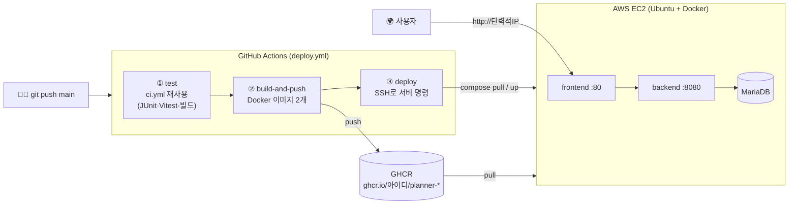
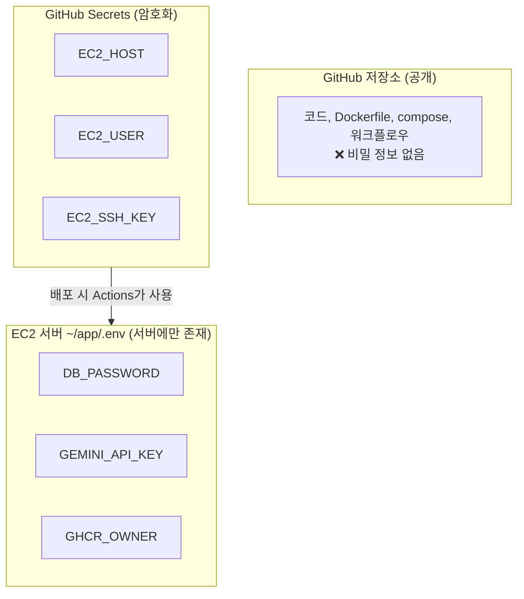
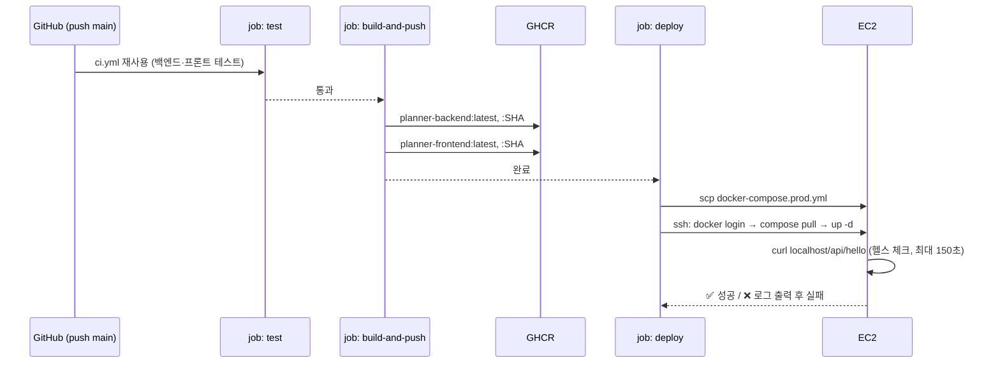
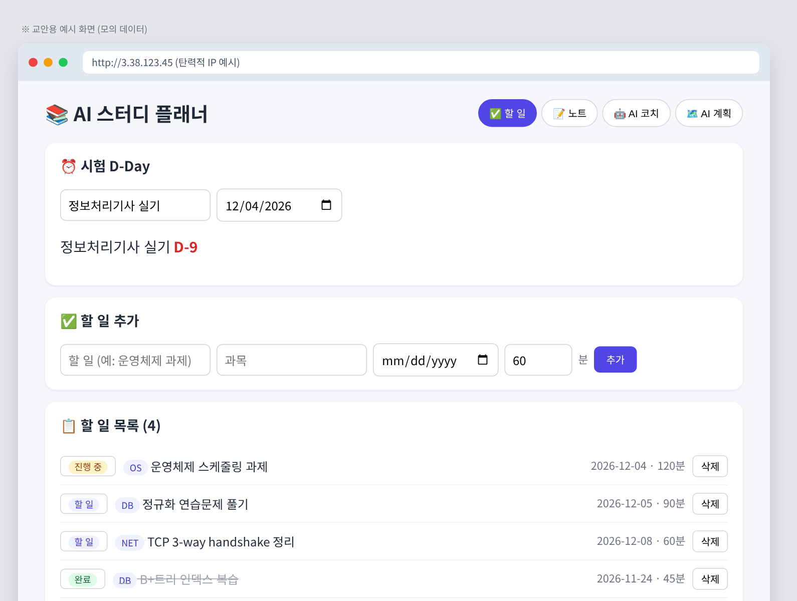
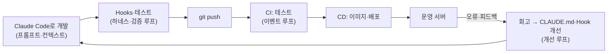
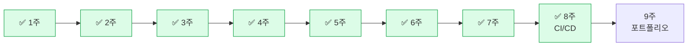
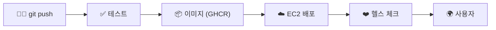

# 8주차 · CI/CD 완성 — GitHub Actions → GHCR → AWS EC2 자동 배포

> **"main에 push하면, 몇 분 뒤 전 세계에서 접속할 수 있다."**
>
> 5주차에 만든 CI(자동 검사)에 **CD(자동 배포)** 를 이어 붙입니다. 테스트를 통과한 코드만 Docker 이미지로 만들어 저장소(GHCR)에 올리고, AWS 서버가 그 이미지를 받아 실행합니다.

---

## 0. 수업 진행표 (3시간)

| 시간 | 내용 | 형태 |
|---|---|---|
| 0:00 ~ 0:30 | CI/CD 개념 · 배포 아키텍처 · 비밀 정보 관리 · 비용 | 설명 |
| 0:30 ~ 1:10 | 실습 ① AWS EC2 준비 (인스턴스·보안 그룹·탄력적 IP·예산 알림) | 실습 |
| 1:10 ~ 1:35 | 실습 ② 서버 설정 (SSH, Docker, 스왑, .env) | 실습 |
| 1:35 ~ 1:45 | 휴식 | |
| 1:45 ~ 2:35 | 실습 ③ 운영용 Compose + ④ 배포 워크플로우 | 실습 |
| 2:35 ~ 2:55 | 실습 ⑤ 배포 확인 · 롤백 · AI로 배포 실패 분석 | 실습 |
| 2:55 ~ 3:00 | 정리 · 과제 | 정리 |

## 1. 학습 목표

1. CI, 지속적 전달(Continuous Delivery), 지속적 배포(Continuous Deployment)를 구분할 수 있다.
2. **컨테이너 레지스트리(GHCR)** 와 **이미지 태그(latest, 커밋 SHA)** 의 역할을 설명할 수 있다.
3. AWS EC2 인스턴스를 만들고 보안 그룹·SSH 키·탄력적 IP를 설정할 수 있다.
4. GitHub Actions로 **테스트 → 이미지 빌드·푸시 → SSH 배포 → 헬스 체크** 파이프라인을 만들 수 있다.
5. 비밀 정보를 **GitHub Secrets와 서버 `.env`** 로 분리해 관리하고, 문제가 생기면 **롤백**할 수 있다.

---

## 2. 개념 ① CI/CD

### 2.1 비유: 빵 공장

| 단계 | 빵 공장 | 소프트웨어 |
|---|---|---|
| CI | 반죽이 들어올 때마다 **품질 검사** | push마다 빌드·테스트 |
| 지속적 **전달** (Delivery) | 검사 통과한 빵을 **포장해 창고에 보관** (출고는 사람이 결정) | 이미지를 레지스트리에 저장, 배포 버튼은 사람이 |
| 지속적 **배포** (Deployment) | 포장되면 **자동으로 매장에 진열** | 테스트 통과 시 운영 서버에 자동 반영 |

> 📖 **용어 풀이 — 배포 (Deploy)와 파이프라인 (Pipeline)**
>
> **배포**: 내 PC에서 만든 프로그램을 **사용자가 접속할 수 있는 서버에 올려 실행**하는 것.
>
> **파이프라인**: 코드가 들어가서 배포까지 **자동으로 흘러가는 단계들의 연결**. 공장의 컨베이어 벨트처럼 한 단계가 끝나면 다음 단계로 넘어가고, 중간 검사에서 불량이 나오면 **라인이 멈춥니다**(테스트 실패 → 배포 중단).

### 2.2 우리 파이프라인 전체 그림



> 📖 **용어 풀이 — 컨테이너 레지스트리와 GHCR**
>
> **레지스트리**: Docker 이미지를 **올려 두고 내려받는 저장소**. 코드의 GitHub처럼, 이미지의 GitHub입니다.
>
> **GHCR** (GitHub Container Registry): GitHub이 제공하는 레지스트리. 주소는 `ghcr.io/아이디/이미지이름:태그`.
>
> **왜 쓰나**: 서버에서 직접 빌드하면 느리고 메모리가 많이 듭니다. **빌드는 GitHub Actions(크고 빠른 컴퓨터)** 에서 하고, 서버는 **완성된 이미지를 받아 실행만** 하면 됩니다.

### 2.3 이미지 태그 전략: "이름표 두 개"

| 태그 | 예 | 용도 |
|---|---|---|
| `latest` | `planner-backend:latest` | 항상 **가장 최근** 버전 |
| 커밋 SHA | `planner-backend:3f2a9c1...` | **특정 버전을 정확히 지목** → 롤백 가능 |

> 💡 `latest`만 쓰면 "어제 잘 되던 버전"으로 돌아갈 방법이 없습니다. SHA 태그는 **세이브 포인트**입니다.

### 2.4 비밀 정보는 어디에?



| 비밀 | 보관 위치 | 이유 |
|---|---|---|
| 서버 접속 정보(SSH 키) | GitHub Secrets | Actions만 사용 |
| DB 비밀번호, Gemini 키 | **서버의 `.env`** | 앱 실행에만 필요, 파이프라인에 노출할 필요 없음 |
| GHCR 로그인 토큰 | Actions가 자동 발급하는 `GITHUB_TOKEN` | 작업이 끝나면 만료되는 **일회용** 토큰 |

> 📖 **용어 풀이 — GitHub Secrets**
>
> 저장소 설정에 **암호화해서 보관하는 비밀 값**. 워크플로우에서 `${{ secrets.이름 }}`으로 꺼내 쓰고, 로그에는 `***`로 가려집니다. 저장소를 공개해도 Secrets 값은 공개되지 않습니다.

### 2.5 자동화는 언제 이득인가? (손익분기점)

수동 배포에 $t_m$분, 자동 배포에 $t_a$분, 자동화 구축에 $C$분이 든다면, $n$번 배포했을 때:

$$
\text{수동 총시간} = n \cdot t_m, \qquad \text{자동 총시간} = C + n \cdot t_a, \qquad n^{*} = \frac{C}{t_m - t_a}
$$

$C = 120$분, $t_m = 20$분, $t_a = 2$분이면 $n^{*} = 120 / 18 \approx 6.7$ → **7번째 배포부터 이득**입니다. 게다가 자동 배포는 **실수(빠뜨린 명령, 잘못된 버전)가 0**에 가깝다는 보너스가 있습니다.

### 2.6 비용과 안전 수칙

> ⚠️ **AWS는 쓰는 만큼 요금이 나옵니다.** 2025년 7월 15일 이후 가입한 계정은 **크레딧 기반 프리 티어**(가입 시 크레딧 지급, 활동 시 추가, 최대 6개월 무료 플랜)이며 `t3.micro`, `t3.small` 등이 프리 티어 대상 인스턴스입니다. 계정마다 조건이 다르므로 콘솔의 **Billing → Free Tier / Credits**에서 꼭 확인하세요.

| ✔ | 수칙 |
|---|---|
| ☐ | **AWS Budgets로 예산 알림**(예: 월 5달러)을 가장 먼저 설정한다 |
| ☐ | 루트 계정 대신 IAM 사용자로 작업하고, 루트에는 MFA를 건다 |
| ☐ | 수업이 끝나면 인스턴스를 **중지(Stop)** 하고, 과정이 끝나면 **종료(Terminate)** + 탄력적 IP **해제** |
| ☐ | 퍼블릭 IPv4 주소도 시간당 요금이 붙을 수 있음을 기억한다 |
| ☐ | `.pem` 키 파일은 Git에 올리지 않는다 (`.gitignore`에 `*.pem` 확인) |

---

## 3. 실습 ① AWS EC2 준비

### 3.1 예산 알림 (가장 먼저!)

AWS 콘솔 → **Billing and Cost Management → Budgets → Create budget** → *Zero spend budget* 또는 *Monthly cost budget*(예: 5 USD) → 알림 받을 이메일 입력.

### 3.2 인스턴스 만들기

> 📖 **용어 풀이 — EC2 관련 용어 한 번에 정리**
>
> | 용어 | 뜻 | 비유 |
> |---|---|---|
> | **EC2** | AWS의 가상 서버 서비스 | 렌터카 회사 |
> | **인스턴스** | 빌린 **서버 한 대** | 빌린 차 한 대 |
> | **리전** | 서버가 있는 **지역** (서울 = ap-northeast-2) | 렌터카 지점 |
> | **AMI** | 서버에 깔린 **운영체제 이미지** (Ubuntu 24.04) | 차종 |
> | **인스턴스 유형** | CPU·메모리 크기 (`t3.small` = 2 vCPU, 2GB) | 경차/중형차 |
> | **키 페어** | 서버 접속용 **자물쇠(공개 키)와 열쇠(개인 키 .pem)** | 차 키 |
> | **보안 그룹** | 들어올 수 있는 **포트·주소를 정하는 방화벽** | 주차장 출입 차단기 |
> | **탄력적 IP** | 바뀌지 않는 **고정 공인 IP 주소** | 고정 주차 자리 번호 |
> | **SSH** | 원격 서버에 **안전하게 접속해 명령을 내리는** 방법 (포트 22) | 원격 운전 |

#### ⌨️ 직접 실행 — AWS 콘솔에서 인스턴스 시작 (웹 화면 작업)

콘솔 오른쪽 위에서 리전을 **아시아 태평양(서울) ap-northeast-2**로 선택 → **EC2 → 인스턴스 시작**

| 항목 | 값 | 설명 |
|---|---|---|
| 이름 | `planner-server` | |
| AMI | **Ubuntu Server 24.04 LTS** | |
| 인스턴스 유형 | `t3.small` 권장 (2GB) / `t3.micro`(1GB)도 가능 | 1GB는 **스왑 설정 필수** |
| 키 페어 | 새로 생성 → `planner-key` (RSA, .pem) | 다운로드한 파일은 **한 번만** 받을 수 있음 |
| 네트워크 설정 | 보안 그룹 생성 (아래 표) | |
| 스토리지 | 20 GiB gp3 | Docker 이미지 공간 |

**보안 그룹(방화벽) 규칙**

| 유형 | 포트 | 소스 | 이유 |
|---|---|---|---|
| SSH | 22 | 0.0.0.0/0 (아래 주의 참고) | GitHub Actions가 접속해야 함 |
| HTTP | 80 | 0.0.0.0/0 | 사용자 접속 |
| ~~MariaDB~~ | ~~3306~~ | **열지 않음** | DB는 외부에 노출하지 않는다 |

> ⚠️ **SSH를 전체에 여는 이유와 위험**: GitHub가 제공하는 실행기(runner)의 IP는 매번 바뀌어서 "내 IP만 허용"으로는 Actions가 접속할 수 없습니다. Ubuntu AMI는 **비밀번호 로그인이 꺼져 있고 키로만 접속**되므로 학습용으로는 허용 가능한 수준이지만, 실무에서는 **AWS Systems Manager(SSM)**, **OIDC 기반 역할**, **자체 호스팅 러너** 등으로 22번 포트를 닫는 방식을 씁니다.

#### ✅ 결과 확인

EC2 → 인스턴스 목록에서 `planner-server`의 **인스턴스 상태가 "실행 중"**, **상태 검사가 "2/2개 검사 통과"** 가 되면 준비 완료입니다(1~3분).

### 3.3 탄력적 IP 연결

인스턴스를 재시작해도 주소가 바뀌지 않도록 고정 IP를 붙입니다.
**EC2 → 탄력적 IP → 탄력적 IP 주소 할당 → 작업: 주소 연결 → planner-server 선택**

---

## 4. 실습 ② 서버 설정

### 4.1 SSH 접속

#### ⌨️ 직접 실행 — 내 PC에서 서버로 접속

**macOS / Linux / WSL**

```bash
chmod 400 ~/Downloads/planner-key.pem
ssh -i ~/Downloads/planner-key.pem ubuntu@<탄력적IP>
```

**Windows PowerShell**

```powershell
# 키 파일 권한을 본인만 읽을 수 있게 제한
icacls $HOME\Downloads\planner-key.pem /inheritance:r /grant:r "$($env:USERNAME):(R)"
ssh -i $HOME\Downloads\planner-key.pem ubuntu@<탄력적IP>
```

#### ✅ 결과 확인 — 접속 성공 화면

```text
The authenticity of host '3.38.123.45' can't be established.
Are you sure you want to continue connecting (yes/no)? yes      ← 처음 한 번만, yes 입력
Welcome to Ubuntu 24.04 LTS (GNU/Linux 6.8.0-1012-aws x86_64)
ubuntu@ip-172-31-5-20:~$                                         ← 이제 서버 안입니다!
```

프롬프트가 `ubuntu@ip-...:~$`로 바뀌면 **지금 입력하는 명령은 AWS 서버에서 실행**됩니다. 내 PC로 돌아가려면 `exit`.

### 4.2 Docker 설치 · 스왑 · 앱 폴더

> 📖 **용어 풀이 — 스왑 (Swap)**
>
> 메모리(RAM)가 부족할 때 **디스크 일부를 임시 메모리처럼** 쓰는 공간. 느리지만, 메모리가 작은 서버에서 Java + MariaDB가 **메모리 부족으로 강제 종료되는 것**을 막아 줍니다.

#### ⌨️ 직접 실행 — 서버에 접속한 상태에서

```bash
# 1) Docker 설치 (공식 편의 스크립트)
curl -fsSL https://get.docker.com | sudo sh
sudo usermod -aG docker ubuntu
exit          # 그룹 적용을 위해 한 번 나갔다가 다시 접속
```

```bash
# 2) 다시 접속 후 확인
docker --version && docker compose version

# 3) 스왑 2GB (메모리 1~2GB 서버에서 Java + MariaDB를 안정적으로 돌리기 위해)
sudo fallocate -l 2G /swapfile
sudo chmod 600 /swapfile
sudo mkswap /swapfile
sudo swapon /swapfile
echo '/swapfile none swap sw 0 0' | sudo tee -a /etc/fstab
free -h

# 4) 시간대
sudo timedatectl set-timezone Asia/Seoul

# 5) 앱 폴더와 운영용 .env
mkdir -p ~/app && cd ~/app
nano .env
```

#### ✅ 결과 확인

```text
Docker version 28.5.1, build e180ab8
Docker Compose version v2.40.0
               total        used        free      shared  buff/cache   available
Mem:           1.9Gi       310Mi       1.2Gi       1.0Mi       520Mi       1.5Gi
Swap:          2.0Gi          0B       2.0Gi                                     ← 스왑 2GB 확인
```

#### 📄 참고 코드 — 서버의 `~/app/.env`

`~/app/.env` (서버에만 존재) — `nano` 편집기에서 입력 후 `Ctrl+O`(저장) → `Enter` → `Ctrl+X`(종료)

```dotenv
GHCR_OWNER=내깃허브아이디소문자
DB_ROOT_PASSWORD=길고-복잡한-루트-비밀번호
DB_PASSWORD=길고-복잡한-앱-비밀번호
GEMINI_API_KEY=발급받은_키
GEMINI_MODEL=gemini-flash-lite-latest
```

```bash
chmod 600 .env     # 소유자만 읽기·쓰기
```

> 💡 `GHCR_OWNER`는 이미지 주소에 쓰이므로 **반드시 소문자**로 적습니다. (Docker 이미지 이름은 대문자를 허용하지 않음)

### 4.3 배포용 SSH 키를 GitHub Secrets에 등록

#### ⌨️ 직접 실행 — 웹 화면 또는 GitHub CLI

GitHub 저장소 → **Settings → Secrets and variables → Actions → New repository secret**

| 이름 | 값 |
|---|---|
| `EC2_HOST` | 탄력적 IP 주소 |
| `EC2_USER` | `ubuntu` |
| `EC2_SSH_KEY` | `planner-key.pem` 파일의 **전체 내용** (`-----BEGIN ... KEY-----`부터 끝까지) |

또는 GitHub CLI로:

```bash
gh secret set EC2_HOST --body "<탄력적IP>"
gh secret set EC2_USER --body "ubuntu"
gh secret set EC2_SSH_KEY < ~/Downloads/planner-key.pem
```

---

## 5. 실습 ③ 운영용 Compose 파일

개발용 `docker-compose.yml`과 달리, 운영용은 **이미지를 빌드하지 않고 GHCR에서 받아** 실행합니다.

> 📖 **용어 풀이 — 운영 환경 (Production)**
>
> 실제 사용자가 쓰는 환경. 개발 환경과 달리 **보안(비밀번호 필수, DB 비공개)·안정성(자동 재시작)** 이 최우선입니다. 그래서 개발용과 운영용 설정 파일을 **분리**합니다.

#### 🤖 Claude Code 프롬프트 — 운영용 Compose

```text
프로젝트 루트에 운영 서버용 docker-compose.prod.yml을 만들어 줘. 개발용 docker-compose.yml과의 차이:
- backend, frontend는 build 대신 ghcr.io/${GHCR_OWNER}/planner-backend:${IMAGE_TAG:-latest} 형식의 이미지 사용
- DB 포트는 외부에 공개하지 않음, 비밀번호가 .env에 없으면 실행을 거부(${VAR:?메시지})
- 모든 서비스 restart: unless-stopped, frontend는 80:80
- 메모리가 작은 서버를 고려해 backend에 JAVA_TOOL_OPTIONS=-Xmx400m
완료 후 개발용과 운영용의 차이를 표로 정리해 줘.
```

#### 📄 참고 코드 — docker-compose.prod.yml

프로젝트 루트 `docker-compose.prod.yml`

```yaml
services:
  db:
    image: mariadb:11.8
    restart: unless-stopped
    environment:
      MARIADB_ROOT_PASSWORD: ${DB_ROOT_PASSWORD:?DB_ROOT_PASSWORD를 .env에 설정하세요}
      MARIADB_DATABASE: planner
      MARIADB_USER: planner
      MARIADB_PASSWORD: ${DB_PASSWORD:?DB_PASSWORD를 .env에 설정하세요}
      TZ: Asia/Seoul
    command: ["--character-set-server=utf8mb4", "--collation-server=utf8mb4_unicode_ci"]
    volumes:
      - db-data:/var/lib/mysql
    healthcheck:
      test: ["CMD", "healthcheck.sh", "--connect", "--innodb_initialized"]
      interval: 10s
      timeout: 5s
      retries: 10
    # ports 없음 → 외부에서 DB에 직접 접속 불가

  backend:
    image: ghcr.io/${GHCR_OWNER}/planner-backend:${IMAGE_TAG:-latest}
    restart: unless-stopped
    environment:
      DB_HOST: db
      DB_PASSWORD: ${DB_PASSWORD}
      GEMINI_API_KEY: ${GEMINI_API_KEY}
      GEMINI_MODEL: ${GEMINI_MODEL:-gemini-flash-lite-latest}
      JAVA_TOOL_OPTIONS: "-Xmx400m"
      TZ: Asia/Seoul
    depends_on:
      db:
        condition: service_healthy

  frontend:
    image: ghcr.io/${GHCR_OWNER}/planner-frontend:${IMAGE_TAG:-latest}
    restart: unless-stopped
    ports:
      - "80:80"
    depends_on:
      - backend

volumes:
  db-data:
```

| 개발용 `docker-compose.yml` | 운영용 `docker-compose.prod.yml` |
|---|---|
| `build: ./backend` (내 PC에서 빌드) | `image: ghcr.io/...` (만들어진 이미지 사용) |
| DB 포트 3306 공개 | DB 포트 **비공개** |
| 기본 비밀번호 허용 (`:-root1234`) | 값이 없으면 **실행 거부** (`:?`) |
| 재시작 정책 없음 | `restart: unless-stopped` (서버 재부팅 시 자동 시작) |
| 프론트 3000번 | 프론트 **80번** |

---

## 6. 실습 ④ 배포 워크플로우

### 6.1 작업(Job) 흐름



### 6.2 워크플로우 파일

5주차 `ci.yml`에 `workflow_call:` 트리거가 들어 있는지 확인하세요. (다른 워크플로우에서 재사용하기 위한 설정)

#### 🤖 Claude Code 프롬프트 — 배포 워크플로우

```text
.github/workflows/deploy.yml을 만들어 줘. main push와 수동 실행(workflow_dispatch)에서 동작.
1. test 잡: ./.github/workflows/ci.yml 재사용
2. build-and-push 잡(test 성공 후): 소유자 이름을 소문자로 바꾸고, GITHUB_TOKEN으로 GHCR 로그인,
   backend·frontend 이미지를 latest와 커밋 SHA 두 태그로 빌드·푸시 (buildx, gha 캐시)
3. deploy 잡(build 성공 후, environment: production): appleboy/scp-action으로 docker-compose.prod.yml을 서버 ~/app에 복사,
   appleboy/ssh-action으로 서버에서 GHCR 로그인 → IMAGE_TAG=SHA로 compose pull·up -d → 이미지 정리 →
   localhost/api/hello를 5초 간격 최대 30회 헬스 체크, 실패하면 backend 로그 80줄 출력 후 실패
Secrets: EC2_HOST, EC2_USER, EC2_SSH_KEY. 동시에 두 배포가 돌지 않게 concurrency 설정. 권한은 contents: read, packages: write.
```

> ⚠️ 배포 워크플로우는 **서버에 직접 명령을 실행**합니다. AI가 만든 결과를 아래 참고 코드와 **한 줄씩 비교**하고, 특히 `script:` 부분에 위험한 명령(`rm -rf`, `docker system prune -a --volumes` 등 **DB 데이터를 지울 수 있는 명령**)이 없는지 꼭 확인하세요.

#### 📄 참고 코드 — deploy.yml

`.github/workflows/deploy.yml`

```yaml
name: Deploy

on:
  push:
    branches: [main]
  workflow_dispatch:          # Actions 탭에서 수동 실행 버튼

concurrency:
  group: deploy-production    # 배포가 동시에 두 개 돌지 않도록
  cancel-in-progress: false

permissions:
  contents: read
  packages: write             # GHCR에 이미지 push

jobs:
  test:
    uses: ./.github/workflows/ci.yml

  build-and-push:
    needs: test
    runs-on: ubuntu-latest
    steps:
      - uses: actions/checkout@v5

      - name: 이미지 이름용 소문자 소유자
        run: echo "OWNER=${GITHUB_REPOSITORY_OWNER,,}" >> "$GITHUB_ENV"

      - uses: docker/setup-buildx-action@v3

      - uses: docker/login-action@v3
        with:
          registry: ghcr.io
          username: ${{ github.actor }}
          password: ${{ secrets.GITHUB_TOKEN }}

      - name: Backend 이미지
        uses: docker/build-push-action@v6
        with:
          context: ./backend
          push: true
          tags: |
            ghcr.io/${{ env.OWNER }}/planner-backend:latest
            ghcr.io/${{ env.OWNER }}/planner-backend:${{ github.sha }}
          cache-from: type=gha,scope=backend
          cache-to: type=gha,mode=max,scope=backend

      - name: Frontend 이미지
        uses: docker/build-push-action@v6
        with:
          context: ./frontend
          push: true
          tags: |
            ghcr.io/${{ env.OWNER }}/planner-frontend:latest
            ghcr.io/${{ env.OWNER }}/planner-frontend:${{ github.sha }}
          cache-from: type=gha,scope=frontend
          cache-to: type=gha,mode=max,scope=frontend

  deploy:
    needs: build-and-push
    runs-on: ubuntu-latest
    environment: production
    steps:
      - uses: actions/checkout@v5

      - name: Compose 파일 복사
        uses: appleboy/scp-action@v1
        with:
          host: ${{ secrets.EC2_HOST }}
          username: ${{ secrets.EC2_USER }}
          key: ${{ secrets.EC2_SSH_KEY }}
          source: docker-compose.prod.yml
          target: /home/${{ secrets.EC2_USER }}/app

      - name: 서버에서 배포
        uses: appleboy/ssh-action@v1
        env:
          GHCR_USER: ${{ github.actor }}
          GHCR_TOKEN: ${{ secrets.GITHUB_TOKEN }}
          IMAGE_TAG: ${{ github.sha }}
        with:
          host: ${{ secrets.EC2_HOST }}
          username: ${{ secrets.EC2_USER }}
          key: ${{ secrets.EC2_SSH_KEY }}
          envs: GHCR_USER,GHCR_TOKEN,IMAGE_TAG
          script: |
            set -e
            cd ~/app
            echo "$GHCR_TOKEN" | docker login ghcr.io -u "$GHCR_USER" --password-stdin
            export IMAGE_TAG
            docker compose -f docker-compose.prod.yml pull
            docker compose -f docker-compose.prod.yml up -d --remove-orphans
            docker image prune -f
            for i in $(seq 1 30); do
              if curl -fs http://localhost/api/hello > /dev/null; then
                echo "✅ 배포 성공: $IMAGE_TAG"
                exit 0
              fi
              sleep 5
            done
            echo "❌ 헬스 체크 실패"
            docker compose -f docker-compose.prod.yml logs --tail=80 backend
            exit 1
```

워크플로우 핵심 문법:

| 문법 | 의미 |
|---|---|
| `needs: test` | 앞 작업이 **성공해야** 실행 (테스트 실패 시 배포 안 됨 = 하네스!) |
| `uses: ./.github/workflows/ci.yml` | 다른 워크플로우를 **함수처럼 재사용** |
| `${{ secrets.X }}` | 암호화된 비밀 값 (로그에 `***`로 가려짐) |
| `${{ github.sha }}` | 이번 커밋의 고유 ID → 이미지 태그 |
| `environment: production` | 저장소 Settings → Environments에서 **승인자 지정** 가능 (지속적 *전달*로 전환) |
| `concurrency` | 같은 그룹의 실행이 겹치지 않게 |

> 💡 `ci.yml`의 `push` 트리거 때문에 main에 push하면 CI가 **두 번**(단독 + 배포 안에서) 돌 수 있습니다. 신경 쓰인다면 `ci.yml`의 `on.push`를 지우고 `pull_request`와 `workflow_call`만 남기세요.

### 6.3 push하고 지켜보기

#### ⌨️ 직접 실행

```bash
git add docker-compose.prod.yml .github/workflows/deploy.yml
git commit -m "ci: GHCR 이미지 빌드와 EC2 자동 배포 워크플로우 추가"
git push
```

GitHub → **Actions** 탭 → **Deploy** 실행을 클릭해 세 작업이 차례로 초록색이 되는지 확인합니다. 또는 터미널에서:

```bash
gh run watch
```

#### ✅ 결과 확인 — Actions 실행 결과 (예시)

```text
✓ main Deploy · 12345678901
Triggered via push about 6 minutes ago

JOBS
✓ test / Backend test in 1m52s
✓ test / Frontend test & build in 58s
✓ build-and-push in 3m10s
✓ deploy in 41s

deploy › 서버에서 배포
  ...
  ✔ Container app-db-1        Healthy
  ✔ Container app-backend-1   Started
  ✔ Container app-frontend-1  Started
  ✅ 배포 성공: 3f2a9c1e8b...
```

#### ✅ 결과 확인 — 인터넷에서 접속

성공하면 브라우저에서 `http://<탄력적IP>` 접속! 🎉 휴대폰(데이터 통신)으로도 접속해 보세요. 이제 **전 세계 어디서나** 접속할 수 있습니다.



> 💡 처음 배포한 서버의 DB는 **비어 있습니다.** (내 PC의 DB와 별개) 할 일·노트를 새로 등록해 보세요.

---

## 7. 실습 ⑤ 운영 확인 · 롤백 · AI로 실패 분석

### 7.1 서버에서 상태 확인

#### ⌨️ 직접 실행

```bash
ssh -i planner-key.pem ubuntu@<탄력적IP>
cd ~/app
docker compose -f docker-compose.prod.yml ps
docker compose -f docker-compose.prod.yml logs -f --tail=100 backend
curl -s localhost/api/hello         # Nginx → backend 경로로 정상 응답하면 OK
curl -s localhost/actuator/health   # Nginx는 /api/만 백엔드로 넘기므로 React HTML이 돌아오는 것이 정상
```

> 💡 `/actuator/health`를 외부에서 보고 싶다면 `nginx.conf`에 `location /actuator/health { proxy_pass http://backend:8080; }`를 추가하세요. (모든 actuator 경로를 여는 것은 금지)

### 7.2 롤백: "어제 버전으로 돌아가기"

> 📖 **용어 풀이 — 롤백 (Rollback)과 헬스 체크 (Health Check)**
>
> **롤백**: 새 버전에 문제가 있을 때 **이전에 잘 되던 버전으로 되돌리는 것**. 게임의 "이전 세이브 불러오기".
>
> **헬스 체크**: 서버가 **정상적으로 응답하는지 확인하는 요청**. 우리 배포 스크립트는 `/api/hello`가 응답할 때까지 기다렸다가 성공/실패를 판단합니다. 사람이 일일이 접속해 보지 않아도 되는 **자동 센서**입니다.

새 버전에 문제가 생겼다면 **이전 커밋 SHA 태그**로 되돌립니다.

```bash
# GitHub 커밋 목록이나 GHCR 패키지 페이지에서 이전 SHA 확인
cd ~/app
IMAGE_TAG=<이전_커밋_SHA> docker compose -f docker-compose.prod.yml up -d
```

또는 Git으로 되돌린 뒤 push하면 파이프라인이 자동으로 다시 배포합니다.

```bash
git revert HEAD
git push
```

### 7.3 AI로 배포 실패 분석하기 (루프 + 하네스 응용)

배포가 실패하면 로그가 길고 어렵습니다. 실패 로그만 뽑아 Claude Code에게 넘겨 봅시다.

#### 🤖 Claude Code 프롬프트 — 헤드리스 모드로 로그 분석 (터미널에서 실행)

```bash
gh run view --log-failed | tail -n 150 | claude -p \
  "GitHub Actions 배포 실패 로그다. 원인 후보를 가능성 순으로 3개, 각각 확인 방법과 해결 방법을 표로 정리해라. 비밀 값은 출력하지 마라."
```

#### ✅ 결과 확인 — 분석 결과 예시

```text
| 가능성 | 원인 후보 | 확인 방법 | 해결 방법 |
|---|---|---|---|
| 높음 | 서버 .env의 GHCR_OWNER에 대문자 포함 | 서버에서 cat ~/app/.env | 소문자로 수정 후 재실행 |
| 중간 | EC2_SSH_KEY 줄바꿈 누락 | Secrets 재등록 | gh secret set EC2_SSH_KEY < key.pem |
| 낮음 | 보안 그룹 22번 포트 차단 | 콘솔 보안 그룹 규칙 | 인바운드 22 허용 |
```

**자주 만나는 배포 오류**

| 증상 | 원인 | 해결 |
|---|---|---|
| `denied: permission_denied` (GHCR push) | 워크플로우 권한 부족 | `permissions: packages: write` 확인, 저장소 Settings → Actions → Workflow permissions |
| `invalid reference format` | 이미지 이름에 대문자 | `OWNER` 소문자 변환 단계, 서버 `.env`의 `GHCR_OWNER` 소문자 |
| `ssh: handshake failed` / timeout | 보안 그룹 22번 차단, 키 오타 | 보안 그룹 규칙, `EC2_SSH_KEY`에 키 전체 내용이 들어갔는지 |
| 헬스 체크 실패, backend 재시작 반복 | DB 비밀번호 불일치, 메모리 부족 | `logs backend`, `free -h`, 스왑 확인 |
| `DB_PASSWORD를 .env에 설정하세요` | 서버 `.env` 누락 | `~/app/.env` 확인 |
| 접속은 되는데 AI 기능만 503 | `GEMINI_API_KEY` 미설정 | 서버 `.env` 확인 후 `up -d` |

### 7.4 (선택) 수동 승인으로 바꾸기 — 지속적 전달

저장소 **Settings → Environments → production → Required reviewers**에 본인을 추가하면, `deploy` 작업이 **승인 버튼을 누를 때까지 대기**합니다. "AI가 만든 변경도 사람이 마지막에 확인한다"는 **사람 승인(Human-in-the-loop)** 장치입니다.

```bash
git tag week-08 && git push origin week-08
```

---

## 8. 전체 흐름 다시 보기: 6단계 엔지니어링과 CI/CD



## 9. 정리

| 질문 | 답 |
|---|---|
| CI와 CD의 차이는? | CI는 자동 검사, CD는 검사 통과물을 자동으로 전달/배포 |
| 이미지 태그를 두 개 다는 이유는? | `latest`는 편의, SHA는 정확한 버전 지정과 롤백 |
| 비밀 정보는 어디에? | 접속 정보는 GitHub Secrets, 앱 비밀은 서버 `.env`, GHCR은 일회용 토큰 |
| 테스트가 실패하면? | `needs`로 연결되어 있어 **배포가 시작되지 않는다** |
| 문제가 생기면? | 이전 SHA로 롤백 또는 `git revert` 후 push |

## 10. 과제

1. **필수**: `http://<탄력적IP>`에서 동작하는 서비스 캡처 + Actions의 Deploy 성공 화면 캡처
2. **필수**: 일부러 테스트를 실패시키는 커밋을 push해서 **배포가 막히는 것**을 확인하고 캡처 → 다시 고쳐서 배포
3. **도전 ①**: 무료 도메인 또는 보유 도메인을 연결하고, Caddy나 Certbot으로 **HTTPS**를 적용해 보세요.
4. **도전 ②**: 배포 성공·실패를 디스코드/슬랙 웹훅으로 알리는 단계를 워크플로우에 추가하세요.

> ⚠️ **수업 후 인스턴스를 중지(Stop)하는 것을 잊지 마세요!** 9주차 발표 때 다시 시작하면 됩니다. (탄력적 IP를 연결해 두었으므로 주소는 그대로입니다.)

---

## 11. 지금까지의 진행 상황 & 다음 주 예고

### 11.1 8주차까지 진행 상황



| 구분 | 완료한 것 |
|---|---|
| 개념 | CI / 지속적 전달 / 지속적 배포, 레지스트리·이미지 태그, 비밀 정보 분리, 손익분기점, 롤백·헬스 체크 |
| AWS | 예산 알림, EC2(Ubuntu 24.04), 보안 그룹, 탄력적 IP, SSH, Docker·스왑 설치, 서버 `.env` |
| 파이프라인 | `docker-compose.prod.yml`, `deploy.yml`(test → build-and-push → deploy → 헬스 체크) |
| 운영 | 상태 확인, SHA 태그 롤백, AI(`claude -p`)로 실패 로그 분석, (선택) 수동 승인 |
| 결과 | **`http://<탄력적IP>`에서 누구나 접속 가능한 서비스**, `week-08` 태그 |



### 11.2 다음 주(9주차) 예고 — 포트폴리오 완성

* **배울 것**: 9주 동안 만든 결과를 **한국어·일본어 README**로 정리해, 채용 담당자가 30초 안에 이해하는 포트폴리오로 완성합니다. 번역에도 **하네스(용어집 + Skill + 검사 스크립트)** 를 적용하고, `v1.0.0` 릴리스와 발표·회고로 과정을 마무리합니다.
* **왜 배우나**: 아무리 잘 만들어도 **설명하지 못하면** 전달되지 않습니다. 특히 일본 IT 기업은 「技術選定理由（기술 선정 이유）」「工夫した点（고민한 점）」을 중요하게 봅니다.
* **미리 준비**: ① 각 화면 스크린샷 5장(할 일·요약·Q&A·코치·계획)과 10~20초 데모 GIF ② 9주 동안 겪은 **문제와 해결 과정 2가지** 메모 ③ 발표 당일 EC2 인스턴스 시작

---

## 12. 🇯🇵 일본 취업 대비 IT 용어 (8주차)

| 한국어 | 日本語 | 읽는 법 | 예문 (日本語) | 예문 해석 |
|---|---|---|---|---|
| 배포 | デプロイ | 데프로이 | mainブランチへのプッシュで自動デプロイされます。 | main 브랜치에 push하면 자동 배포됩니다. |
| 지속적 배포 | 継続的デプロイ（CD） | けいぞくてきデプロイ | テスト通過後に継続的デプロイを行う構成です。 | 테스트 통과 후 지속적 배포를 하는 구성입니다. |
| 파이프라인 | パイプライン | 파이푸라인 | CI/CDパイプラインをGitHub Actionsで構築しました。 | CI/CD 파이프라인을 GitHub Actions로 구축했습니다. |
| 운영 환경 | 本番環境 | ほんばんかんきょう | 本番環境ではデータベースを外部に公開していません。 | 운영 환경에서는 데이터베이스를 외부에 공개하지 않습니다. |
| 개발 환경 / 검증 환경 | 開発環境 / 検証環境 | けんしょうかんきょう | 検証環境で確認してから本番に反映します。 | 검증 환경에서 확인한 뒤 운영에 반영합니다. |
| 인스턴스 | インスタンス | 인스탄스 | EC2インスタンスにDockerをインストールしました。 | EC2 인스턴스에 Docker를 설치했습니다. |
| 보안 그룹 | セキュリティグループ | 세큐리티 구루-푸 | セキュリティグループで不要なポートを閉じました。 | 보안 그룹으로 불필요한 포트를 닫았습니다. |
| 비밀 정보 | シークレット / 機密情報 | きみつじょうほう | 接続情報はGitHubのシークレットで管理しました。 | 접속 정보는 GitHub Secrets로 관리했습니다. |
| 롤백 | ロールバック | 로-루박쿠 | 問題発生時はコミットIDのタグでロールバックできます。 | 문제 발생 시 커밋 ID 태그로 롤백할 수 있습니다. |
| 헬스 체크 | ヘルスチェック | 헤루스 쳇쿠 | デプロイ後にヘルスチェックで正常性を確認します。 | 배포 후 헬스 체크로 정상 여부를 확인합니다. |
| 장애 | 障害 | しょうがい | 障害発生時のログ確認手順をまとめました。 | 장애 발생 시 로그 확인 절차를 정리했습니다. |
| 운용 / 보수 | 運用 / 保守 | うんよう / ほしゅ | 運用コストを抑えるため小さなインスタンスを選びました。 | 운용 비용을 줄이기 위해 작은 인스턴스를 골랐습니다. |

> 💬 **면접에서 이렇게 말해 보세요**
>
> 「テストに通ったコードだけが本番環境に自動デプロイされる仕組みを一人で構築しました。」
>
> (테스트를 통과한 코드만 운영 환경에 자동 배포되는 구조를 혼자서 구축했습니다.)

[← 7주차](week07-graph-engineering.md) · [9주차: 포트폴리오 README →](week09-portfolio-readme.md)
