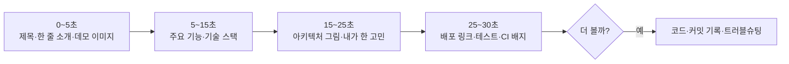
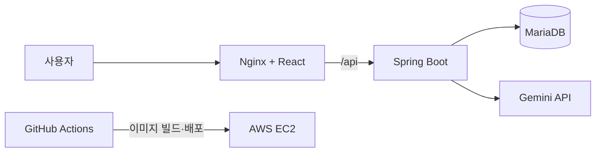
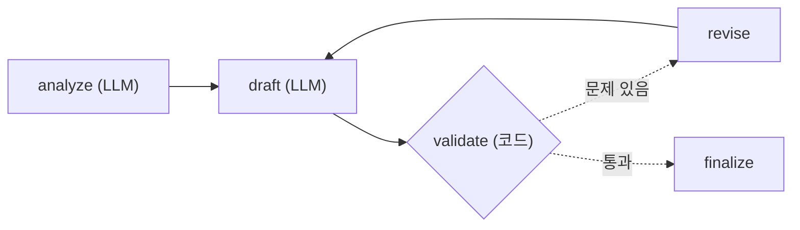
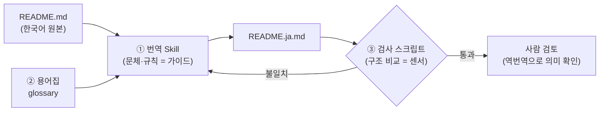
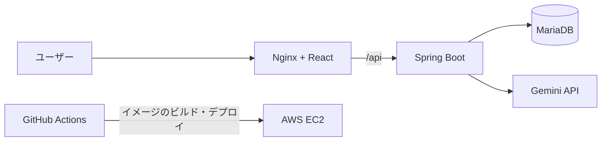
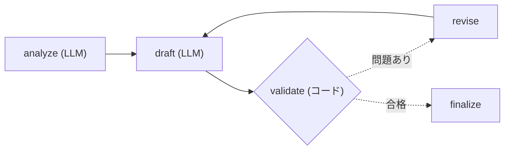
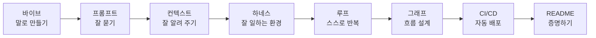
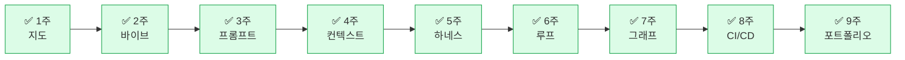

# 9주차 · 포트폴리오 완성 — 한국어 + 일본어 README

> **"코드는 면접관이 읽지 않을 수 있지만, README는 반드시 읽는다."**
>
> 9주 동안 만든 AI 스터디 플래너를 **한국어·일본어 README**로 정리해 국내와 일본 취업에 모두 쓸 수 있는 포트폴리오로 완성합니다. 그리고 발표와 회고로 과정을 마무리합니다.

---

## 0. 수업 진행표 (3시간)

| 시간 | 내용 | 형태 |
|---|---|---|
| 0:00 ~ 0:25 | 좋은 README의 조건 · 한국/일본 채용 담당자가 보는 것 | 설명 |
| 0:25 ~ 1:20 | 실습 ① 한국어 README 작성 (AI 초안 → 사람 편집) | 실습 |
| 1:20 ~ 1:30 | 휴식 | |
| 1:30 ~ 2:10 | 실습 ② 일본어 README (번역 Skill + 용어집 + 검사 스크립트) | 실습 |
| 2:10 ~ 2:20 | 실습 ③ 저장소 마무리 (About, Topics, 배지, 릴리스 v1.0.0) | 실습 |
| 2:20 ~ 2:55 | 발표 (1인 3~5분) | 발표 |
| 2:55 ~ 3:00 | KPT 회고 · 수료 | 정리 |

## 1. 학습 목표

1. 채용 담당자 관점에서 **30초 안에 이해되는 README** 구조를 설계할 수 있다.
2. 9주간 적용한 **AI 엔지니어링 6단계를 근거(코드·그림·수치)와 함께** 설명할 수 있다.
3. AI 번역 + 용어집 + 검사 스크립트(하네스)로 **자연스러운 일본어 README**를 만들 수 있다.
4. GitHub 저장소를 포트폴리오로 정돈하고 **v1.0.0 릴리스**를 발행할 수 있다.

---

## 2. 개념 ① 좋은 README의 조건

> 📖 **용어 풀이 — README**
>
> **뜻**: 저장소 첫 화면에 자동으로 표시되는 **설명서 파일**(`README.md`). "나를 먼저 읽어 주세요(Read me)"라는 뜻입니다.
>
> **왜 중요한가**: 채용 담당자는 코드를 한 줄씩 읽을 시간이 없습니다. README는 **프로젝트의 표지이자 요약 보고서**이고, 많은 경우 **유일하게 읽히는 문서**입니다.
>
> **Markdown**: `#` 제목, `**굵게**`, `| 표 |`처럼 간단한 기호로 서식을 표현하는 문서 형식. 이 교안도 Markdown으로 쓰였습니다.

### 2.1 채용 담당자의 30초



> 📌 **앞쪽 5초에 승부가 납니다.** 데모 GIF/스크린샷과 한 줄 소개를 맨 위에 두세요.

### 2.2 README 품질 공식

$$
\text{README 점수} = \underbrace{\text{명확성}}_{\text{무엇을 만들었나}} \times \underbrace{\text{근거}}_{\text{그림·수치·코드 링크}} \times \underbrace{\text{재현성}}_{\text{따라 하면 실행되나}} \times \underbrace{\text{성찰}}_{\text{왜·어떻게 고민했나}}
$$

곱셈이라는 점에 주목하세요. 기능이 화려해도 **실행 방법이 없거나(재현성 0)**, **고민의 흔적이 없으면(성찰 0)** 점수가 크게 떨어집니다.

### 2.3 한국과 일본 채용 담당자가 특히 보는 것

| 관점 | 한국 | 일본 |
|---|---|---|
| 자주 묻는 질문 | "어떤 문제를 어떻게 해결했나요?" | 「なぜその技術を選びましたか？」「工夫した点・苦労した点は？」 |
| README에서 강조 | 트러블슈팅, 성능 개선 수치 | **기술 선정 이유(技術選定理由)**, **工夫した点**, 팀/개인 역할 |
| 문체 | 간결한 개조식 | **です・ます調**(정중체), 개조식 + 짧은 설명 |
| 날짜·숫자 | 2026.12.01 | 2026年12月1日 또는 2026/12/01 |
| 주의 | 과장 표현 지양 | 과도한 자기 PR보다 **사실과 과정** 중심 |

### 2.4 README 목차 (한국어 ↔ 일본어 대응표)

| # | 한국어 | 日本語 | 담을 내용 |
|---|---|---|---|
| 1 | 프로젝트 소개 | プロジェクト概要 | 한 줄 소개, 만든 이유 |
| 2 | 데모 | デモ | 배포 URL, GIF, 스크린샷 |
| 3 | 주요 기능 | 主な機能 | 기능 4~6개 |
| 4 | 기술 스택 | 技術スタック | 표 + **선정 이유** |
| 5 | 시스템 아키텍처 | システム構成 | Mermaid 그림 |
| 6 | AI 엔지니어링 적용 | AIエンジニアリングの実践 | 6단계별 적용 내용 |
| 7 | 실행 방법 | 起動方法 | 복사해서 실행 가능한 명령 |
| 8 | API 명세 | API仕様 | 표 또는 문서 링크 |
| 9 | 테스트와 CI/CD | テストとCI/CD | 배지, 파이프라인 그림 |
| 10 | 트러블슈팅 | 苦労した点と解決策 | 문제 → 원인 → 해결 → 배운 점 |
| 11 | 회고 | 振り返り | 배운 점, 아쉬운 점, 다음 계획 |
| 12 | 개발자 | 開発者 | 이름, 연락처, GitHub |

---

## 3. 실습 ① 한국어 README 작성

### 3.1 재료 모으기

README에 넣을 재료는 **이미 9주 동안 만들어 두었습니다.**

| 재료 | 위치 |
|---|---|
| 아키텍처·API | `docs/architecture.md`, `docs/api-spec.md` |
| 규칙·명령어 | `CLAUDE.md` |
| 그래프 그림 | 계획 화면의 Mermaid 출력 |
| 트러블슈팅 | 각 주차 회고표, PR 설명, 커밋 기록(`git log --oneline`) |
| 스크린샷 | 각 주차 과제 캡처 |

스크린샷과 GIF는 `docs/images/` 폴더에 모읍니다.

#### ⌨️ 직접 실행 — 이미지 폴더 만들기

```bash
mkdir -p docs/images
# 예: docs/images/demo.gif, tasks.png, coach.png, plan.png, actions.png
```

> 💡 GIF 녹화 도구: Windows는 **ScreenToGif**, macOS는 **Kap** 등. 10~20초, 가로 1000px 안팎이 적당합니다.

### 3.2 AI로 초안 만들기 (컨텍스트 엔지니어링 복습)

Claude Code에게 **재료(컨텍스트)를 지정**해서 초안을 맡깁니다. 4주차에 배운 `@파일` 참조가 여기서 다시 쓰입니다.

#### 🤖 Claude Code 프롬프트 — README 초안

```text
@CLAUDE.md @docs/architecture.md @docs/api-spec.md 를 참고해서 프로젝트 루트에 README.md 초안을 작성해 줘.

[독자] 한국 IT 기업 채용 담당자와 현직 개발자
[목차] 프로젝트 소개 / 데모 / 주요 기능 / 기술 스택(선정 이유 포함) / 시스템 아키텍처(Mermaid) /
       AI 엔지니어링 적용(바이브·프롬프트·컨텍스트·하네스·루프·그래프 6단계 표) / 실행 방법 /
       API 명세 / 테스트와 CI/CD / 트러블슈팅 / 회고 / 개발자
[규칙]
- 과장하지 말고, 실제 코드에 있는 내용만 쓴다. 확실하지 않은 부분은 <!-- TODO: 확인 --> 주석으로 남긴다.
- 실행 방법은 복사해서 바로 실행할 수 있게 쓴다.
- 트러블슈팅과 회고는 내가 직접 쓸 것이므로 빈 틀(문제/원인/해결/배운 점)만 만든다.
- 맨 위에 언어 전환 링크: [한국어](README.md) | [日本語](README.ja.md)
```

> ⚠️ **트러블슈팅과 회고는 반드시 직접 쓰세요.** 면접에서 가장 많이 질문받는 부분이며, AI가 쓴 문장은 면접관이 금방 알아챕니다. AI는 **문장 다듬기**에만 쓰세요.

#### ✅ 결과 확인 — 초안 점검표

| ✔ | 확인 항목 |
|---|---|
| ☐ | 맨 위 언어 전환 링크, 제목, **한 줄 소개**가 있다 |
| ☐ | 기술 스택 표에 **선정 이유** 열이 있다 |
| ☐ | 아키텍처 Mermaid 그림이 GitHub에서 그림으로 보인다 |
| ☐ | AI 엔지니어링 6단계 표의 **관련 코드 경로가 실제로 존재**한다 (AI가 없는 파일을 지어내지 않았는지!) |
| ☐ | 실행 방법을 **새 폴더에 clone해서 그대로 따라 하면** 실행된다 |
| ☐ | `<!-- TODO: 확인 -->` 주석을 모두 해결했다 |

> 💡 Markdown 미리보기: VS Code에서 `Ctrl+Shift+V`(macOS `Cmd+Shift+V`)를 누르면 GitHub와 비슷한 모양으로 볼 수 있습니다.

### 3.3 📄 참고 코드 — README.md (한국어)

아래를 기준으로 **자신의 내용으로 바꿔** 완성합니다. `<...>` 부분은 반드시 수정하세요.

````markdown
[한국어](README.md) | [日本語](README.ja.md)

# 📚 AI 스터디 플래너

> 할 일·공부 노트를 관리하고, AI가 **요약 · 노트 기반 질의응답 · 도구를 쓰는 코치 · 검증된 학습계획**을 제공하는 웹 서비스

[](https://github.com/<아이디>/ai-study-planner/actions/workflows/ci.yml)
[](https://github.com/<아이디>/ai-study-planner/actions/workflows/deploy.yml)

🔗 **서비스 주소**: http://<탄력적IP>  ·  📅 **개발 기간**: 2026.10 ~ 2026.12 (9주, 개인 프로젝트)


## 1. 프로젝트 소개

시험 기간마다 할 일과 노트가 흩어져 "무엇부터 공부할지" 정하는 데 시간을 쓰는 문제를 해결하고자 만들었습니다.
AI 코딩 도구(Claude Code)로 개발하면서 **바이브코딩부터 그래프 엔지니어링까지 6단계 AI 엔지니어링 기법**을 단계적으로 적용했습니다.

## 2. 주요 기능

| 기능 | 설명 | 화면 |
|---|---|---|
| ✅ 할 일 관리 | 과목·마감일·예상 시간, 상태 변경, D-Day |  |
| ✨ AI 노트 요약 | 3줄 요약·핵심 키워드·셀프 체크 질문 |  |
| 🔎 노트 Q&A (RAG) | 내 노트에서만 근거를 찾아 출처와 함께 답변 |  |
| 🤖 AI 코치 (에이전트 루프) | 할 일 조회·추가·상태 변경 도구를 스스로 호출 |  |
| 🗺️ AI 학습계획 (그래프) | 분석→초안→코드 검증→수정 워크플로우로 계획 생성 |  |

## 3. 기술 스택

| 영역 | 기술 | 선정 이유 |
|---|---|---|
| Frontend | React, TypeScript, Vite | 타입 안정성, 빠른 개발 서버, 생태계 |
| Backend | Spring Boot 4, Java 21, JPA | 계층 구조와 트랜잭션 관리, 국내외 수요 |
| DB | MariaDB 11.8 | MySQL 호환 오픈소스, Docker로 간편 실행 |
| AI | Gemini API (Function Calling) | 무료 등급으로 학습·시연 가능, 도구 호출 지원 |
| AI 개발 도구 | Claude Code | CLAUDE.md·Hooks·Skill·Subagent로 하네스 구성 |
| Infra | Docker Compose, GitHub Actions, GHCR, AWS EC2 | 테스트 통과 시 자동 배포 |

## 4. 시스템 아키텍처



## 5. AI 엔지니어링 적용

| 단계 | 적용 내용 | 관련 코드 |
|---|---|---|
| 바이브코딩 | 프로젝트 뼈대·D-Day 컴포넌트를 자연어로 생성하고 한계를 체험 | `frontend/src/components/DdayCounter.tsx` |
| 프롬프트 | 역할·맥락·작업·제약·형식·예시 6요소 템플릿을 코드로 관리 | `ai/PromptTemplates.java` |
| 컨텍스트 | `CLAUDE.md`·설계 문서, TF-IDF 기반 RAG(상위 3개·노트당 1,500자) | `CLAUDE.md`, `ai/rag/` |
| 하네스 | 권한 규칙, PreToolUse 차단·PostToolUse 컴파일 Hook, Skill, 리뷰 Subagent, 가짜 LLM 테스트, CI | `.claude/`, `src/test/` |
| 루프 | Function Calling 에이전트(최대 6단계), Stop Hook 테스트 검증 루프 | `agent/StudyCoachAgent.java` |
| 그래프 | 직접 구현한 StateGraph, LLM 노드 + 코드 검증 노드 + 최대 2회 수정 순환 | `graph/` |

**학습계획 그래프**



## 6. 실행 방법

```bash
git clone https://github.com/<아이디>/ai-study-planner.git
cd ai-study-planner
cp .env.example .env        # GEMINI_API_KEY 등 입력
docker compose up -d --build
# http://localhost:3000 접속
```

## 7. API 명세

[docs/api-spec.md](docs/api-spec.md) 참고

## 8. 테스트와 CI/CD

- 백엔드: JUnit 5 + H2, **가짜 LLM(FakeLlmClient)** 으로 AI 기능을 결정적으로 테스트
- 프론트엔드: Vitest
- main에 push → 테스트 → GHCR 이미지 빌드 → EC2 배포 → 헬스 체크 (테스트 실패 시 배포 중단)

## 9. 트러블슈팅

### D-Day가 하루 어긋나는 문제
- **문제**: <직접 작성>
- **원인**: <직접 작성>
- **해결**: <직접 작성>
- **배운 점**: <직접 작성>

### <두 번째 문제>
- ...

## 10. 회고

- **잘한 점(Keep)**: <직접 작성>
- **아쉬운 점(Problem)**: <직접 작성>
- **다음 시도(Try)**: <직접 작성>

## 11. 개발자

| 이름 | GitHub | 이메일 |
|---|---|---|
| <이름> | [@<아이디>](https://github.com/<아이디>) | <이메일> |
````

---

## 4. 실습 ② 일본어 README

### 4.1 번역 품질을 높이는 3가지 장치



5주차에 배운 **하네스(가이드 + 센서)** 를 번역 작업에 그대로 적용하는 것입니다.

### 4.2 ① 용어집 (일관성의 핵심)

> 📖 **용어 풀이 — 용어집 (Glossary)**
>
> 같은 단어를 **항상 같은 번역어**로 쓰기 위한 대응표. AI는 같은 문서 안에서도 "タスク"와 "課題"처럼 번역어를 바꿔 쓰기 쉽습니다. 용어집을 컨텍스트로 주면 **일관성**이 생깁니다(4주차 컨텍스트 엔지니어링의 응용).

#### 📄 참고 코드 — 용어집

`docs/glossary-ja.md`

| 한국어 | 日本語 | 비고 |
|---|---|---|
| 프로젝트 소개 | プロジェクト概要 | |
| 주요 기능 | 主な機能 | |
| 기술 스택 | 技術スタック | |
| 선정 이유 | 選定理由 | |
| 시스템 아키텍처 | システム構成 | アーキテクチャ도 가능 |
| 실행 방법 | 起動方法 | |
| 트러블슈팅 | 苦労した点と解決策 | 일본 포트폴리오 관례 |
| 회고 | 振り返り | |
| 할 일 | タスク | |
| 공부 노트 | 学習ノート | |
| 학습계획 | 学習計画 | |
| 배포 | デプロイ | |
| 테스트 | テスト | |
| 가짜 LLM | フェイクLLM | |
| 하네스 엔지니어링 | ハーネスエンジニアリング | 고유 용어는 가타카나 |
| 루프 엔지니어링 | ループエンジニアリング | |
| 그래프 엔지니어링 | グラフエンジニアリング | |
| 컨텍스트 엔지니어링 | コンテキストエンジニアリング | |
| 프롬프트 엔지니어링 | プロンプトエンジニアリング | |
| 바이브코딩 | バイブコーディング | |
| 개인 프로젝트 | 個人開発 | |
| 개발 기간 | 開発期間 | |

### 4.3 ② 번역 Skill

#### 📄 참고 코드 — 번역 절차서 (Skill)

5주차에 만든 `add-feature`와 같은 방식입니다. 번역의 **문체·규칙·확인 절차**를 한 번 적어 두면 README를 고칠 때마다 같은 품질로 번역할 수 있습니다.

`.claude/skills/translate-readme-ja/SKILL.md`

```markdown
---
name: translate-readme-ja
description: 한국어 README.md를 일본 IT 기업 채용 담당자가 읽기 좋은 README.ja.md로 번역한다. README 번역·갱신 요청 시 사용한다.
---

# README 일본어 번역 절차

1. `docs/glossary-ja.md` 용어집을 먼저 읽고, 용어집의 번역어를 반드시 사용한다.
2. 문체: 설명문은 です・ます調, 표와 목록은 체언 종지(名詞止め)로 간결하게.
3. 다음은 번역하지 않고 그대로 둔다: 코드 블록, 명령어, 파일 경로, URL, 배지, Mermaid 노드 ID.
   Mermaid 노드의 **표시 문자열(따옴표 안)** 은 번역한다.
4. 맨 위 언어 전환 링크는 `[한국어](README.md) | [日本語](README.ja.md)` 그대로 유지한다.
5. 날짜는 `2026年10月〜2026年12月` 형식, 기간은 `9週間`.
6. 한국 고유 표현은 일본 독자가 이해하도록 의역한다. (예: "D-Day" → "試験日カウントダウン(D-Day)")
7. 번역 후 `node scripts/check-readme.mjs`를 실행해 구조가 일치하는지 확인하고, 불일치하면 고친다.
8. 마지막으로 의미가 바뀌었을 가능성이 있는 문장 3개를 골라 한국어로 역번역해 보여 준다.
```

#### 🤖 Claude Code 프롬프트 — 번역 실행

```text
/translate-readme-ja
```

#### ✅ 결과 확인 — AI의 진행 과정 (예시)

```text
● Read(docs/glossary-ja.md)            ← 1. 용어집 먼저 읽기
● Read(README.md)
● Write(README.ja.md)                  ← 2. 번역 작성
● Bash(node scripts/check-readme.mjs)  ← 7. 구조 검사 (센서)
  ⎿ images  8  7 ❌
● 이미지 하나가 빠졌습니다. 「主な機能」 표의 화면 이미지를 추가하겠습니다.
● Bash(node scripts/check-readme.mjs)
  ⎿ ✅ 구조가 일치합니다.
● 역번역 확인 (의미가 바뀌었을 가능성이 있는 문장 3개) ...
```

절차서대로 **용어집 → 번역 → 검사 → 수정 → 역번역**을 수행하는지 확인하세요. 검사 스크립트가 실패를 잡아 AI가 스스로 고치는 장면이 보이면, 6주차의 **검증 루프**가 번역에도 적용된 것입니다.

### 4.4 ③ 구조 검사 스크립트 (센서)

번역 과정에서 **절이 빠지거나 링크·이미지가 누락되는** 실수를 자동으로 잡습니다.

#### 📄 참고 코드 — check-readme.mjs

`scripts/check-readme.mjs`

```js
// README.md와 README.ja.md의 구조(제목 수, 코드 블록 수, 이미지·링크 수)를 비교한다.
import fs from 'node:fs';

const count = (text, re) => (text.match(re) ?? []).length;

function profile(file) {
  const text = fs.readFileSync(file, 'utf8');
  return {
    h2: count(text, /^## /gm),
    h3: count(text, /^### /gm),
    codeBlocks: count(text, /^```/gm) / 2,
    images: count(text, /!\[[^\]]*\]\([^)]+\)/g),
    links: count(text, /(?<!!)\[[^\]]+\]\([^)]+\)/g),
    tables: count(text, /^\|(?:\s*:?-{3,}:?\s*\|)+$/gm),   // 표의 구분선(|---|---|) 개수
  };
}

const ko = profile('README.md');
const ja = profile('README.ja.md');
let ok = true;

console.log('항목'.padEnd(12), 'KO'.padStart(4), 'JA'.padStart(4));
for (const key of Object.keys(ko)) {
  const same = ko[key] === ja[key];
  if (!same) ok = false;
  console.log(key.padEnd(12), String(ko[key]).padStart(4), String(ja[key]).padStart(4), same ? '✅' : '❌');
}

const jaText = fs.readFileSync('README.ja.md', 'utf8');
const hangul = jaText.replace(/```[\s\S]*?```/g, '').match(/[가-힣]+/g) ?? [];
const leftover = hangul.filter((w) => w !== '한국어');
if (leftover.length > 0) {
  ok = false;
  console.log('❌ 일본어 README에 번역되지 않은 한국어:', [...new Set(leftover)].slice(0, 10).join(', '));
}

console.log(ok ? '\n✅ 구조가 일치합니다.' : '\n❌ 구조가 다릅니다. 위 항목을 확인하세요.');
process.exit(ok ? 0 : 1);
```

#### ⌨️ 직접 실행

```bash
node scripts/check-readme.mjs
```

#### ✅ 결과 확인

```text
항목             KO   JA
h2             11   11 ✅
h3              2    2 ✅
codeBlocks      3    3 ✅
images          8    8 ✅
links           6    6 ✅
tables          4    4 ✅

✅ 구조가 일치합니다.
```

> 💡 이 스크립트를 `ci.yml`에 한 단계로 추가하면, README 한쪽만 고치고 다른 쪽을 잊은 PR을 **CI가 막아 줍니다.**

### 4.5 📄 참고 코드 — README.ja.md (일본어)

````markdown
[한국어](README.md) | [日本語](README.ja.md)

# 📚 AI スタディプランナー

> タスクと学習ノートを管理し、AI が **要約・ノートに基づく質疑応答・ツールを使うコーチ・検証済みの学習計画** を提供する Web サービスです。

[](https://github.com/<ID>/ai-study-planner/actions/workflows/ci.yml)
[](https://github.com/<ID>/ai-study-planner/actions/workflows/deploy.yml)

🔗 **URL**: http://<Elastic IP>  ·  📅 **開発期間**: 2026年10月〜2026年12月（9週間・個人開発）


## 1. プロジェクト概要

試験期間のたびにタスクやノートが散らばり、「何から勉強すべきか」を決めるだけで時間を使ってしまう課題を解決するために開発しました。
AI コーディングツール（Claude Code）を活用し、**バイブコーディングからグラフエンジニアリングまでの 6 段階の AI エンジニアリング手法** を段階的に取り入れています。

## 2. 主な機能

| 機能 | 説明 | 画面 |
|---|---|---|
| ✅ タスク管理 | 科目・締切・所要時間の登録、ステータス変更、試験日カウントダウン（D-Day） |  |
| ✨ AI ノート要約 | 3 行要約・キーワード・セルフチェック問題 |  |
| 🔎 ノート Q&A（RAG） | 自分のノートだけを根拠に、出典付きで回答 |  |
| 🤖 AI コーチ（エージェントループ） | タスクの参照・追加・更新ツールを自律的に呼び出し |  |
| 🗺️ AI 学習計画（グラフ） | 分析→下書き→コード検証→修正のワークフローで計画を生成 |  |

## 3. 技術スタック

| 領域 | 技術 | 選定理由 |
|---|---|---|
| Frontend | React, TypeScript, Vite | 型安全性、高速な開発サーバー、豊富なエコシステム |
| Backend | Spring Boot 4, Java 21, JPA | レイヤー構造とトランザクション管理、国内外での需要 |
| DB | MariaDB 11.8 | MySQL 互換の OSS、Docker で手軽に起動可能 |
| AI | Gemini API（Function Calling） | 無料枠で学習・デモが可能、ツール呼び出しに対応 |
| AI 開発ツール | Claude Code | CLAUDE.md・Hooks・Skill・Subagent でハーネスを構築 |
| Infra | Docker Compose, GitHub Actions, GHCR, AWS EC2 | テスト通過時に自動デプロイ |

## 4. システム構成



## 5. AIエンジニアリングの実践

| 段階 | 取り組み内容 | 関連コード |
|---|---|---|
| バイブコーディング | プロジェクトの雛形と D-Day コンポーネントを自然言語で生成し、その限界を体験 | `frontend/src/components/DdayCounter.tsx` |
| プロンプト | 役割・文脈・タスク・制約・形式・例の 6 要素テンプレートをコードで管理 | `ai/PromptTemplates.java` |
| コンテキスト | `CLAUDE.md`・設計ドキュメント、TF-IDF ベースの RAG（上位 3 件・1 ノート 1,500 文字） | `CLAUDE.md`, `ai/rag/` |
| ハーネス | 権限ルール、PreToolUse によるブロック・PostToolUse によるコンパイル検査、Skill、レビュー用 Subagent、フェイク LLM テスト、CI | `.claude/`, `src/test/` |
| ループ | Function Calling エージェント（最大 6 ステップ）、Stop Hook によるテスト検証ループ | `agent/StudyCoachAgent.java` |
| グラフ | 自作の StateGraph、LLM ノード＋コード検証ノード＋最大 2 回の修正サイクル | `graph/` |

**学習計画グラフ**



## 6. 起動方法

```bash
git clone https://github.com/<ID>/ai-study-planner.git
cd ai-study-planner
cp .env.example .env        # GEMINI_API_KEY などを入力
docker compose up -d --build
# http://localhost:3000 にアクセス
```

## 7. API仕様

[docs/api-spec.md](docs/api-spec.md) を参照してください（韓国語）。

## 8. テストとCI/CD

- バックエンド：JUnit 5 + H2。**フェイク LLM（FakeLlmClient）** により AI 機能を決定的にテスト
- フロントエンド：Vitest
- main へ push → テスト → GHCR へイメージをビルド → EC2 へデプロイ → ヘルスチェック（テスト失敗時はデプロイを中止）

## 9. 苦労した点と解決策

### 試験日カウントダウンが 1 日ずれる問題
- **課題**：<記入>
- **原因**：<記入>
- **解決策**：<記入>
- **学び**：<記入>

### <2 つ目の課題>
- ...

## 10. 振り返り

- **良かった点（Keep）**：<記入>
- **課題（Problem）**：<記入>
- **次に挑戦したいこと（Try）**：<記入>

## 11. 開発者

| 名前 | GitHub | メール |
|---|---|---|
| <名前> | [@<ID>](https://github.com/<ID>) | <メール> |
````

> 💡 **이름 표기**: 일본어 README의 개발자 이름은 「홍길동（ホン・ギルドン）」처럼 **가타카나 읽기**를 함께 적으면 읽기 쉽습니다.

### 4.6 역번역으로 의미 확인

AI 번역은 문법은 자연스럽지만 **의미가 미묘하게 바뀌는** 경우가 있습니다. 중요한 문장은 역번역(일→한)으로 확인합니다.

> 📖 **용어 풀이 — 역번역 (Back-translation)**
>
> 번역된 글을 **다시 원래 언어로 번역**해서 원문과 비교하는 검증 방법. 일본어를 잘 몰라도 **의미가 바뀐 곳**을 찾을 수 있습니다.

#### 🤖 Claude Code 프롬프트 — 역번역 검증

```text
README.ja.md의 "苦労した点と解決策" 절을 한국어로 직역해 줘. 원문(README.md)과 의미가 달라진 곳을 표로 표시해 줘.
```

#### ✅ 결과 확인 — 표 채우기

| 원문(한) | 일본어 | 역번역(한) | 의미 차이 |
|---|---|---|---|
| | | | |

---

## 5. 실습 ③ 저장소 마무리

### 5.1 체크리스트

| ✔ | 항목 | 방법 |
|---|---|---|
| ☐ | About(설명)·웹사이트 주소 | 저장소 오른쪽 ⚙️ → Description, Website |
| ☐ | Topics | `spring-boot`, `react`, `typescript`, `gemini-api`, `ai-agent`, `docker`, `github-actions`, `aws` |
| ☐ | `.env`, `*.pem`이 저장소에 없음 | `git log --all --full-history -- .env` 결과가 비어 있어야 함 |
| ☐ | 실행 방법대로 새 폴더에서 실행 확인 | 다른 폴더에 clone해서 `docker compose up` |
| ☐ | CI·Deploy 배지 초록색 | README 상단 |
| ☐ | 스크린샷·GIF가 깨지지 않음 | GitHub 웹에서 확인 |
| ☐ | 프로필에 저장소 고정(Pin) | GitHub 프로필 → Customize your pins |

> 📖 **용어 풀이 — Topics·배지·핀**
>
> **Topics**: 저장소에 붙이는 **검색용 태그**. GitHub 검색·탐색에서 내 프로젝트가 노출됩니다.
>
> **배지 (Badge)**: README에 표시하는 **작은 상태 이미지**(예: CI passing). "이 프로젝트는 지금 테스트가 통과 중"이라는 **살아 있는 증거**입니다.
>
> **Pin**: 프로필 첫 화면에 **대표 저장소를 고정**하는 기능.

#### ⌨️ 직접 실행 — GitHub CLI로 설명·토픽 설정

```bash
gh repo edit --description "AI 스터디 플래너 — Spring Boot · React · Gemini 에이전트/그래프 워크플로우" \
  --add-topic spring-boot --add-topic react --add-topic typescript --add-topic gemini-api \
  --add-topic ai-agent --add-topic docker --add-topic github-actions --add-topic aws
```

### 5.2 v1.0.0 릴리스

> 📖 **용어 풀이 — 릴리스 (Release)와 시맨틱 버전 (Semantic Versioning)**
>
> **릴리스**: 특정 버전을 **공식적으로 발표**하는 것. GitHub Releases에 버전·변경 내역·다운로드가 정리됩니다.
>
> **시맨틱 버전 `MAJOR.MINOR.PATCH`**: `1.0.0`에서 **MAJOR**는 호환이 깨지는 큰 변경, **MINOR**는 기능 추가, **PATCH**는 버그 수정 때 올립니다. 예: 기능 추가 → `1.1.0`, 버그 수정 → `1.1.1`.

#### ⌨️ 직접 실행

```bash
git add .
git commit -m "docs: 한국어·일본어 README와 번역 하네스 추가"
git push
git tag -a v1.0.0 -m "AI 스터디 플래너 1.0.0 — 9주 과정 완성"
git push origin v1.0.0
gh release create v1.0.0 --generate-notes --title "v1.0.0 AI 스터디 플래너"
```

#### ✅ 결과 확인 — 자동 생성된 릴리스 노트 (예시)

```text
v1.0.0 AI 스터디 플래너                                    Latest

## What's Changed
* feat: D-Day 7일 이하일 때 강조 표시 by @gildong in #1
* feat: 할 일·노트 CRUD API와 Gemini 노트 요약 기능 추가
* feat: TF-IDF 기반 노트 질의응답(RAG) 추가
* feat: 도구 호출 루프 기반 AI 스터디 코치 에이전트 ...
* feat: StateGraph 엔진과 학습계획 생성 그래프 워크플로우 추가
* ci: GHCR 이미지 빌드와 EC2 자동 배포 워크플로우 추가
* docs: 한국어·일본어 README와 번역 하네스 추가

Full Changelog: https://github.com/<아이디>/ai-study-planner/commits/v1.0.0
```

`--generate-notes`는 커밋·PR 기록으로 **릴리스 노트를 자동 작성**합니다. 9주 동안 Conventional Commits를 지킨 보람이 여기서 나타납니다!

---

## 6. 발표 (1인 3~5분)

### 6.1 발표 구성

| 순서 | 시간 | 내용 |
|---|---|---|
| 1 | 30초 | 한 줄 소개 + 데모 GIF |
| 2 | 60초 | 라이브 데모 (배포 주소에서 코치·계획 기능) |
| 3 | 90초 | **가장 인상 깊었던 엔지니어링 단계 1개** 깊게: 문제 → 적용 → 결과(수치/그림) |
| 4 | 60초 | 트러블슈팅 1개 |
| 5 | 30초 | 회고와 다음 계획 |

### 6.2 평가 기준표 (루브릭)

| 항목 | 배점 | 우수 (만점) | 보통 | 미흡 |
|---|---|---|---|---|
| 기능 완성도 | 20 | 5개 기능 모두 배포 환경에서 동작 | 일부 기능 동작 | 로컬에서만 동작 |
| AI 엔지니어링 이해 | 25 | 6단계를 **자기 코드로** 설명 | 개념은 설명하나 코드 연결 약함 | 용어 나열 |
| 하네스·테스트·CI/CD | 20 | 테스트·Hook·CI·자동배포 모두 동작 | 일부 동작 | 없음 |
| README (한·일) | 20 | 30초 안에 이해, 재현 가능, 트러블슈팅 구체적 | 구성은 갖춤 | 템플릿 그대로 |
| 발표·회고 | 15 | 근거 있는 회고, 시간 준수 | 회고가 일반적 | 준비 부족 |

---

> 📖 **용어 풀이 — KPT**
>
> **K**eep(계속할 것) · **P**roblem(문제였던 것) · **T**ry(다음에 시도할 것)로 나누어 돌아보는 **회고 방법**. 일본 IT 기업에서 매우 널리 쓰이는 방식(「KPT法」)이라 알아 두면 좋습니다.

## 7. KPT 회고 (5분)

포스트잇이나 노션에 각자 작성합니다.

| Keep (계속할 것) | Problem (문제였던 것) | Try (다음에 시도할 것) |
|---|---|---|
| | | |

**질문 가이드**

1. 9주 전의 나와 비교해 AI에게 일을 시키는 방식이 어떻게 달라졌나?
2. 6단계 중 **가장 실무에 쓸모 있다고 느낀 단계**는? 왜?
3. AI가 만든 코드를 **믿지 못했던 순간**은? 그때 무엇으로 확인했나?

---

## 8. 9주 과정 총정리



| 단계 | 핵심 질문 | 9주 후 내가 할 수 있는 것 |
|---|---|---|
| 바이브 | 무엇을 원하나? | AI로 빠르게 시제품을 만들고 그 한계를 안다 |
| 프롬프트 | 어떻게 물을까? | 6요소 프롬프트와 완료 조건을 쓴다 |
| 컨텍스트 | 무엇을 알려 줄까? | `CLAUDE.md`와 RAG로 필요한 정보만 골라 준다 |
| 하네스 | 어떤 환경에서 일하게 할까? | 권한·Hook·테스트·CI로 AI의 실수를 잡는다 |
| 루프 | 언제 반복하고 언제 멈출까? | 검증기와 멈춤 조건이 있는 에이전트를 만든다 |
| 그래프 | 흐름을 어떻게 설계할까? | LLM 노드와 코드 노드를 섞은 워크플로우를 만든다 |

> 🎓 **마지막 메시지**: 도구와 용어는 빠르게 바뀝니다. 내년에는 또 새로운 "○○ 엔지니어링"이 등장할 것입니다. 하지만 **"AI에게 무엇을 보여 주고(컨텍스트), 어떤 울타리 안에서(하네스), 어떻게 확인하며(루프), 어떤 순서로(그래프) 일하게 할 것인가"** 라는 질문은 바뀌지 않습니다. 9주 동안 그 질문에 답하는 법을 연습했습니다. 수고하셨습니다!

## 9. 최종 제출물

1. GitHub 저장소 주소 (`v1.0.0` 릴리스 포함)
2. 배포 주소 (발표 당일 동작 확인)
3. `README.md`, `README.ja.md` (구조 검사 스크립트 통과)
4. KPT 회고 1페이지

> ⚠️ 발표가 끝나면 AWS 인스턴스를 **중지**하고, 과정 종료 후에는 **종료(Terminate)·탄력적 IP 해제·예산 확인**까지 마무리하세요. 포트폴리오용으로 계속 운영하려면 예상 월 비용을 먼저 계산해 보세요.

---

## 10. 9주 전체 진행 상황 & 수료 후 다음 단계

### 10.1 완주!



| 주차 | 만든 것 | Git 태그 |
|---|---|---|
| 1 | 개발 환경, Claude Code 첫 사용 | - |
| 2 | 프로젝트 뼈대(React·Spring Boot·MariaDB), D-Day, 첫 PR | `week-02` |
| 3 | 할 일·노트 CRUD, Gemini 클라이언트, AI 요약 | `week-03` |
| 4 | `CLAUDE.md`·설계 문서, RAG 노트 Q&A | `week-04` |
| 5 | 권한·Hooks·Skill·Subagent·MCP, 테스트, Docker, CI | `week-05` |
| 6 | Stop Hook 검증 루프, AI 스터디 코치(Function Calling) | `week-06` |
| 7 | StateGraph 엔진, AI 학습계획 워크플로우 | `week-07` |
| 8 | GHCR + EC2 자동 배포, 롤백 | `week-08` |
| 9 | 한국어·일본어 README, 번역 하네스, 릴리스 | `v1.0.0` |

**최종 프로젝트 구조**

```text
ai-study-planner/
├── CLAUDE.md                      # 컨텍스트: AI에게 주는 프로젝트 규칙
├── README.md / README.ja.md       # 포트폴리오 (한·일)
├── docs/                          # 설계 문서, 용어집, 이미지
├── .claude/                       # 하네스: 권한·Hooks·Skill·Subagent
├── backend/                       # Spring Boot (task, note, ai, agent, graph, common)
├── frontend/                      # React (할 일·노트·코치·계획)
├── scripts/                       # fix-loop.sh, check-readme.mjs
├── docker-compose.yml / .prod.yml # 개발용 / 운영용
└── .github/workflows/             # ci.yml, deploy.yml
```

### 10.2 수료 후 다음 단계 (추천 로드맵)

| 방향 | 다음에 해 볼 것 | 이 과정의 어느 부분을 확장? |
|---|---|---|
| 기능 확장 | 로그인(Spring Security), 사용자별 데이터 | 3주차 CRUD |
| AI 고도화 | 임베딩 검색, 라우팅 그래프(`/api/ai/chat`), 대화 기억 | 4·6·7주차 도전 과제 |
| 운영 | HTTPS·도메인, 모니터링, 배포 알림 | 8주차 도전 과제 |
| 협업 | 팀 프로젝트에서 공용 `CLAUDE.md`·Skill 운영, PR 리뷰 | 5주차 하네스 |
| 일본 취업 | 일본어 자기소개·기술 면접 연습, JLPT N2 이상 목표 | 매주 일본어 용어표 |

---

## 11. 🇯🇵 일본 취업 대비 IT 용어 (9주차 — 포트폴리오·면접 편)

| 한국어 | 日本語 | 읽는 법 | 예문 (日本語) | 예문 해석 |
|---|---|---|---|---|
| 포트폴리오 | ポートフォリオ | 포-토호리오 | ポートフォリオとしてWebサービスを公開しています。 | 포트폴리오로 웹 서비스를 공개하고 있습니다. |
| 개인 개발 | 個人開発 | こじんかいはつ | 9週間の個人開発で企画から運用まで担当しました。 | 9주간의 개인 개발로 기획부터 운영까지 담당했습니다. |
| 팀 개발 | チーム開発 | チームかいはつ | 今後はチーム開発でも同じ仕組みを活かしたいです。 | 앞으로는 팀 개발에서도 같은 구조를 살리고 싶습니다. |
| 기술 선정 이유 | 技術選定理由 | ぎじゅつせんていりゆう | 技術選定理由はREADMEに表でまとめています。 | 기술 선정 이유는 README에 표로 정리해 두었습니다. |
| 고민·궁리한 점 | 工夫した点 | くふうしたてん | 工夫した点は、AIの出力をコードで検証したことです。 | 궁리한 점은 AI의 출력을 코드로 검증한 것입니다. |
| 어려웠던 점 | 苦労した点 | くろうしたてん | 苦労した点は、日付が1日ずれる不具合の原因特定です。 | 어려웠던 점은 날짜가 하루 어긋나는 버그의 원인 파악입니다. |
| 버그 / 결함 | 不具合 | ふぐあい | テストを追加して同じ不具合の再発を防ぎました。 | 테스트를 추가해 같은 버그의 재발을 막았습니다. |
| 담당 범위 | 担当範囲 | たんとうはんい | 担当範囲は設計・実装・デプロイの全てです。 | 담당 범위는 설계·구현·배포 전부입니다. |
| 성과 | 成果 | せいか | 成果として自動デプロイまで完成させました。 | 성과로 자동 배포까지 완성했습니다. |
| 회고 | 振り返り | ふりかえり | 毎週KPTで振り返りを行いました。 | 매주 KPT로 회고를 했습니다. |
| 자기 PR | 自己PR | じこピーアール | 自己PRでは学習の継続力を伝えたいです。 | 자기 PR에서는 꾸준한 학습력을 전하고 싶습니다. |
| 경력 기술서 | 職務経歴書 | しょくむけいれきしょ | 職務経歴書にGitHubのURLを記載しました。 | 경력 기술서에 GitHub URL을 기재했습니다. |
| 기술 면접 | 技術面接 | ぎじゅつめんせつ | 技術面接ではアーキテクチャ図を使って説明しました。 | 기술 면접에서는 아키텍처 그림을 써서 설명했습니다. |
| 신입 채용 | 新卒採用 | しんそつさいよう | 新卒採用でWebエンジニア職に応募しています。 | 신입 채용으로 웹 엔지니어 직무에 지원하고 있습니다. |

> 💬 **면접 자기소개 예시 (약 30초)**
>
> 「韓国の〇〇大学でコンピュータ工学を専攻している〇〇です。9週間の個人開発で、React と Spring Boot を使った AI 学習支援サービスを作り、AWS に自動デプロイするところまで一人で担当しました。特に工夫した点は、生成AIの出力をそのまま使わず、テストやコードによる検証の仕組みで品質を担保したことです。」
>
> (한국 ○○대학에서 컴퓨터공학을 전공하는 ○○입니다. 9주간의 개인 개발로 React와 Spring Boot를 사용한 AI 학습 지원 서비스를 만들고, AWS에 자동 배포하는 데까지 혼자 담당했습니다. 특히 궁리한 점은 생성형 AI의 출력을 그대로 쓰지 않고, 테스트와 코드에 의한 검증 구조로 품질을 담보한 것입니다.)

[← 8주차](week08-cicd-aws.md) · [처음으로: 1주차 →](week01-overview.md)
